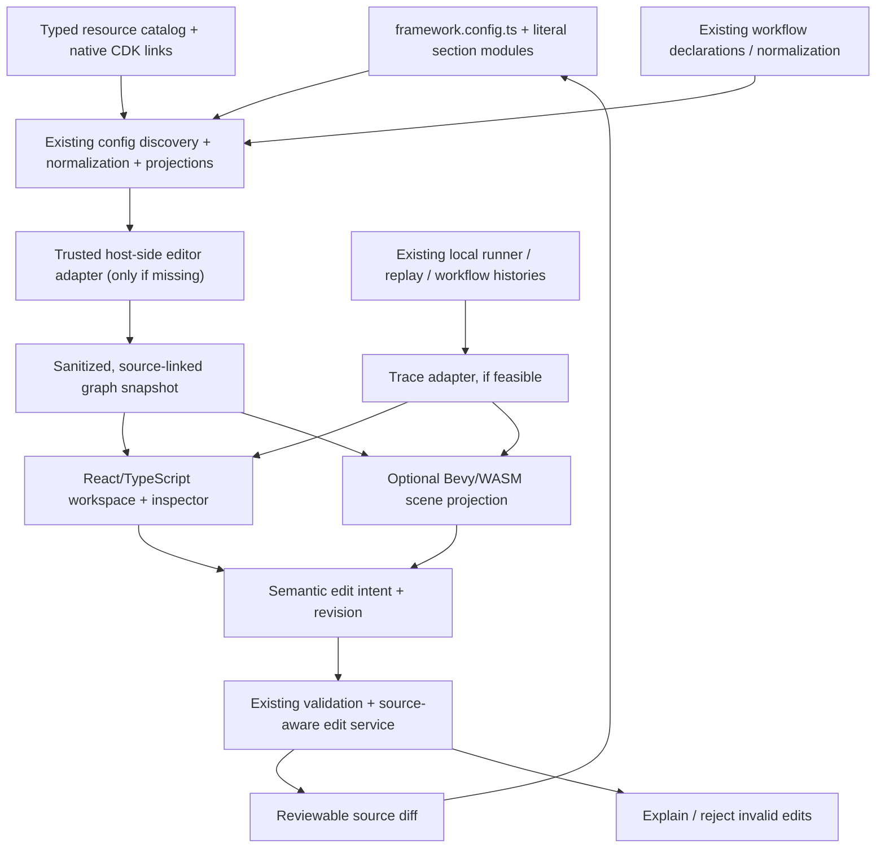

# Unified Visual Development Interface for Matt's AWS Framework

**Preliminary architecture and discovery handoff for Claude**  
**Status:** Exploration / design brief; **not** an approved implementation specification  
**Prepared from:** (1) a supplied `FRAMEWORK(1).md` architecture document; (2) an independently supplied technical extraction report for a Rust/Bevy/WebAssembly isometric visualization engine; and (3) the owner's stated vision.  
**Evidence limit:** Neither the live AWS framework repository nor the original renderer's complete source was inspected for this handoff. File names and symbols below are leads from supplied documents, **not independently verified against current checked-out code**.

> **Primary instruction to Claude:** Treat this document as a head start, not as authority over the repository. Inspect the actual implementation, challenge every design inference, reuse existing abstractions, and return a better architecture grounded in code before performing major implementation work. The owner specifically does **not** want an external assistant to pretend it already understands the codebase.

---

## 0. How to read this document

### Evidence labels

| Label | Meaning |
|---|---|
| **[DOCUMENTED]** | Explicitly described by the supplied AWS framework documentation. Describes what the document says, not an independent code audit. |
| **[RENDERER AUDIT]** | Reported by a separate code-level audit of a prospective reusable visual engine. It is not yet part of the AWS framework. |
| **[INFERRED]** | A reasonable implication, but requires repository validation. |
| **[PROPOSED]** | A possible design, not necessarily the preferred or correct one. |
| **[UNKNOWN]** | An unresolved question; Claude must discover or clarify it. |

### Scope and non-goals

**The owner's idea:** a unified visual interface for a sophisticated, TypeScript-based AWS framework: a navigable, possibly isometric architecture view; inspection of workloads and their relationships; visual workflow exploration and perhaps authoring; source-linked configuration editing; and eventually overlays for local/cloud execution and deployment information.

**Not a goal:** reproducing a generic CloudFormation canvas, moving all infrastructure logic into the frontend, or forcing every graph into an isometric view. The desired UI is intended to **link to actual source and edit framework configuration live**, with appropriate validation and round-trip guarantees. The precise interaction model and edit breadth have **not** been decided.

**Interpretation of “live editing” remains [UNKNOWN]:** Could mean editor updates in memory immediately, patches TypeScript files immediately, or saves after preview/validation. Do not silently choose an interpretation; investigate repository tooling and confirm the intended UX before implementation.

**Instruction priority:** code evidence > current repository conventions > supplied documentation > hypotheses in this document. Do not create a second resource catalog, workflow DSL, compiler, execution engine, route registry, or configuration schema without proving the existing system cannot provide what is needed.

---

## 1. What the framework already appears to be

### 1.1 Composition root and boundaries — [DOCUMENTED]

- `framework.config.ts` is the composition root. It imports defaults, a typed resource catalog, and literal section modules under `framework-config/`.
- Configuration declarations feed **CDK projection, local execution, and generated browser route/payload contracts**.
- Application sections are authored as arrays and composed at the root. Object spreads at the section-composition level are discouraged because they can erase duplicate keys before validation.
- `@repo/framework` encompasses configuration machinery, backend runtime, local execution, and generation, with explicit export boundaries:
  - `@repo/framework/config` — authoring and browser-safe configuration entry point.
  - `@repo/framework/config/source` — **Node-only** source discovery and CDK/tooling integration.
  - `@repo/framework/local` — local execution.
  - `@repo/framework/runtime/*` — server/backend runtime entry points.
- `@repo/api-contract` is the browser-safe published route/payload contract package; it is **not** necessarily an authoring API for the entire framework.
- `@repo/database` owns database schema/migrations/records/repositories.
- `framework-config/contracts.ts` supplies application section types derived from the resource catalog, is type-only, and should not import runtime/CDK values.
- The config boundary deliberately avoids value imports of `aws-cdk-lib` or `constructs`; `framework:check` enforces that separation.

**Consequence [INFERRED]:** The editor probably needs a *Node-side discovery/authoring service or CLI adapter* plus a browser-safe representation; it should not simply import the full runtime/CDK or evaluate arbitrary configuration in a browser. Investigate whether the existing normalization/projection APIs already expose a serializable, stable graph before introducing a new graph schema.

### 1.2 Workload inventory — [DOCUMENTED]

| Concept | Declaration surface | Identity / important semantics |
|---|---|---|
| HTTP Lambda | `http` section | Public route paths; underlying target identity may be pinned independently of route changes. |
| WebSocket Lambda | `webSocket` section | API Gateway route keys; `$connect` can own authorizer behavior. |
| Event Lambda | `events` section | Stable event target ids; native owners and optional local replay. |
| Service | `services` section | Public mounts; generated local Compose service; cloud VPC / load-balancer behavior. |
| Task | `tasks` section | Stable target ids; dynamically invoked containers. |
| Workflow | `workflows` section | Typed graph declaration rather than an implementation directory. |
| AgentCore tool | `tools` section | Stable tool ids, implementation/contract, and agent associations. |
| AgentCore agent | `agents` section | Stable agent ids; optional route, local/cloud invocation. |

These distinctions matter visually. A **public route**, an **invocation target**, a **physical CDK construct**, a **resource catalog entry**, and a **workflow step** are not automatically the same identity or the same node.

**[UNKNOWN]** The exact normalized identifiers, projections, source spans, and data already emitted by the config machinery need inspection. The editor should conform to them, not invent replacement identities casually.

### 1.3 Local versus cloud semantics — [DOCUMENTED]

- Workload `deploy` can be `both`, `local-only`, `cloud-only`, or `none` (subject to workload-kind-specific rules). Agent tools derive their lanes from consuming agents rather than declaring `deploy` themselves.
- Local development uses a hybrid model: some AWS resources are deployed, while many compute workloads run locally. Production materializes the cloud-enabled AWS infrastructure.
- The development AWS graph differs from production in intentional ways: Cognito and AWS-invoked events are examples of dev-deployed resources; local compute substitutes for routed Lambdas/services/tasks/workflows; production builds the applicable cloud graph.
- Local service containers are generated into `docker-compose.services.yml`; application `docker-compose.yml` and overrides remain separately authored.
- Lambda handlers may run in isolated, warm local child processes. The local runner preserves important execution behavior but does not promise full AWS durability/parity.
- Events can be captured in AWS and replayed locally with `withLocalReplay`, an existing replay manifest, and related tooling.
- `.framework/local/resources.json` is a generated local resource binding/export manifest, not a generic frontend config file and not a source of secret values.
- A separate `.framework/prod/outputs.json` contains appropriate exported production outputs.

**Visual opportunity [PROPOSED]:** show *declared*, *local-execution*, *development AWS*, and *production AWS* perspectives, but do **not** collapse these into one misleading graph. Presence in the catalog, eligibility for a lane, actual deployment, and live status are separate facts.

### 1.4 Resource catalog and permissions — [DOCUMENTED]

A typed catalog in `framework-config/resources.ts` includes:

- `resource.cdk<T>()` — linked native CDK constructs, including imported/custom constructs.
- `resource.stack<T>()` — public fields/accessors of a stack, linked via `linkResources`.
- `resource.fromEnv(...)` — authored environment input.
- `resource.secret(...)` — authored secret.
- `linkResource` / `linkResources` associate catalog entries with native constructs **beside those constructs**, preserving existing stack ownership and logical IDs.
- Resource references are symbolic across workload declarations; grants such as `resources.jobs.grantSendMessages()` and environment references such as `resources.jobs.queueUrl` derive what the workload receives.
- Native grants and explicit policy controls remain available. Merely using a string identifier is **not** the same as receiving an IAM permission.
- `initializeFrameworkResources` and `finalizeFrameworkResources` bracket resource registration and finalization in application synthesis. Missing links, conflicting links, unavailable resources, and cycles can be rejected with context.
- Catalog entries may deliberately evaluate to `undefined` in a mode; absent resources do **not** necessarily imply missing or erroneous declarations.
- Secret values have tightly controlled delivery and must not surface in templates, manifests, diagnostics, or browser representations.

**Consequence [INFERRED]:** resource bindings are a particularly valuable kind of visual edge, but semantics must be retained. Example: an environment reference, an IAM grant, an invocation grant, a DB capability flag, and a resource dependency must not all appear as an undifferentiated “connected to” line.

### 1.5 Workflows are a major existing differentiator — [DOCUMENTED]

The framework includes a custom typed workflow vocabulary:

`workflow`, `sequence`, `parallel`, `map`, `when`, `choose`, `retry`, `attempt`, `wait`, `transform`, `succeed`, `fail`, plus `invokeLambda`, `runTask`, `runWorkflow`, and `invokeAgent`.

It also has:

- Typed conditions: `eq`, `ne`, `gt`, `gte`, `lt`, `lte`, `contains`, `startsWith`, `endsWith`, `and`, `or`, `not`, `exists`, `isNull`.
- Symbolic expression utilities (e.g. `expr.add`, `expr.project`, `expr.filter`, `expr.merge`) designed to evaluate/compile consistently across lanes.
- Type-safe references to prior step outputs and checks around ordering/scoping.
- The rule that constructing a step does not by itself schedule it; the returned flow/graph determines execution order.
- Validation of direct, acyclic invocation references, enabled destinations, parallel/iteration scopes, and derived outgoing permissions.
- A **local workflow interpreter** using the same graph that compiles to **AWS Step Functions** in the cloud.
- Service integrations (DynamoDB/SQS/SNS/EventBridge, HTTP, explicit AWS actions), nested workflows, map/parallel constructs, callbacks, waits, timeouts, and retries, with documented restrictions.
- A read-only `npm run workflows:inspect` command that prints steps, workloads/resources, dev execution lanes, and bindings.
- A local invocation runner exposing task/workflow operations and workflow histories; local histories are in-memory and not durable across restarts.

**High-value editor concept [PROPOSED]:** use an existing normalized workflow representation, if present, as an inspection surface. Later consider graph authoring, but a graph UI must preserve the semantics of `map`, `parallel`, `retry`, `when`, typed outputs, and scoped expressions. A generic “boxes with edges” abstraction is insufficient for editing this DSL safely.

### 1.6 Agent and tool relationships — [DOCUMENTED, limited scope]

- Agents and tools are declared sections, with implementation contracts and runtime entry points.
- Agents may expose exact same-origin browser routes or be workload-only.
- The framework supports agent invocation from workflows and other applicable workloads.
- Tools' local/cloud availability is derived from their consuming agents.

**[UNKNOWN]** The supplied framework file references `AGENTCORE.md` for more detail, but that file was **not** supplied in this turn. Claude should read it and inspect the actual agents/tools normalization, Gateway derivation, authorization, and execution wiring before designing this part of the UI.

### 1.7 Network, database, identity, and verification — [DOCUMENTED]

- Network configuration lives in `framework-config/network.ts`; production may materialize a dual-stack VPC with subnet types and conditional connectivity. Workload placement and endpoints carry constraints; local runtime can enforce egress restrictions intended to mirror AWS.
- Database access is declared by a workload capability (`database: true` or its supported options), not by a raw password. AWS permissions, subnet selection, connection delivery, and local Compose replacement are handled by the framework.
- The user pool is named once and a workload can opt into `userPool: true`; `auth: true` has *different* meanings depending on whether the subject is a route/service or an agent/tool. These must not be conflated in a UI.
- `framework:generate` creates generated contracts/manifests, `framework:check` validates framework/config invariants, and `npm run verify` covers framework projections/tests and other workspace checks. **`verify` does not prove CDK synthesis or deployed behavior.** The docs explicitly call for synth checks of both dev and prod graphs after infrastructure/config changes.
- Application CDK constructs maintain native ownership and stable deployment identities; renaming or moving constructs can have unintended infrastructure effects.

**UI implication [PROPOSED]:** validation feedback should distinguish an editor-level draft error, a framework check error, a synth error, and an AWS runtime/deployment observation. They are not equivalent.

---

## 2. Vision: one workspace, multiple truthful visual perspectives

The idea is to make existing infrastructure abstractions visible and actionable, not to turn the framework into a game or create new deployment semantics.

### 2.1 Candidate modes — [PROPOSED]

| Mode | Primary purpose | Candidate representation | Initial editing stance |
|---|---|---|---|
| **Application landscape** | Orient a developer: workloads, resources, groupings, connections, entry points | Isometric scene / explorable architecture | Read-only at first; source navigation |
| **Dependency and binding view** | Show precise relationships: grant, env delivery, invoke, route, auth, source binding | Typed 2D graph | Read-only first; constrained edits later |
| **Workflow studio** | Understand flow semantics, nested branches, maps, conditions, agents, callbacks | Conventional 2D workflow graph | Read-only, then a deliberately bounded editor |
| **Execution explorer** | Understand local workflow/task executions, captured events, step status, history | Timeline + graph overlays + inspector | Inspection and replay controls only when explicitly supported |
| **Deployment comparison** | Explain what exists locally, in dev AWS, and in prod AWS; understand changes | Multi-layer diff/tree/graph | Preview initially; no implicit deploy |
| **Source/config inspector** | Navigate to code, inspect an effective declaration, show diagnostics | React/DOM forms, code links, diffs | Bounded semantic edits after source-map feasibility study |

These are **possible perspectives over existing framework data**, not a demand for six separate products. The same application may have different logical projections; choose a small coherent MVP based on repository evidence and user priorities.

### 2.2 Example interaction (hypothetical)

1. User opens a project; the editor discovers framework declarations through a trusted local adapter.
2. User selects a routed Lambda in the isometric view.
3. An inspector shows public route(s), target id, deployment lane, linked source file, runtime settings, resource bindings, and relevant diagnostics—only where those are legitimately discoverable.
4. User clicks a workflow invocation edge and opens a precise workflow graph (not an isometric approximation of `parallel`/`map` control flow).
5. A local execution occurs; a trace adapter associates known execution events with stable target/step identities, showing the running branch, completion, errors, and relevant *sanitized* data.
6. User proposes a supported config edit. The authoritative framework adapter validates it, produces a source diff, then writes only after the appropriate confirmation/commit policy.
7. The framework is rediscovered; the visual scene reconciles to the accepted source state.

**Not assumed:** live AWS observability, arbitrary AST round-tripping, stable step ids, multi-user editing, or an existing editor backend. These must be checked.

### 2.3 Avoid semantic falsehoods

- A *logical* dependency is not necessarily an IAM permission.
- A resource reference is not proof an AWS construct is present in the currently selected mode.
- A target id, a public URL, a generated API contract, and a CDK logical id are distinct.
- An accepted task submission is not task success.
- Local workflow completion and AWS Step Functions durability/cancellation are not automatically equivalent.
- A workflow control-flow DAG and an overall application/infrastructure graph are not the same kind of graph; the latter may contain cycles or non-control relationships.
- A line drawn from a Lambda to DynamoDB should never silently imply that a grant, query, event source, route, or workflow step has been created.

---

## 3. What a separate visual-engine audit actually established

**All items in this section are [RENDERER AUDIT] unless labeled otherwise.** They describe a **separate candidate codebase**, not components already imported into the AWS framework. The original app's domain behavior should generally be left behind.

### 3.1 Existing reusable technology

- Rust edition 2024, **Bevy 0.20**, compiled to `wasm32-unknown-unknown`, using Bevy's WebGL2-backed 2D renderer.
- One orthographic `Camera2d` mounted to a browser canvas by a JavaScript host loader.
- Isometric terrain built from sparse tile data. Cells are grouped into diagonal rows (`x + y`); a shared-texture `Mesh2d` is constructed per row with textured top quads and vertex-colored side walls.
- World/scene entities implemented through Bevy ECS: node cards as sprite/text entity hierarchies; edges as thin rotated sprites and moving frame sprites; decorative/environment effects as separate systems.
- A bitmap atlas-generation script (`tools/make-textures.py`), nearest-neighbor filtering for pixel tiles, optional visual effects, camera control and basic selection/picking logic.
- A tested WebAssembly release build and a browser smoke-test pathway were reported; there were **no dedicated unit tests or performance benchmarks** in the source audit.

### 3.2 Coordinate and artwork mechanics

For a grid coordinate `(x, y)` and height `h`, the audited renderer uses:

```text
world_x = (x - y) * 32
world_y = -(x + y) * 16 + h * 16
terrain_z = x + y  (diagonal row)
```

- Displayed tile-top diamond: **64 × 32** in world/screen units at scale 1.
- Elevation step: **16** units.
- Source tiles: **32 × 32** isometric block sprites, drawn at 2× in quads.
- A **136 × 136** texture atlas: 4×4 cells, each 34 pixels (32px source plus edge padding).
- Variant choices use deterministic coordinate hashing; colored mesh geometry forms visible terrain side walls.
- Scene nodes are currently free/fractional grid-position capable, but picking uses a rectangular card hitbox rather than a general elevated-terrain picking system.

These numbers are properties of the existing visual implementation, **not** requirements for the new application. Claude should assess what to retain.

### 3.3 Directly interesting source areas (in the separate renderer repository)

| Files/symbols reported by audit | Why useful | Extraction caution |
|---|---|---|
| `game/src/world.rs`: `iso`, `row_z`, `cell_hash`, tile constants | Isometric projection and consistent depth | Constants/layout are hardcoded; inverse grid picking is absent. |
| `world.rs`: `MeshBuf`, `spawn_terrain`, `atlas_cell`, `cell_uv`, `wall_color`, `top_tint` | High-value terrain rendering core | Original data parsing and map-specific repair logic should not be carried over. |
| `game/src/view.rs`: `ViewState`, `to_world`, `pan`, `zoom_about`, `follow`, `pick`, input systems | Pan, scroll-to-zoom, touch, click-vs-drag, focus | Gated on an original game state and coupled to original `NodeCard`/`World` types. |
| `world.rs`: `NodeCard`, `spawn_nodes`, `emoji_text` | Card/icon/label composition | Current in-renderer identity is a `usize` vector index; replace with stable external IDs. |
| `game/src/ops.rs`: `LinkLine`, `LinkFrame`, edge spawn/update logic | Animated logical links; basic geometry | Entangled with original domain state and an undirected, untyped graph. |
| `game/src/main.rs`, `game/Cargo.toml`, `tools/deploy.sh` | Bevy/WebAssembly bootstrap and build | Canvas lifecycle, CLI/crate binding-version compatibility, browser requirements. |
| `tools/make-textures.py`, `game/assets/*` | Atlas, sprite-card appearance, font handling | Some imagery provenance and font attribution obligations need clearance. |
| Optional `game/src/water.rs`, `clouds.rs` | Decorative visual atmosphere | Lower priority; domain-specific couplings and GPU/CPU overhead. |

### 3.4 Known gaps that must not be mistaken for solved capabilities

The audit found **no general live JS↔WASM command API**, no reliable WASM-to-JS event interface, no dynamic node/edge add-update-remove path, no proper SPA teardown, no hover/multi-select/marquee, no drag-to-connect, no undo/redo, no graph layout engine, and no generalized code synchronization.

Additional constraints:

- The app was only proven as a **mount-once** browser experience; repeated React mount/unmount remains a high-risk unknown.
- Served WebAssembly was reportedly about **6.74 MB compressed**, **28.6 MB raw**. Real-world startup, browser, and GPU compatibility should be measured.
- Edges use individual animated sprite frames; the report estimated approximately **940 frame sprites across 44 edges**. Scaling that design blindly to large dependency graphs would be wasteful. Treat animated flow as an optional layer, not the only edge representation.
- Existing edge topology is **undirected, unlabeled, deduplicated**, and permits cycles; a workflow editor requires directed, typed semantics and scoped control-flow structures.
- Canvas-rendered text/forms do not replace accessible DOM controls. Use DOM/React inspectors unless code evidence suggests an alternative.
- Original sprite provenance is partly unconfirmed; avoid shipping assets without rights verification. Do not conflate permission to use source code with permission to redistribute third-party artwork.

### 3.5 Renderer architectural choices — [PROPOSED, not predetermined]

| Approach | Why it could fit | Why it might not |
|---|---|---|
| **Reuse/adapt Bevy/WASM as scene engine** | Already handles tile meshing, depth, animation, ECS, camera; strong distinctive visual presentation | Bridge and teardown required; bundle/startup overhead; React DOM integration; version churn |
| **Hybrid: Bevy canvas + React/DOM editor shell** | Keep isometric look and ECS while using DOM for inspectors, forms, accessibility, code diffs | Two synchronized coordinate systems; bridge complexity; lifecycle risk remains |
| **Port renderer math/atlas to a JS/TS canvas/WebGL engine** | Tight integration with TypeScript tooling, smaller dependency/lifecycle surface, easier UI event integration | Need to reproduce correct terrain overlap, batching and any desired effects |
| **Use a conventional 2D graph editor for precise workflows, optional isometric overview** | Workflow precision, edge handles, rich keyboard editing; separate ornamental and semantic concerns | More than one view technology unless shared host abstractions are designed carefully |

**Early proof needed:** embed a sample scene in the proposed host app, stream host commands and pick events, reconcile dynamic nodes/edges, test repeated mount/unmount, measure first render and frame time, and verify current browser targets. Only then choose a renderer investment.

---
## 4. Tentative integration architecture — investigate before adopting

**Everything in this section is [PROPOSED] unless explicitly marked otherwise.** The names are conceptual; **do not manufacture new packages** if the repository already has the right place for the functionality.



This graph is deliberately **not** saying there must be a new `graph-model` package or a new compiler. It highlights integration boundaries that might already exist.

### 4.1 Data plane separation

Treat these as distinct categories, even if one repository subsystem can service several:

1. **Authored source** — user-owned TypeScript, CDK constructs, configuration modules, values and comments.
2. **Resolved/declarative model** — what the framework's normalization/validation actually recognizes, including resources, workload identities, routes, bindings, workflows, and deploy lanes.
3. **Deployment projection** — a target-specific view of constructs and configuration (dev/prod can differ).
4. **Visual scene** — positions, camera, grouping, art assets, selection, transient hover, animation, display preferences.
5. **Execution observations** — local/cloud run state, errors, timing, logs, and trace history, with different confidence/durability.
6. **Edit history/drafts** — proposed changes, review status, validated commits, undo/redo semantics.

The rendering engine should never become the authority over AWS IAM, deployment, resource linking, workload IDs, or secret delivery. Conversely, view-only coordinates should not need to live in deployment configuration unless the owner deliberately wants them there.

### 4.2 Possible graph data contract (illustrative pseudocode)

The exact schema should derive from existing types and projections **after inspection**. A minimal transport contract might resemble:

```ts
// PROPOSAL, NOT AN EXISTING REPOSITORY TYPE
interface EditorSnapshot {
  revision: string;                // opaque model revision for concurrency checks
  perspective: "application" | "workflow" | "deployment";
  lane?: "local" | "dev-aws" | "prod-aws";
  nodes: EditorNode[];
  edges: EditorEdge[];
  groups?: EditorGroup[];
  diagnostics?: EditorDiagnostic[];
}

interface EditorNode {
  id: string;                      // stable framework-derived identity, when possible
  kind: string;                    // preserve real workload/resource/step type
  title: string;
  source?: {
    file: string;
    symbol?: string;
    range?: { start: number; end: number };
  };
  attributes?: Record<string, unknown>; // allowlisted, browser-safe only
  status?: "declared" | "disabled" | "unresolved";
}

interface EditorEdge {
  id: string;
  from: string;
  to: string;
  relation: string; // e.g. invokes, granted-to, provides-env, routes-to, next-step
  directed: boolean;
  source?: EditorNode["source"];
  attributes?: Record<string, unknown>;
}

interface EditorGroup {
  id: string;
  title: string;
  members: string[];
}

interface EditorDiagnostic {
  severity: "error" | "warning" | "info";
  message: string;
  entityIds?: string[];
  source?: EditorNode["source"];
}
```

**Cautions:**

- `Record<string, unknown>` in an example is **not** permission to serialize private configuration. Establish explicit allowlists, redaction and schemas before browser delivery.
- Do not treat workflow step identity as stable merely because a generated index is available. Changes to sequence order or branching can invalidate positional identifiers; ask what identity the workflow normalization already maintains.
- Do not invent a shared `environment` flag on resources; documentation says resource absence and deployment scope have nuanced meanings.
- Preserve multi-edges: the same two nodes may have a binding, an invocation, and a permission relation with different semantics.
- Show whether an edge is **declared**, **inferred from normalized config**, **observed from CDK synthesis**, or **observed at runtime**. “Appears connected” is not enough.

### 4.3 Renderer protocol (only if keeping Rust/WASM)

The rendering layer could accept a **scene projection** rather than framework declarations or source files:

```ts
// PROPOSAL; signature illustration only
interface VisualEngine {
  mount(container: HTMLElement): Promise<void>;
  loadScene(scene: VisualSceneSnapshot): void;
  applySceneChanges(changes: VisualSceneChange[]): void;
  onInteraction(fn: (event: VisualInteraction) => void): () => void;
  setCamera(camera: CameraView): void;
  dispose(): Promise<void>;
}
```

The audited implementation does **not** already supply these functions. A JS→WASM inbox drained by Bevy ECS each frame, plus a Rust→JS event queue/callback, was one candidate in the audit. Use revision-tagged batched changes and stable ids; verify error reporting, reinitialization, callback safety, ordering and lifecycle. Direct DOM-based UI should remain in React rather than forcing forms and editors into Bevy.

A **scene node** is not the same as a **framework workload**. A single workload may have one node in the architecture perspective, many steps within a workflow perspective, and several physical objects in a CDK/deployment perspective. Model projections should handle that deliberately.

### 4.4 Where layout should live — [UNKNOWN]

Potential choices:

- Separate ignored local/editor metadata keyed by stable framework identities.
- Checked-in editor-specific layout files, if teams should share diagrams.
- Declarative layout hints alongside authoring source, only if this fits current conventions and doesn't contaminate runtime config.
- Generated layouts with optional persistence, with separate rules for each perspective.

**Suggested starting hypothesis:** keep camera and node positions in editor metadata, with a deterministic auto-layout fallback. Do not store purely visual tile positions in production CDK state without an explicit requirement.

### 4.5 Possible semantic relationships

A graph should be typed enough to avoid inventing runtime behavior:

| Potential edge type | Example | Source of truth to inspect |
|---|---|---|
| `route.targets` | HTTP `/graphql` → Lambda target | HTTP normalization / route projection |
| `workload.invokes` | Handler A → declared task B | `runsTask` / `startsWorkflow` binding/projection |
| `workflow.transitions` | Step A → Step B | normalized workflow control-flow representation |
| `workflow.usesResource` | Step → declared queue/table | workflow integration normalization |
| `workload.envFrom` | Lambda → resource attribute | catalog reference resolution |
| `workload.granted` | workload → resource capability | CDK native grant binding or derived permission graph |
| `service.exposedBy` | Service → gateway/LB route | service declaration and deployment projection |
| `agent.usesTool` | Agent → tool | agent/tool declaration/derivation |
| `workload.databaseAccess` | Workload → database writer/readers | explicit `database` capability + resolver |
| `workload.authContext` | Target → user pool reference | `userPool` / auth resolution; preserve context-specific meaning |

This table is a **research checklist**, not a claim these relations are already exposed as individually queryable records.

---

## 5. Live editing is the highest-risk piece

The visual engine may be visually complex, but making a visual gesture **safely edit typed TypeScript config** is likely the deeper integration challenge.

### 5.1 Proposed progressive editing model

| Tier | Ability | Risk / prerequisite |
|---|---|---|
| **0 — Observe** | Render declarations/relationships and navigate to source | Requires reliable read-only discovery and provenance |
| **1 — Arrange** | Move nodes, group islands, set camera/presets | No framework source mutation; stable layout ids required |
| **2 — Edit supported scalar config** | Change a known timeout/memory/label/deploy field on a literal declaration | Must preserve `satisfies` typing, formatting, comments, imports, validation and source ownership |
| **3 — Edit typed relationships** | Add/remove a supported binding or workload edge | Need actual semantic operations: grants, invocations, env attrs, auth scopes, constraints |
| **4 — Author structured workflows** | Insert steps/branches and modify scoped expressions | Must preserve the workflow DSL's control flow, type references and local/AWS compiler invariants |
| **5 — Native infrastructure changes** | Edit CDK constructs, VPC topology, network and resource ownership | High risk; not assumed desirable or safely auto-generatable |

**Provisional recommendation:** Build tiers 0–1 first. Consider tier 2 only once the actual source-to-model mapping is proven; tiers 3–5 require separate design work.

### 5.2 Source is TypeScript, not a static JSON file

The docs describe *literal section modules*, `satisfies ...Section` types, references to typed `resources`, and a composition root that assembles arrays. Despite disciplined conventions, these remain executable TypeScript declarations with imports and expressions.

The editor must discover whether the codebase can already provide:

- The source file and location owning each normalized entry.
- A stable identity from normalized target/route to the literal it originated from.
- Rules for default resolution, inherited values, and user-written overrides.
- Safe replacement of literal fields without collapsing authored reference expressions.
- A way to distinguish a field inherited from defaults versus specified in a section versus specified on an entry.
- A way to show a *computed effective value* without overwriting the authored source that produced it.
- A way to detect hand-edited files changed since the UI snapshot was loaded.

If this is missing, a source mapping/AST layer may be necessary. That is a research outcome, **not permission to start a wholesale TypeScript parser/compiler project**.

### 5.3 Source-aware edit transaction (possible design)

1. User performs a visual gesture or edits a field.
2. UI sends a **semantic intent** with entity ID, expected revision, and changes; not a raw source replacement.
3. Trusted editor service resolves the target back to the owning source declaration.
4. Existing framework validation/preconditions are applied as appropriate; an unsupported/ambiguous edit is rejected with an explanation.
5. Service prepares a **minimal source diff** preserving imports/comments/style and validates with existing tooling as practical.
6. UI displays a preview or follows an explicitly agreed automatic-save policy.
7. Save is committed atomically with an optimistic concurrency check; an externally modified file triggers reconciliation, not overwrite.
8. Existing generators/checks re-run according to cost and relevance, then the model is rediscovered and the scene reconciled.
9. Undo/redo, if supported, is based on committed source-aware operations or reversible patches; scene coordinates have separate history.

**Do not assume** every drag should initiate `framework:generate`, `npm run verify`, CDK synthesis, or AWS deployment. Different checks should be staged appropriately. Never use deploying as an incidental validation step.

### 5.4 Candidate edit command contract — [PROPOSED]

```ts
// Illustration only. These commands may not correspond to current framework APIs.
type EditorIntent =
  | { kind: "layout.move"; entityId: string; x: number; y: number }
  | { kind: "source.open"; entityId: string }
  | { kind: "workload.patchKnownField";
      entityId: string; field: string; value: unknown; expectedRevision: string }
  | { kind: "workflow.requestChange";
      workflowId: string; operation: unknown; expectedRevision: string };
```

Use actual framework semantic operations rather than broad `unknown` payloads in production. Do not presume that adding a visual line creates `cloud.bindings` or a correctly scoped expression; those are domain-specific changes with framework-side rules.

### 5.5 Handling edits the GUI cannot represent

The editor should gracefully classify declarations as:

- **Editable**: fully understood literal/supported construct, safe round trip.
- **Inspectable**: parsed/normalized but source rewrite is unsafe.
- **Opaque**: model only partially understood; show source link and limitations.
- **Invalid**: existing validation reports a problem; don't quietly drop it from the canvas.

The UI must not silently normalize, reorder or remove source code just because the diagram cannot represent it.

---

## 6. Mapping high-value framework features to UI behavior

### 6.1 Resource catalogs and derived bindings

**Idea:** Selecting a resource should show which workloads reference its attributes, which grants were explicitly declared, which workflow integrations use it, and whether it is present in the selected execution/deployment perspective.

**Inspect first:** `framework-config/resources.ts`; `packages/framework/src/config/`; `cdk-app/lib/framework/` linkage and finalization; `framework:check`/projection code.

**Avoid:** representing any raw ARN or environment variable as a permission, or exposing secret values. Native resources may have CDK construct relationships that don't appear in the application declarations; make provenance explicit.

### 6.2 Typed workflows and the existing interpreter

**Idea:** Rather than render a workflow as an opaque Lambda-like box, open its normalized graph with properly nested **sequence, branch, parallel, map, retry, callback, and agent** semantics. Execution overlays might show per-step status and outputs if the runner exposes them.

**Inspect first:** `packages/framework/src/config/workflows.ts`; normalized workflow implementation; compiler; local interpreter; `framework-config/workflows/invocation-tests.ts`; `framework-config/workflows/capabilities.ts`; `npm run workflows:inspect` implementation/output.

**Avoid:** converting all conditions into arbitrary JavaScript or flattening parallel/map scopes into edges that lose return-shape semantics. Determine whether workflow representation is structurally a tree/AST, DAG, or both before choosing an editor library.

### 6.3 Local execution and replay

**Idea:** Emphasize development parity by visualizing **what actually runs locally**, what delegates to AWS, what can be replayed, and which resources are imported from a development deployment. A meaningful trace or run panel may be more valuable than continuous edge animation.

**Inspect first:** `@repo/framework/local` implementation and runner, local HTTP API, handler child-process lifecycle, event replay manifest, execution history shape, logs, and the documented local task/workflow runner endpoints.

**Avoid:** calling a submission response “succeeded,” implying durable local histories, assuming live events are already pushed, or exposing the locally bound runner to remote browsers. Build a safe bridge or poll existing APIs only if justified.

### 6.4 Agents and tools

**Idea:** Show agents, their consumed tools, agent invocations inside workflows, exposure via optional browser routes, and potentially traces of agent execution where the framework actually supports them.

**Inspect first:** `AGENTCORE.md`, `framework-config/agents`, `framework-config/tools`, normalization, derived gateway details, and runtime invocation APIs.

**Avoid:** inventing agent orchestration internals or equating all tool calls with an AWS resource binding. The supplied overview is too limited to specify these semantics yet.

### 6.5 Network and database

**Idea:** In a separate network/deployment view, explain conditional VPC creation, subnet placement, endpoints, database access modes, and why a workload can or cannot reach a resource in a lane.

**Inspect first:** `framework-config/network.ts`, placement/resolver code, endpoint validation/egress guard, database connection target/adapters.

**Avoid:** showing fictional networking links as if they were deployed ENIs/routing tables. A high-level *capability view* is not a packet topology. Don't suggest editing stack identity, CIDR, native constructs or grant topology until robust safeguards exist.

### 6.6 Browser contracts, routes, and authentication

**Idea:** Show an API/entrypoint inventory with generated browser paths, target mapping, session/auth requirements, and where route methods or wildcard mounts overlap.

**Inspect first:** `@repo/api-contract`, route normalizer, `framework-config/http`, `services`, `agents`, auth validation, generated union projections.

**Avoid:** exposing session tokens; conflating gateway admission with handler-level verification; changing public route strings in ways that accidentally rename deployed targets.

---
## 7. Discovery tasks for Claude: inspect the actual repository

Do this **before** proposing new architecture in detail. These are questions to answer, not mandatory commands or proof that corresponding modules exist today.

### 7.1 High-priority repository research matrix

| Priority | Question | Likely entry points from supplied docs | Evidence Claude should return |
|---|---|---|---|
| **P0** | What is the canonical normalized application representation? | `packages/framework/src/config/`, `framework.config.ts`, section normalization/projection modules | Exact types/functions, lifecycle, sample serialized-safe shape |
| **P0** | How can the project be discovered without accidentally executing server-only code in the browser? | `@repo/framework/config/source`, export boundaries, bundle tests | Feasible host-side discovery plan; trust boundary |
| **P0** | Do normalized entities retain stable IDs and source-origin metadata? | Config/source discovery; section assemblers, generators | Verified ID scheme, code origin path/line or absence |
| **P0** | What is the normalized workflow IR and can it be serialized? | Workflow definitions/normalization, compiler, `workflows:inspect` | True flow/branch/map structure and canonical step identities |
| **P0** | Can the existing framework validate an in-memory proposed change without mutating files? | `framework:check`, normalization and validation exports | Actual callable API and what checks it covers |
| **P0** | Is source-aware configuration editing feasible within current literal-module conventions? | `framework-config/*`, TS parser/build setup, generation scripts | Supported edits, ambiguities, ownership rules, min-diff strategy |
| **P1** | Can local executions be inspected or streamed with safe IDs and structured statuses? | `@repo/framework/local`, runner endpoints, interpreter, replay | Actual history/event/log structures; local vs cloud limitations |
| **P1** | What existing tooling already knows resource usage/grants and lane presence? | Catalog finalization, bindings, `workflows:inspect`, CDK projections | Reusable data APIs; avoid a second analyzer |
| **P1** | How is the frontend organized and where can a developer-only editor safely live? | `client-app/`, route/build tooling, auth, API contracts | UI architecture, local-only vs deployable plan |
| **P1** | What is the safest way to edit/patch literal TS source? | Current code formatting, tests, TS tooling | Proof-of-concept patch with formatting/comments preserved |
| **P1** | What is the real browser integration viability of the extracted renderer? | Separate Bevy/WASM source, React host, build | Boot/teardown/command/events/performance evidence |
| **P2** | What deployment diff/construct metadata is available? | CDK synth outputs, manifest/export code | Distinguish documented intent from actual synthesized resources |
| **P2** | Are there source-map/editor/link capabilities already available? | workspace tooling, CLIs, IDE tasks | Prefer existing source navigation rather than inventing it |

### 7.2 Suggested inspection order

1. Read project root `framework.config.ts`, `framework-config/contracts.ts`, `framework-config/resources.ts`, and representative declaration modules for **each** workload kind.
2. Trace each section through `@repo/framework/config` definitions, validation, normalization, and projections. Make a concrete inventory of already existing graph-like structures.
3. Follow source discovery and import/bundle separation into the CLI/CDK flows. Determine what may safely be exposed to a local frontend adapter.
4. Trace a simple workflow and a complex `parallel`/`map`/callback workflow from literal declaration through normalized representation into both the local interpreter and ASL compiler.
5. Trace a resource from `defineResources` through `linkResource(s)` and work-specific grant/environment binding into a local manifest and AWS synthesized construct.
6. Investigate the local runner's execution records and APIs; establish whether an instrumentation change is necessary or merely a display adapter.
7. Examine the actual React/Vite frontend structure, existing components, editors, build practices and testing tools.
8. If the renderer source is available, confirm its reusable symbols and test integration independently of the AWS framework first.
9. Identify extension seams requiring the **fewest** changes to existing production runtime packages and application stacks.
10. Return a revised plan with code references and open questions. **Do not** treat this handoff's proposed types as a mandate.

### 7.3 Confirm assumptions with examples, not just symbol searches

Ask the code to answer concrete questions:

- From a real declaration, can I get: display name, id, kind, route, source module, effective deploy lane, bindings, diagnostics, and implementation directory?
- Are there instances where one public route maps to a target with another stable identity?
- For a conditional `undefined` catalog entry, what is the correct visual representation in each mode?
- For a workflow `parallel` branch, how are step identities, outputs and nested scope represented? What may a diagram reorder without changing semantics?
- For a typed `resources.x.queueUrl` expression, can source ownership be determined without evaluating arbitrary code? Can the expression be preserved if another field is edited?
- Is there a safe serializable projection of resources and grants, or would such a projection need to be added to existing normalization code?
- What is already emitted by `workflows:inspect` and is it stable enough to use as a prototype interface? If text-only, can the underlying data path be reused rather than scraping CLI output?
- Is an editor-visible log/execution ID already correlated to stable workload/step identities?
- What happens when a file changes outside the editor while the canvas is open?

### 7.4 More source documents to read if available

The attached framework overview references supporting documents that were **not provided here**: `DEV-DEPLOYMENT.md`, `PROD-DEPLOYMENT.md`, `AGENTCORE.md`, `DATA-FEATURES.md`, workflow source/fixtures, auth playbooks, and database documentation. These may materially revise the assumptions in this report.

---

## 8. Tentative MVP progression with explicit go/no-go gates

This is a **hypothesis about implementation order**, not an order to implement each step. If repository discovery indicates a radically simpler approach, prefer it.

### Phase 0 — Architectural feasibility and data source audit

**Goal:** Determine what existing config data and source links are genuinely available and define truthful view semantics.

Deliverables:
- Verified map of current declaration → normalized entity → projection → source origin.
- Inventory of existing output formats, resource/wf graph access, stable IDs, and edit-capable syntax categories.
- Evaluation of where a UI-host adapter belongs without corrupting browser/server partitions.
- Three or more renderer options scored against real needs and integration constraints.

**Gate:** Can we generate a useful, sanitized, source-linked snapshot for a real project *without* adding a parallel declaration model?

### Phase 1 — Read-only architecture browser

**Goal:** Given a project, render real workloads/resources/relationships with search, select, filter, inspector and source jump.

Potential minimal slice:
- One trusted project-discovery command or service.
- One serializable source-linked graph projection.
- One browser workspace with a graph view (the 2D/isometric engine choice can remain temporary).
- Stable entity identity; clear relation labels; helpful error/unresolved states.
- Perspective selector for declared vs mode-specific views **only where genuine data exists**.

**Gate:** Clicking a node reliably identifies its true authored declaration. The diagram does not invent permissions, route semantics, or deployment presence.

### Phase 2 — Visual foundation experiment and renderer selection

**Goal:** Prove that the reusable isometric look can integrate with the host app without dominating complexity.

Test:
- Render 20 arbitrary nodes and typed edges from a host-provided scene snapshot.
- Zoom at cursor, pan, select, focus a node; have selection arrive in React.
- Add/update/remove nodes and edges dynamically; move one node and update its edges.
- Mount/unmount repeatedly with no listener/GPU leaks; evaluate failure handling.
- Measure startup bundle size and first meaningful render on representative devices.
- Compare against a TypeScript graph/Canvas/WebGL alternative using the same scene data.

**Gate:** Renderer choice justified by measured UX/maintenance tradeoffs, not only visual appeal. A conventional graph view can be a first-class editor even if the isometric scene remains a high-level overview.

### Phase 3 — Workflow explorer and local run visualization

**Goal:** Turn the existing workflow semantics/interpreter into a legible, source-linked view with meaningful run overlays.

Potential features:
- Correct nested scopes, branches and control-flow visualization.
- Inspector for step operation, conditions, timeout/retry and typed output dependencies.
- Overlay local execution status/history where observed data allows it.
- Navigate from a workflow step to invoked target and from invoked target back to relevant workflows.

**Gate:** Complex fixture workflows are accurately represented and execution state is correlated without invented timestamps, outcomes or durability guarantees.

### Phase 4 — Layout persistence, controlled configuration edits

**Goal:** Allow harmless visual arrangement first; then support a **small** set of declarative source changes.

Suggested initial editor spike:
- Edit one known literal workload field and preserve source formatting/comments.
- Preview diff; reject stale revision; execute the appropriate existing validation path.
- Reload source and verify no semantic drift.
- Document what source constructs are *not* round-trippable and show them read-only.

**Gate:** Zero unintended source modifications in representative cases; no loss of typed references; clear rollback and concurrency behavior.

### Phase 5 — Rich semantic authoring (future option)

Only after prior gates: drag-to-bind resources with explicit permission semantics, create routes/workloads, graphically modify workflows, reveal deployment impact, or automate scaffolding. Each edit type needs its own valid transaction and tests. This phase might be deferred indefinitely if precision/source control is better served by code-first authoring.

### Very rough effort/risk estimate (not a schedule)

| Capability | Relative complexity | Confidence |
|---|---|---|
| Read-only graph from a mature normalized configuration | **Low to medium**, if useful projections already exist | Low until checked |
| Isometric viewer prototype from reusable rendering code | **Medium**, mostly bridge/lifecycle/host integration | Medium |
| Source-linked inspector with a Node-side discovery service | **Medium** | Low until source provenance confirmed |
| Workflow visualization that faithfully represents this DSL | **Medium to high** | Medium: complex semantics documented |
| Local workflow execution overlays | **Medium to high**, dependent on exposed event/history data | Low |
| Safe, general source-code round-trip editing | **High** | High confidence it is nontrivial; exact scope unknown |
| Drag-and-drop arbitrary CDK infrastructure changes | **Very high / potentially inappropriate** | Low feasibility confidence |

These are *relative engineering estimates only*. A compelling read-only prototype could be much smaller than a full application editor. A robust bidirectional tool could become a significant standalone subsystem.

---

## 9. Acceptance criteria and engineering guardrails

### Correctness

- The graph represents all supported declaration kinds in the chosen perspective without changing target identity.
- Public route and internal target identities remain distinguishable; route renames do not casually recreate cloud constructs.
- Resource edges retain explicit relationship type and source/projection provenance.
- The UI handles deliberately absent resource entries, local-only/cloud-only modes and errors rather than dropping nodes silently.
- Workflow views preserve branch/map/parallel/callback semantics; unsupported constructs remain inspectable, not silently rewritten.
- A save results in a minimal, auditable diff and passes the relevant pre-existing validations, or is rejected with a precise reason.
- Source code remains authoritative and can be edited outside the GUI.

### Security and trust boundaries

- **Never** send secret plaintext, auth tokens, cookie contents, callback tokens, raw credentials, or confidential deployment inputs to a canvas snapshot or browser log.
- Don't import Node-only discovery, `@repo/framework/runtime/*`, or CDK runtime values into browser bundles.
- Treat a browser UI as untrusted with respect to local filesystem writes, process execution, invocation endpoints, and AWS credentials; host-side actions require explicit authorization and origin safety.
- The local runner is documented as loopback-bound; do not expose it broadly in the name of editor convenience.
- A graphical grant suggestion is not an IAM change until framework validation and source commit explicitly approve it.
- Do not couple ordinary canvas interactions to deploy/synth/secret upload/migrations or destructive cloud actions.

### Rendering and accessibility

- Interactive selection matches the visible topmost node and does not conflict with canvas pan.
- Canvas + inspector maintain selection parity and keyboard access to relevant actions.
- Prefer native DOM text controls and inspectors for forms, screen reader support and predictable code editing.
- Complex graphs remain usable when edge animation is disabled or reduced; benchmark representative graph sizes.
- Distinguish visual distance/terrain groupings from actual network proximity or security boundaries.
- Have fallbacks or a documented browser support policy if WebGL2/WASM is unavailable.

### Development discipline

- Preserve existing package/bundle boundaries and generated-artifact ownership.
- Reuse existing validation and generation commands where their guarantees are relevant; `verify` alone is not equivalent to CDK synth/deployment correctness.
- Add tests at the model/adapter/source-edit boundaries before adding decorative features.
- Treat cloud/deployment inspection as read-only by default.
- Preserve native construct scope/logical IDs and secret-delivery semantics.

---

## 10. Key unresolved design decisions for the owner

Claude should surface these explicitly rather than deciding all of them unilaterally.

1. **Primary first use case:** read-only architecture understanding, workflow authoring, live debugging, or source config editing? Which would produce the most value immediately?
2. **Editor host:** an integrated screen in the existing app, a local developer-only web app, an IDE extension, or a standalone workspace?
3. **Commit policy:** immediate source writes, preview-then-save, or a draft transaction layer?
4. **Renderer fidelity:** must the full pixel-art isometric system be used, or is it primarily a visual inspiration? Could a hybrid/2D workflow view be accepted?
5. **What is an “island”?** A logical application group, VPC, stack, service, bounded context, workflow, or user-defined organizational unit? Avoid asserting false technical topology.
6. **Layout ownership:** personal/untracked, project-checked-in, generated per view, or user-customizable?
7. **Initial source edit scope:** scalar fields only, bindings, adding workloads, workflow steps, or native CDK constructs?
8. **Deployment interactions:** purely informative, generate a diff, or eventually authorize deployment commands?
9. **Telemetry scope:** local runner history only, AWS execution status, CloudWatch, or additional observability integrations? None should be claimed as presently implemented without evidence.
10. **Users and environments:** solo local authoring versus team/project sharing, expected browsers/platforms, and whether this UI will ever run publicly.
11. **Source availability and licensing:** which separate engine modules/assets are actually transferred, and which art/fonts can legally ship?
12. **Performance target:** realistic number of workloads, resources, workflow steps and concurrently visible edges, with which devices and screen resolutions?

If multiple of these remain unresolved, Claude should build a technical **options memo** before starting broad editor implementation.

---

## 11. What Claude should deliver back before coding

Please provide an evidence-based design review, using exact repository paths and symbols. Suggested output:

1. **Repository-grounded architecture inventory**: identify existing types, normalizers, projections, runtime APIs, source-discovery utilities, tests and frontend stack; indicate whether supplied documentation is stale.
2. **Reuse map**: for every suggested subsystem above, specify **existing / extend / new / unnecessary**, and explain why. Do not duplicate systems already present.
3. **Authoritative model choice**: name the existing framework representation(s) best suited to drive a visual editor, with the smallest safe serialization boundary.
4. **Source/provenance feasibility**: show concrete examples mapping normalized targets and workflow steps back to authored declarations, including limitations.
5. **Renderer decision**: assess Bevy/WASM vs hybrid vs TS/JS renderer/graph editor using verified browser/toolchain facts; include a small technical spike plan where uncertainty remains.
6. **Editing safety analysis**: specify an intentionally narrow first editable operation, source patch technique, validation, preview, concurrency and rollback behavior.
7. **Concrete vertical slice**: propose the smallest end-to-end demonstrator (e.g. inspect one route, one resource binding, one workflow, one source location), including explicit acceptance tests.
8. **Risks, unknowns, and questions**: rank architectural blockers and ask the owner about decisions that cannot be inferred from code.
9. **Phased plan**: sequence only changes justified by the audit; call out the effects on existing packages and conventions.

### Required answer discipline

- Mark every important recommendation **Verified**, **Reasoned hypothesis**, or **Proposal**.
- Provide line/path evidence for statements about the current repository.
- Do not infer that a method/API exists because another framework typically has it.
- Show alternative designs when evidence is insufficient; do not give a fake certainty score.
- Distinguish an editor interaction, an in-memory model change, a source patch, a framework validation, and a deployment action.
- Do not claim parity with cloud runtime or deployed topology when only local projections exist.
- Explicitly mention what you found in the repo that renders this handoff obsolete or wrong.
- Avoid proposing large refactors just to accommodate the visualization system. The editor should adapt to mature framework semantics, not the reverse.

---

## 12. Copy/paste task for Claude

> **Task: audit and design a unified visual development interface for this AWS framework.**
>
> Read this handoff as preliminary context, not a build specification. I have a sophisticated TypeScript AWS/CDK framework with typed literal configuration, a resource catalog, workload sections, local/cloud execution, a workflow DSL and local interpreter, generated contracts, and normalization/validation. I want to explore a source-linked unified visual interface, potentially using an isometric Bevy/WASM scene engine whose technical characteristics are summarized above.
>
> **First inspect my actual repository.** Identify existing representations, source discovery, IDs, graph/normalization/validation APIs, workflow structures, runtime histories, frontend packages and code ownership. Challenge any incorrect assumptions in this handoff. Avoid duplicating the resource catalog, workflow compiler/interpreter, or other existing abstractions.
>
> Formulate a feasible architecture with alternatives and tradeoffs for (a) read-only application visualization, (b) workflow exploration and run tracing, and (c) safely editing supported framework declarations from the GUI. Treat source code as authoritative. Separate visual layout, semantic edit intents, framework validation, and cloud deployment.
>
> Please return an evidence-based report with exact source paths and symbols, unknowns, a reusable-component inventory, a renderer feasibility assessment, a small proof-of-concept proposal, phased acceptance criteria and the minimum code changes necessary. **Do not begin a substantial implementation or rewrite until we review your findings.**

---

## 13. Final assessment: what seems genuinely promising

The distinctive opportunity is **not** another AWS resource canvas. The available information points toward a code-first AWS platform whose declarative model already makes many formerly implicit relationships explicit: workload bindings, deployment lanes, resource attributes, IAM grants, local execution, workflow invocations and agent/tool relationships. A visual interface could make that internal model explorable, debuggable, and—carefully—editable.

The rendering audit establishes a useful foundation for a memorable architecture landscape, but its interactive editor mechanics, host synchronization, stable IDs and lifecycle management largely remain to be built. The AWS framework documentation establishes unusually rich application semantics, but **does not establish that an editor-friendly, source-addressable graph API exists yet**.

Thus the likely leverage points, in order, are:

1. **Find and reuse existing normalized framework information.**
2. **Expose only a safe, typed, source-linked visualization projection.**
3. **Build a convincing read-only explorer and a truthful workflow view.**
4. **Prove browser/renderer integration independently.**
5. **Add execution insight using real runner events/history where supported.**
6. **Add constrained, source-aware edits only after correctness is demonstrated.**

Everything beyond that should be a decision made from code evidence and an actual working prototype—not from the confidence of this preliminary report.
