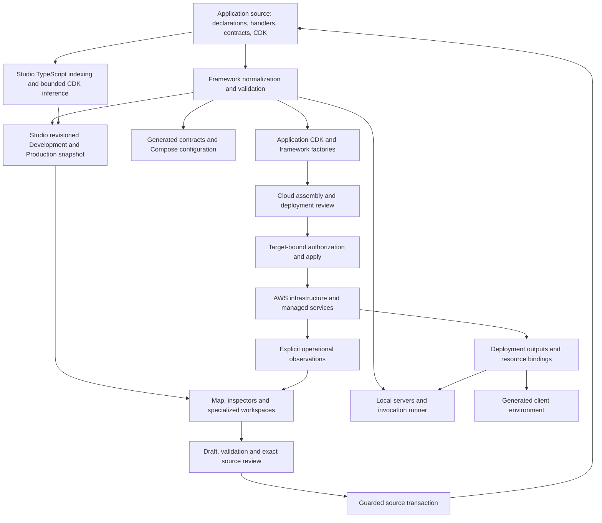

# AWS Studio: product, architecture and direction

AWS Studio is the local visual development and operations interface for Matt's AWS
Framework. Together they let a developer describe an AWS application in TypeScript,
inspect its architecture, change supported declarations through reviewed source edits,
run its local counterparts, and operate explicitly selected AWS deployments.

The application model lives in the repository. Studio reads and edits that model;
the framework remains usable through code and commands without Studio. A map node,
a source declaration, a synthesized resource and a running AWS resource are related
representations with different evidence and responsibilities.

This overview reflects source inspected on **October 29, 2026**, including existing
working-tree changes. “Implemented” means a source path exists, not that every AWS
integration has been exercised. See the [implementation status](aws-studio-knowledge/reference/status.md),
[capability matrix](aws-studio-knowledge/reference/capabilities.md) and
[discovery evidence](framework-studio/discovery-2026-10-29.md) for those boundaries.

## Who it serves and what it solves

The primary audience is engineers building full-stack AWS applications: frontend and
application developers who need to understand infrastructure effects, backend engineers
connecting workloads and data, infrastructure engineers reviewing deployment identity
and lifecycle, and contributors or coding agents extending the framework itself.

An ordinary change can otherwise require separate routing tables, IAM statements,
container wiring, runtime environment variables, infrastructure definitions and diagrams.
The framework derives those projections from shared declarations where it has a defined
contract. Studio makes that contract inspectable and provides constrained authoring and
operational workflows over it. Application business logic, arbitrary CDK constructs,
GraphQL exposure and record-level authorization still require engineering in source.

| Tool or approach | Primary responsibility | Studio's relationship to it |
| --- | --- | --- |
| AWS Console | Service-specific configuration and observed cloud state | Studio starts from a repository's application intent and a selected deployment; it does not replace every AWS service console |
| CDK and infrastructure as code | Executable infrastructure construction and CloudFormation artifacts | The framework uses CDK; Studio exposes declarations, source evidence, synthesis and reviewed operations over the existing machinery |
| Visual infrastructure builders | Visual authoring of their supported infrastructure model | Studio projects and edits ordinary framework source. Its canvas layout is a view preference, not a second infrastructure definition |
| Application IDE and source control | General code editing, review, history and collaboration | Studio links to source, produces bounded diffs and leaves saved-source history to Git |

## One ecosystem, distinct layers

1. **Application source.** `framework.config.ts` composes literal section modules under
   `framework-config/workloads/`. Resource, network, database, identity and client
   environment declarations live beside them. Handlers, containers, agent modules,
   Prisma storage and application CDK implement behavior outside the composition root.
2. **Framework model.** `@repo/framework/config` validates declarations, resolves stable
   targets, execution lanes and bindings, and provides the workflow representation.
   Runtime, local execution and Node source discovery have separate package entry points.
3. **Studio.** A React application consumes a revisioned model from a loopback Express
   server. Source indexing adds locations, editability and bounded resource/relationship
   evidence. Studio's projections do not replace framework normalization or CDK synth.
4. **Local tooling.** Vite serves Studio through the host process. The application has
   its own client, local HTTP/WebSocket servers, Docker Compose services and invocation
   runner. Running Studio does not start that application stack.
5. **Cloud construction.** Application CDK stacks and framework factories materialize
   native resources, grants, networking, compute and Step Functions. Catalog declarations
   describe references; actual construction and linking happen in CDK.
6. **Operations.** Repository scripts and typed Studio operations bind actions to explicit
   targets. CloudFormation evidence, database evidence, identity operations and frontend
   releases have their own review and outcome contracts.

Use the [framework architecture](aws-studio-knowledge/framework/architecture.md),
[Studio backend](aws-studio-knowledge/studio/backend.md),
[authority model](aws-studio-knowledge/architecture/contracts.md) and
[repository map](aws-studio-knowledge/REPOSITORY-MAP.md) for implementation owners.

## What the model can express

The workload vocabulary includes HTTP and WebSocket Lambda routes and authorizers,
event Lambdas, container services and tasks, workflows, AgentCore tools and agents.
Execution and invocation are separate concepts: a public route, a target ID, a CDK
construct ID and a resource catalog path must not be substituted for one another.

The resource catalog represents environment inputs, public source values, authored
secrets and typed native CDK resources/stack members. A linked stack can expose a bucket,
queue, topic, table, user pool or another native construct without introducing a parallel
framework resource class for every AWS service. Native attributes and grant methods
carry capabilities to consumers. This extensibility does not imply that Studio offers
creation forms or arbitrary editing for every CDK type.

Networks and the framework database are explicit declarations. Workloads opt into
database access with `database: true`; production uses the declared database placement
and IAM login. VPC references are explicit at each networked workload. Local Compose
PostgreSQL substitutes for the application database, with different networking and
credential semantics. Cross-VPC database access is rejected rather than automatically
creating peering.

Workflow authoring builds a typed, symbolic intermediate representation. Step Functions
compilation and the local interpreter consume that representation. Outputs are
references: use DSL branching and expressions rather than JavaScript coercion or control
flow. Agents and tools likewise share contracts and declared bindings across local
execution and AgentCore provisioning. Local execution can invoke real model providers
or AWS services and does not reproduce managed-service durability or isolation.

See [resources and CDK](aws-studio-knowledge/framework/resources-and-cdk.md),
[workflows](aws-studio-knowledge/framework/workflows.md),
[agents and tools](aws-studio-knowledge/framework/agents-and-tools.md) and
[local execution](aws-studio-knowledge/runtime/local-execution.md).

## The developer lifecycle

**Define → Visualize → Configure → Validate → Review Diff → Deploy → Operate → Evolve**
is a useful product journey, not a single atomic operation. A source change can require
generation, application implementation, database migration and frontend publication as
separate steps before the feature works end to end.

| Stage | Developer experience | Authority and boundary |
| --- | --- | --- |
| Define | Write a declaration or use Add to application for a supported creator | Source files and supported starter templates; a valid declaration is not finished business logic |
| Visualize | Explore islands, VPC/subnet placement, resource groups, routes and connections; search or use the resource navigator | Evaluated declarations and labeled source inference; the map is not live deployment health |
| Configure | Inspect effective values, defaults, source locations, bindings, inputs and supported environment settings | Typed drafts over recognized source shapes; unsupported expressions stay source-owned |
| Validate | Evaluate proposed configuration and applicable artifact/type/generated checks; validate Prisma separately | Each check proves its own scope; successful graph evaluation is not synth, runtime or authorization evidence |
| Review Diff | Inspect proposed file changes, expected model effects and diagnostics; apply with stale-source checks | Guarded source writes, with recovery for interrupted transactions; Git owns saved-source history |
| Deploy | Select the named deployment, profile/account/region and mode; review plan, effects, secrets and required approval | Saved deployment artifacts and ownership/fingerprint guards; changing the Source selector authorizes nothing in AWS |
| Operate | Inspect deployment status/events, jobs, local services, selected database and identity evidence | Explicit observed targets and bounded operational tools; successful infrastructure does not prove application success |
| Evolve | Edit code or supported UI, regenerate projections, compare changes and repeat reviews | Stable deployed identities, retained data and separate migration/release/teardown contracts |

### Navigating Studio

The six primary routes are **Map**, **Database**, **Deploy**, **Cognito**, **Domains**
and **WebSockets**. The shared **Source: Development / Production** control selects
declaration context; Deploy has its own target context. Map is the isometric home view;
the old Board remains in source but has no navigation route.

Map supports camera controls, keyboard navigation, search, tags, a resource navigator,
connection categories and source-linked inspectors. The renderer groups entities into
islands and network terraces from their semantics. Selecting a resource reveals related
connections even when background categories are filtered. Positions are computed;
dragging the map pans the camera and does not edit infrastructure placement.

Database offers Prisma source/diagram editing, history, offline migration planning and
target-specific database evidence/application. Cognito separates user pools, identity
pools, providers and permission evidence. Domains handles production domain intent and
bounded diagnostics/DNS operations. WebSockets presents local and AWS connection
panels; connecting or sending a message is a runtime action. Deploy separates source
configuration from named deployments, local lifecycle, reviewed cloud operations and
frontend release. The [interface guide](aws-studio-knowledge/studio/interface.md)
explains controls, state ownership and safe workflows.

### Configuration without hidden equivalence

Development and Production are the two framework modes. Development combines local
compute with selected real AWS dependencies. A named staging target can use existing
dev/prod semantics; there is no third independent mode or promotion pipeline.

Public source inputs (`resource.value`), authored environment inputs (`resource.fromEnv`),
secret values, generated runtime exports and browser-visible client variables are
different layers. Standalone source values are not overridden by environment files.
Authored raw secrets live in protected `cdk-app/.env.<mode>` files. A secret created,
generated or imported by native CDK can instead be exposed through a public `ISecret`
stack member. Both use declared secret delivery rather than public stack-string outputs.
Client environment mappings are recipes whose values are resolved
during export/build; generated client files are not an editing authority. Anything
delivered to the browser must be public.

The [environment reference](aws-studio-knowledge/runtime/environment.md),
[secret lifecycle](aws-studio-knowledge/deployment/secrets.md) and
[deployment environments](aws-studio-knowledge/deployment/environments.md) own the
precise file and delivery contracts.

## Safety and consistency principles

Studio is a trusted local engineering tool. Loopback binding, Host/origin checks and a
per-process token protect its HTTP surface; evaluator processes are not a sandbox for
untrusted repositories. Private input detail endpoints intentionally have a different
disclosure boundary from public graph metadata. Never copy secret values into source,
templates, screenshots, documentation or public client configuration.

Source writers accept bounded intents and preserve unrelated text. Reviews bind to
source hashes and expected effects. Source recovery, deployment plans, database changes,
secret updates, Cognito operations, DNS changes and frontend releases have separate
authorities and outcomes. A source save never grants blanket authority to perform all
of those actions. Automated guards reduce mistakes; they do not replace explicit
environment authorization, cloud IAM, code review or application-level access control.

Cloud identities and retained resources outlive a particular source revision. Removing
a declaration does not prove a deployed resource or its costs disappeared. Teardown
reviews use deployed identity and dependency/retention evidence. Retention, reuse,
adoption and recovery are supported only through their implemented resource-specific
paths; there is no universal automatic import/restore system.

These principles and their consequences are recorded in the
[architectural decisions](aws-studio-knowledge/architecture/decisions.md),
[invariants](aws-studio-knowledge/reference/invariants.md) and
[operational lifecycle](aws-studio-knowledge/deployment/lifecycle.md).

## Present system and longer-term direction

The implemented system already links architecture visualization, bounded source
authoring, generation, local execution, deployment review and several operational
workspaces. It remains an engineering environment: unsupported code shapes, native CDK
construction, advanced workflow authoring and application data propagation still need
source work. External integration success must be demonstrated separately.

The original [product exploration](../UNIFIED_AWS_FRAMEWORK_VISUAL_EDITOR_HANDOFF.md)
described a unified visual interface over the existing framework. The subsequent
[implementation guidance](framework-studio/moving-forward.md) preserves TypeScript
rendering, a host process, source authority and preview-before-apply. Those are evidence
for a direction, not promises that every proposed feature will ship.

**The architectural interpretation of that direction** is an integrated application
development control plane: developers move between code, visual structure,
configuration, local execution and cloud operations while preserving identities and
evidence across each transition. The next useful capabilities should extend those
existing contracts rather than create another catalog, workflow language or hidden
configuration store.

Explicitly proposed areas include workflow execution overlays, richer structured
workflow visualization, additional typed resource templates, optional manual view
arrangement and measured touch/performance work. A CloudWatch application
logs/metrics/traces explorer is not implemented. Arbitrary visual editing, complete
AWS emulation, universal native-resource CRUD, general IAM proof and automatic
environment promotion are not current capabilities. There are no delivery dates or
roadmap commitments implied here.

## Start contributing

Read the [documentation index](README.md), then use the
[knowledge router](aws-studio-knowledge/README.md) for the smallest relevant subsystem.
Start Studio with `npm run studio`; inspect it without starting application services.
Follow [Development](DEV-DEPLOYMENT.md) for the actual application setup and
[AGENTS.md](../AGENTS.md) for repository constraints. The
[extension recipes](aws-studio-knowledge/guides/extensions.md) trace new fields,
resource capabilities, workflow operations and creators through their producers,
consumers and verification boundaries.
