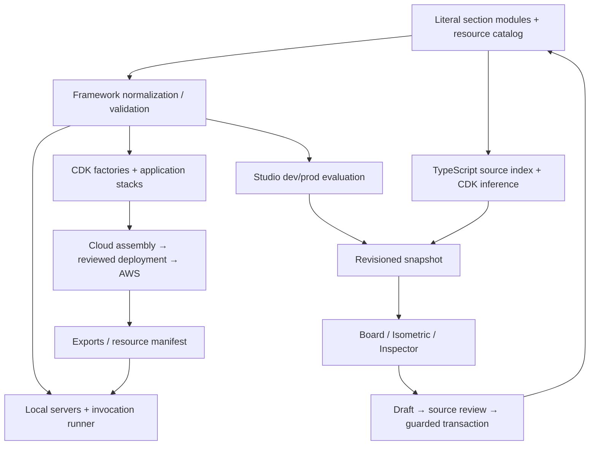

# Architectural relationships

| Producer → consumer | Contract and canonical explanation |
| --- | --- |
| Declarations → all execution surfaces | [Configuration](framework/configuration.md): normalized targets, roles, lanes and identities |
| Catalog → CDK → workload | [Resources/CDK](framework/resources-and-cdk.md): deferred native linking, grants and finalization |
| Workflow author → compiler/interpreter | [Workflows](framework/workflows.md): shared IR, symbolic outputs and integration bindings |
| Agent/tools → Runtime/Gateway/local runner | [Agents/tools](framework/agents-and-tools.md): contracts, sessions and derived tooling |
| Config + source → snapshot | [Snapshots](studio/snapshots.md) consumes [source evidence](studio/source-indexing.md); evaluation is separate from synth |
| Snapshot → visible connections | [Graph model](studio/graph-model.md) preserves provenance; [rendering](studio/rendering.md) aggregates and routes |
| Inspector → source | [Editing](studio/editing.md) owns drafts, AST changes, preflight, apply and undo; [creators/triggers](studio/creation-and-connections.md) extend it |
| Inputs + manifest → execution | [Environment delivery](runtime/environment.md), [local execution](runtime/local-execution.md); some integrations call real AWS |
| Named target → reviewed AWS changes | [Environments](deployment/environments.md), [planning/safety](deployment/planning-and-safety.md), [secret writes](deployment/secrets.md) |
| Studio deployment UI → fixed command registry | [Operations](deployment/operations.md): jobs, observation, cancellation and local lifecycle |

[Source authority](architecture/contracts.md) distinguishes declarations, generated projections and observed cloud state. These are related representations, not interchangeable inventories. [Change impact](reference/change-impact.md) gives the reverse traversal when a producer changes. [Repository map](REPOSITORY-MAP.md) locates implementation owners.
