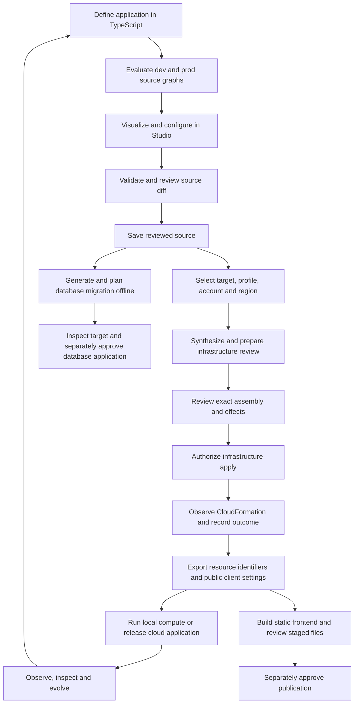

# From application definition to operated deployment

Studio brings source editing, infrastructure review and operational actions into one
application, but they have different authorities and effects. Saving a configuration
diff changes repository files. Applying an infrastructure plan changes AWS. Applying
a migration changes a selected database. Publishing a frontend changes S3 objects and
CloudFront cache state. None of these approvals implies another.

This is the central operational boundary to preserve when extending Studio. The
browser supplies a typed request; a dedicated server service validates its context;
the existing CLI or bounded service performs the effect. The server is a local
engineering tool running with its operator's filesystem access and AWS credentials,
not a hosted account administration service with a separate authorization system.

## The lifecycle and its separate reviews

The database and frontend branches are explicit operations, not automatic follow-on
steps of infrastructure deployment. Local startup verifies existing storage; it does
not initialize/migrate it, clean orphan users or create a Cognito test identity.
Production infrastructure completion does not establish application health.

| Action | Authority and effect | Review and outcome boundary |
| --- | --- | --- |
| Save Studio source edits | Supported TypeScript/JSON/Prisma source, through the owning editor service | Source revisions and validation; no deployment or database write. [Editing](../studio/editing.md) |
| Save CDK inputs | Fixed private dev/prod dotenv files | Protected value handling and file revision; no export or secret synchronization. [Secrets](secrets.md) |
| Plan infrastructure | Selected target and synthesized assembly | Template review reads AWS; change-set preparation writes AWS review objects. Explicit missing-secret creation can also write. [Planning](planning-and-safety.md) |
| Apply infrastructure | Exact saved assembly and selected AWS destination | Ownership, account, fingerprints, assembly digest and secret binding rechecked. CloudFormation and secret updates are not one transaction |
| Generate client environment | Public mappings, selected inputs and deployment outputs | Writes generated client file; ordinary dev export additionally owns Compose controls/resource manifest. [Frontend release](../../framework-studio/frontend-release.md) |
| Start development | Existing exported dev identity and this checkout's Compose project | Generates projections, builds/starts services, verifies storage and readiness. It can leave some containers running after failure. [Development](../../DEV-DEPLOYMENT.md) |
| Plan/save a migration | Contract, generated storage model and migration history | Offline artifact review; saving SQL/migration source does not apply it. [Database workbench](../../framework-studio/database-workbench.md) |
| Inspect/apply production database | Exact deployed migration-task descriptor, IAM/TLS and database identity | Even inspection launches a billed ECS task and needs its own approval; application is a second task with a separate review |
| Execute Saved SQL | Resolved local PostgreSQL target and a reviewed command | Local only, bounded single statement, bound parameters, typed confirmation and transaction outcome; no production SQL console |
| Administer Cognito users/groups | Verified deployment-owned pool plus fresh subject preconditions | A bounded operation with pool/account confirmation; production adds an operation-specific approval. Referenced pools are inspectable but not mutable here |
| Publish static frontend | Verified website stack's bucket/distribution and staged artifact | Separate publication approval; confirmed uploads, deletes, invalidation and HTTP result are recorded separately |
| Delete deployment | Observed identity-bearing AWS stacks, independent of current source | Expiring teardown review, exact StackIds, dependency/retention checks and typed confirmation. [Stateful lifecycle](../../framework-studio/stateful-resources.md) |

## Three contexts must remain distinct

**Source mode** selects one of the two graphs Studio evaluates, dev or prod. It is
useful for seeing conditional declarations, input availability and local/cloud
placement. It does not select credentials or authorize an AWS action.

**Deployment destination** is a named identity with a mode, account and region.
`framework:targets` in `cdk-app/cdk.json` can declare several destinations using the
same mode, including a staging-named prod target. The deployment service selects a
profile, resolves AWS identity and applies target pins. Studio's source graph and
fixed input-file editors are not per-target projections of arbitrary custom input
paths. See [environments](environments.md).

**Runtime evidence** describes one actual destination, local Compose binding or
physical resource at an observed time. A source declaration does not prove that
resource exists. A synthesized inventory does not prove deployment. A completed
stack does not prove database compatibility, sign-in, model access or frontend
behavior. Operation views retain stale, partial and unknown outcomes rather than
converting them into a success indicator.

## How the backend composes operations

[`DeployService`](../../../framework-studio/server/deploy/service.ts) combines
target preferences, prerequisite probes, `AwsObserver`, `LocalEnvironment`,
`PlanStore`, `TeardownStore` and `JobManager`. Its
[`buildOperation`](../../../framework-studio/server/deploy/registry.ts) registry
accepts known actions and converts validated parameters to fixed argv. It does not
accept arbitrary shell commands. Child processes use the selected profile; direct
credential and mode carryover is removed by
[`studioEnvironment`](../../../framework-studio/server/deploy/process.ts).

The CLI remains the infrastructure safety authority. `scripts/deploy.ts` selects
inputs and identity, synthesizes, locks, verifies ownership, reviews and applies.
Studio adds reviewed UI flows in front of it. Saved apply/discard paths can work
even when current declarations no longer load, because they consume the reviewed
assembly rather than synthesizing current source. A review is single-attempt:
interruption after apply begins requires inspecting durable evidence and AWS before
creating another plan, not replaying the old command.

Other effects deliberately have their own owners: `DatabaseApplicationService` and
`DatabaseCloudService` handle database review/application; `DatabaseSqlService`
handles local SQL; `CognitoOperations` handles bounded identity administration;
`FrontendReleaseService` handles static assets. They are not aliases for Deploy's
job registry and do not inherit an infrastructure plan's approval.

## State ownership and recovery

| State | Location/owner | Meaning and recovery limit |
| --- | --- | --- |
| Authored application | `framework-config/`, application CDK/handlers, database contract | Durable source of intended behavior; commit/review through normal Git workflow |
| Private values | Selected `cdk-app/.env.dev` / `.env.prod` or target inputs path | Operator-owned inputs; never commit, copy between modes implicitly or expose in graph metadata |
| Infrastructure plan | CLI-selected plan directory; Studio's `PlanStore` under `.cache/framework-studio` | Saved assembly, review and operation/result records; 24-hour review expiry, no automatic uncertain apply retry |
| Secret review binding | `.cache/deploy/secret-bindings/` | Private keyed value digests and version evidence kept outside shareable plans; moving a plan without its binding requires replanning |
| Deploy coordination | `.cache/deploy/<deployment>.lock` and physical-reference locks | Checkout-local exclusion only; unknown locks require inspection before manual recovery |
| Studio jobs | `.cache/framework-studio/jobs/` by default | Process/job logs and interruption evidence; process restart does not resume CloudFormation execution |
| Database and SQL outcomes | `.cache/framework-studio/database-operations/` and `sql-operations/` by default | Redacted durable outcomes; reviews live in memory, unknown COMMIT outcomes are never automatically retried |
| Cognito operations | `.cache/framework-studio/cognito-operations/` by default | Redacted outcomes and pool lock; acknowledgement, follow-up observation and successful authentication are distinct |
| Frontend release | `.cache/framework-studio/frontend-releases/<id>/` | Staged files, hashes, previous local output and confirmed effects; prior output is not a deployed rollback |
| Retained resource evidence | `.framework/retained-resources/<account>/<region>/<deployment>.json` | Historical physical identity/dependencies across removed source/stacks; requires live corroboration, not a global ownership registry |
| Local application data | Compose project's `postgres_data` volume | Independent of AWS retention; preserve project/volume identity during rebuilds |

`FRAMEWORK_STUDIO_STATE_DIRECTORY` isolates supported Studio job/operation stores
for testing; infrastructure CLI and retained-resource evidence have their own
locations. Do not assume one cache directory contains every recovery artifact.
No local lock provides distributed coordination across developers or checkouts.

Failure handling follows the same rule across effects: record the request phase
before mutation, keep confirmed outcomes, and label lost acknowledgements as
uncertain. Cancelling a process does not cancel an accepted AWS operation. A
successful API acknowledgement does not mean all downstream effects have converged.
CloudFormation rollback does not undo secret versions, SQL commits, Cognito user
changes or already uploaded frontend objects.

## Present scope and extension boundaries

Implemented source-backed paths include named deployment targets, template and
change-set review, local compute supervision, cloud stack events/drift, explicit
retention/reference reuse, database migration inspection/application, bounded local
SQL, reviewed Cognito operations, domain inspection/DNS review and static frontend
publication. Their detailed guides own the exact supported variants.

Current limits include two mode semantics, checkout-local coordination, partial
cross-stack deployment reviews, supported AST forms rather than arbitrary source
rewrites, no CloudWatch application log/metric/trace explorer, no production Saved
SQL console, and no automated CloudFormation import or snapshot restore. A retained
resource reference preserves external ownership; it is not adoption into a new stack.

A future action should identify its source of authority, exact destination,
reviewed bytes/preconditions, effect boundary and recovery evidence before adding a
button. Broader hosted collaboration, promotion pipelines and cross-machine locking
would require new architecture; the current code does not establish those features
or a delivery commitment.

This reference was reconstructed from source on 2026-10-29. It does not claim a new
live deployment, database application, identity mutation or publication test. Use
the linked operational guides and the task's actual verification record for runtime
evidence.
