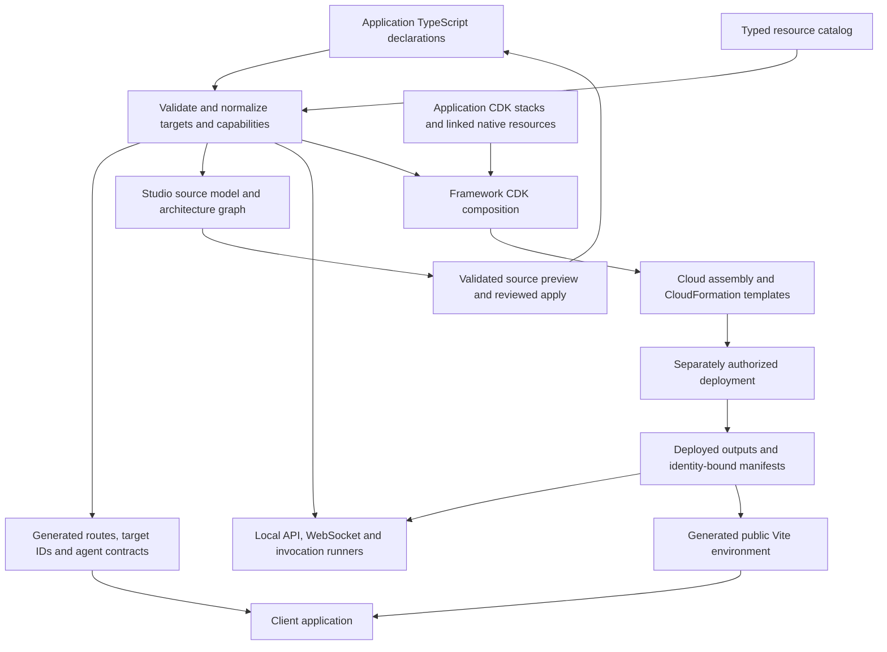

# Framework architecture and responsibility boundaries

Matt's AWS Framework describes an application once in TypeScript and derives its
workload routing, runtime capabilities, infrastructure wiring and development
execution from that declaration. AWS Studio reads and edits this application model;
it is another consumer of the framework, not the owner of a parallel infrastructure
format. This page explains the machinery. [Framework](../../FRAMEWORK.md) is the
long-form authoring reference, and [configuration](configuration.md) owns normalization
and identity details.

## One model, several projections

[framework.config.ts](../../../framework.config.ts) composes literal workload arrays,
resource references, imported networks and a primary database declaration. Application
handlers, native CDK constructors and Prisma's storage contract remain separate source
because they express behavior, provider-specific infrastructure and data semantics
that the workload model does not replace.

The diagram shows dependency and data flow, not an automatic deployment pipeline.
Saving source, generating artifacts, synthesizing infrastructure, applying AWS changes
and publishing frontend assets are separate operations. A graph node can exist without
a corresponding construct in the selected assembly or a live AWS resource.

`defineFrameworkConfig` merges sections and immediately validates the result.
`normalizeFrameworkConfig` and `getFrameworkTargets` provide a common vocabulary for
Lambda, service, task, workflow and agent targets, including their roles, settings,
origins and capability bindings. Literal arrays preserve duplicate declarations for
validation; object spreading would silently discard one definition. Normalization
checks route collisions, incompatible shared compute, invocation cycles, deployment
compatibility, placement and supported workflow semantics before consumers build
anything. Filesystem/artifact validation is separately owned by the Node-only
[config/source.ts](../../../packages/framework/src/config/source.ts).

Projections deliberately have different completeness rules. Generated route/contracts
include the declaration superset so a deployment toggle cannot invalidate application
types. A selected runtime or CDK graph resolves concrete input conditions and includes
only eligible targets. Studio adds source location, editability, inferred native
resources and operation evidence to the normalized application model; that extra
metadata is not a new workload definition.

## What the framework actually manages

| Family | Framework responsibility | Application/native responsibility |
| --- | --- | --- |
| HTTP Lambda and API Gateway | Route/method resolution, bundles, authorizers, environment, roles and same-origin API integration | Handler behavior, public payloads and authorization inside the handler |
| WebSocket API and Lambdas | Connect/message/disconnect routes, optional connect authorizer, connection push transport | Message contracts and application connection policy |
| Event Lambda | Compute, native registration, typed trigger attachments, failure destinations and opt-in replay | Event source lifecycle, payload handling and idempotency |
| ECS/Fargate service | Declared service discovery, image/build settings, networking and API exposure | Container process, health endpoint and application protocol |
| ECS/Fargate task | Task definition, declared invocation capability and task-exit/callback workflow integration | Dockerfile, task implementation and its business result |
| Step Functions workflow | Typed graph, semantic validation, ASL/JSONata compilation, role derivation and local interpreter | Graph/business rules, idempotency and external integration bindings |
| AgentCore Runtime/Gateway and tools | Agent/tool contracts, deployment, derived per-agent Gateway, invocation/session transport | Agent implementation, model choice, tool logic and domain-level controls |
| VPC and managed PostgreSQL | Imported declaration identity, placement policy, lazy network construction, IAM login and client attachment | Selected topology/defaults, schema, repositories and migration decisions |
| Cognito and frontend | Shared workload pool references and integration with application-owned stacks | Native pool/providers/identity policy, static hosting and release configuration |
| S3, DynamoDB, SQS, SNS, EventBridge, Secrets Manager and other native constructs | Typed references, native grants, selected triggers/workflow adapters, output export | Native constructors, encryption, lifecycle, retention and service-specific options |

This is not a closed catalog of all AWS services. The generic catalog accepts native
construct references and supported public attributes/grant methods. First-class
workflow or event behavior is a smaller, explicitly implemented adapter set. A CDK
construct being discoverable by Studio does not imply a complete inspector, creation
wizard, runtime emulator or operational console for that AWS service.

The current application includes a source-only
[ReferenceExampleStack](../../../cdk-app/lib/app/reference-example-stack.ts) with S3,
DynamoDB, SNS, SQS, EventBridge, SSM and CloudWatch examples. The catalog references its
type, but [cdk-app.ts](../../../cdk-app/bin/cdk-app.ts) does not instantiate it. Its
presence demonstrates source discovery and native wiring patterns; it is not evidence
that those example resources were deployed.

## References describe capabilities; native CDK supplies them

A resource reference is a serializable identity, not an instantiated CDK construct or
an AWS lookup. `resource.stack<MyStack>()` projects a stack's public construct fields,
public strings and secret handles. Private/protected members and inherited `Stack`
properties are excluded. Public strings therefore must never contain secret values.
`resource.cdk<T>()` is the lower-level one-construct form.

Native string attributes become environment references. Compatible native
`grant*` methods become typed capability descriptors with the workload grantee left
implicit. Calling `resources.files.bucket.grantRead()` while authoring config records
intent; finalization calls the actual native CDK method against the consumer's role.
This preserves provider semantics such as encryption-key grants without maintaining a
second handwritten permission library. It does not prove effective IAM access through
SCPs, boundaries, resource policies or account-wide conditions.

The lifecycle in [framework-resources.ts](../../../cdk-app/lib/framework/framework-resources.ts)
is initialize → link → defer consumers → finalize. `linkResources(this, resources.x)`
links the public native values at the end of the owning stack constructor. Finalization
resolves deferred references, validates and applies triggers and permissions, emits inventory
metadata and exports needed identifiers. Missing or duplicate links and resource cycles
fail with catalog/consumer context. A catalog entry never constructs its owner.

Application stacks go in `cdk-app/lib/app`; generic factories stay in
`cdk-app/lib/framework`. Native resource ownership, lifecycle and specialized AWS options
remain beside their constructors. Framework factories own workload mechanics and prohibit
manual workload VPC/security-group options that would bypass declaration validation.
See [resources/CDK](resources-and-cdk.md) for native linking and [environment delivery](../runtime/environment.md)
for resolving the same capability in a local process.

## Two environment axes, not two applications

A target's `deploy` setting selects local/cloud execution lanes; a deployment's `dev`
or `prod` mode selects an infrastructure graph. These axes are intentionally distinct.
A cloud-enabled HTTP Lambda is absent from the development cloud graph because its
development caller uses Compose. Enabled event Lambdas and WebSocket handlers can be
present in that graph because AWS invokes them. Production includes eligible cloud
workloads. Explicit named deployment targets reuse these two modes; there is no third
staging mode or automatic promotion system.

A declarative condition can use a non-secret environment input or standalone
`resource.value(...)`. Environment inputs resolve from the selected authored file,
with explicit CDK context precedence and then declared defaults. Standalone values
resolve only from source. Optional absence and graph exclusion are explicit; a value
from the other mode does not fill a gap. Cloud-edge validation rejects a deployed
caller whose declared destination is unavailable in the same graph.

Local execution uses the same target IDs, bindings, contracts and workflow IR, while
its transport/process model differs. Node workers, Docker containers and an in-memory
workflow interpreter are not IAM enforcement, Step Functions durability, AgentCore
microVM isolation or a full AWS emulator. Development still uses real Cognito, replay
queues, model APIs and selected managed-service integrations. See
[local execution](../runtime/local-execution.md) before assuming a test is offline.

## How infrastructure is assembled

[bin/main.ts](../../../cdk-app/bin/main.ts) resolves deployment selection before the
mode-sensitive catalog loads. [bin/cdk-app.ts](../../../cdk-app/bin/cdk-app.ts) reads
inputs, resolves deployment settings and initializes framework resource state. The
application constructs production frontend/RDS when applicable, foundation/replay
infrastructure, tasks, event handlers, Cognito, custom application stacks, orchestration
and routed workloads in an order compatible with their native references. Finalization
runs after links exist. Workflows require their native integration links earlier, before
orchestration constructs them.

Workflows and agents share the historical `WorkflowsStack`, so their acyclic invocation
graph determines construction order without creating mutually dependent stacks. The
event implementation class is `EventLambdaFunctionsStack`, but its deployed stack name
remains `AsynchronousLambdaFunctionsStack`. Public paths, target IDs, directory names,
construct IDs and stack scopes are separate identities. Preserve deployed scopes and
output prefixes when moving source; compare templates when infrastructure identities
might change.

Network declarations do not eagerly create VPCs. Only production builds them, lazily
when native resources/workloads use them. A networked workload names an imported VPC
explicitly; a database consumer must match the database's declared VPC. There is no
implicit inheritance or automatic cross-VPC peering. Database retention/reuse preserves
more than the RDS instance: its network and security dependencies matter, and retained
resources can continue costing money. [Stateful database](stateful-database.md) and
[deployment safety](../deployment/planning-and-safety.md) own recovery and authorization.

## Extending without creating a second source of truth

For a workload setting, follow type → normalization/defaults → validation → local/CDK
consumer → generated projections → Studio model/editor where applicable. For a native
resource, first expose and link its public construct. Add a special adapter only if a
new operation, trigger or source-editing capability needs semantics the generic reference
cannot express. For a workflow operation, extend both compilation and interpretation;
adding an ASL branch alone creates a local/cloud mismatch.

These boundaries trade some authoring flexibility for reliable source inspection and
cross-consumer consistency. Unsupported dynamic TypeScript should become an explicit
read-only/manual-edit path in Studio, not a guessed rewrite. A complete schema/typecheck
is not proof of browser behavior, synthesized identities, live authorization or recovery.
Use [extension recipes](../guides/extensions.md), [change impact](../reference/change-impact.md)
and the narrow subsystem's tests to select evidence. Keep implemented behavior separate
from live validation and future product ambitions in the [capability ledger](../reference/capabilities.md).
