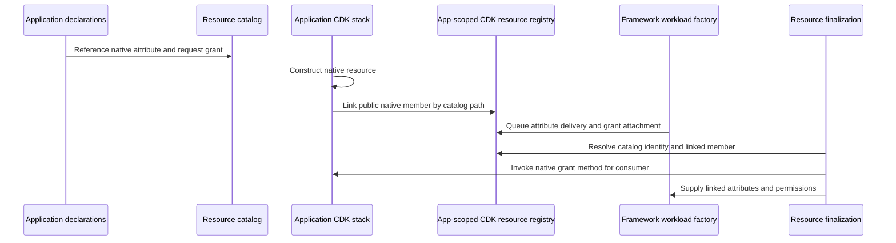

# Resource catalog, permissions and CDK

`resources.ts` explicitly composes imported descriptor constants from cohesive modules
under `framework-config/resources/`. Source indexing follows those constants to their
owning declarations; public catalog names and native link sites remain stable. Type-only
stack imports still keep evaluation browser-safe.

Tags follow ownership rather than consumer traversal. Stack descriptors carry `tags` and
typed `members: { field: { tags } }` overrides; references and public string values retain
metadata without independent AWS tagging. Imported constructs are not retagged. Owned
compute/network/native subtrees use CDK tagging, preserving deployment ownership keys.
A stack built without a catalog entry (the framework's API, frontend and replay stacks) takes
`framework.config.ts` `stacks.<Class>.tags` as its outermost layer, matched by class name in
`applyFrameworkTags`; a cataloged stack named there is refused.
The database declaration owns final overrides on its primary resource. Conflicting aliases
must fail instead of choosing import order. The
[tag guide](../../framework-studio/declarations-and-tags.md) describes limits and unsupported
cases; saving tags never calls AWS or deploys.

The catalog describes what consumers need without constructing CDK or reading secret values. [resources.ts](../../../framework-config/resources.ts) uses `defineResources`, `resource.value`, `resource.fromEnv`, `resource.secret`, and `resource.stack<T>()`. A mode-absent entry remains a typed reference but resolves to nothing; consumers must respect required/optional semantics.

`resource.value(...)` is a standalone non-secret input, with a source value instead of an
environment variable/default. Its effective reference carries `authoredValue`; differing
graphs retain `modes.value`. Local/cloud consumers and deployment conditions resolve it
without environment/context reads, links, manifest attributes or resource outputs. Secrets
continue to use protected environment inputs or a stack-owned secret handle.

Authored-secret catalog renames retain an input-only `bindingPath` option containing the
original catalog segments, plus the existing explicit `fromEnv` name. Builders, mode
resolution and secret projections preserve that pin. `secretBindingPath` in
[cdk-resources.ts](../../../packages/framework/src/config/cdk-resources.ts) uses it only
for authored secrets and their ARN projections; generic graph/native-link paths remain
the current catalog paths. It feeds the existing CDK parameter digest/cache, managed
secret metadata `path` and `resourceAttributeKey`, preserving ownership tags, development
outputs and existing local manifests without an identity migration. Repeat renames keep
the first pin. Ordinary `fromEnv` and `value` inputs retain dormant pins through source
and Secret controls; `defineResources` reserves these along with active bindings and
rejects duplicate claims, including declarations absent from the selected mode. Native
`stack`/`cdk` metadata does not accept the option. Tests compare both synth modes,
existing owned-secret planning and local manifest resolution in
[secret-binding-rename.test.ts](../../../cdk-app/test/secret-binding-rename.test.ts) and
[secret-binding-identity.test.ts](../../../packages/framework/test/secret-binding-identity.test.ts).

| Abstraction | Implementation contract |
| --- | --- |
| `ResourceReference` | [resources.ts](../../../packages/framework/src/config/resources.ts): branded catalog path, kind, absence, authoredValue or fromEnv/default/required, and attribute/secret projections |
| `CdkResourceGroup`, `CdkResource`, `NativeGrantBinding` | [cdk-resources.ts](../../../packages/framework/src/config/cdk-resources.ts): public stack fields project native string attributes and typed grant methods; inherited Stack fields are excluded |
| `SecretProjections` | `.arn`, `.value`, `.field(key)` distinguish ARN delivery from injected contents; [secrets](../deployment/secrets.md) owns storage/synchronization |
| Invocation bindings | `runsTask`, `startsWorkflow`, agent references declare capabilities; runtime descriptors are generated/injected, never handwritten |

In [framework-resources.ts](../../../cdk-app/lib/framework/framework-resources.ts), `initializeFrameworkResources` sets readers/identity; `linkResource` registers one native value; `linkResources(this, resources.group)` walks a stack's public fields/getters. Consumers defer attachment until `finalizeFrameworkResources`, which resolves queued references, applies native grants/triggers, and publishes metadata/resource outputs. `applyNativeGrant` invokes the native CDK grant method with the workload grantee. This is narrower and more faithful than a duplicate application permission registry.

This is the common deferred-resource path, not an AWS request sequence. Native
constructs and deferred actions live in the app-scoped CDK registry; the pure catalog
continues to hold descriptors. Finalization runs the factory's queued attachment closures. Workflow
service integrations that need native constructs during orchestration construction
must be linked before that construction phase. Plain environment attributes and grant
requests remain different relationships even when they refer to the same resource.

Application stacks own native constructors/options and expose public constructs/strings/ISecret fields. The framework owns shared workload factories, reference resolution, grants, network/database attachment and runtime descriptors. [cdk-app.ts](../../../cdk-app/bin/cdk-app.ts) orders foundation/tasks/events/Cognito → custom application stacks → orchestration → routed workloads → finalization. Bind workflow integrations beside constructs before orchestration builds them. Preserve the historical `AsynchronousLambdaFunctionsStack` deployed identity.

**A catalog declaration does not instantiate a stack.** `ReferenceExampleStack` is declared in the catalog but is not instantiated in the current entry point. Source-derived members can therefore appear without deployed infrastructure. Use [synth inventory](../deployment/operations.md), not the source graph, to establish assembly contents.

`frameworkLambda` in [framework-lambda.ts](../../../cdk-app/lib/framework/framework-lambda.ts) resolves packaging/runtime and denies manual VPC/subnet/security-group options. `database: true` gives IAM database access and placement; use [network declarations](../../../framework-config/networks/application/index.ts) for NAT/endpoints. Native grants and explicit IAM requirements are inputs to role construction, not a complete effective-permission viewer.

When no VPC placement is selected, the factory explicitly synthesizes empty
subnet/security-group lists and `Ipv6AllowedForDualStack: false`. This clears
previously enabled IPv6 when the same function moves to `subnet: "none"`;
omitting `VpcConfig` can fail that update. The common factory covers Node/Python
zip and container packaging without changing construct identities or adding VPC
permissions. Application declarations still own placement; no application-level
CDK override is required. AWS documents detachment with empty lists and limits
outbound IPv6 to VPC functions in its [Lambda VPC guide](https://docs.aws.amazon.com/lambda/latest/dg/configuration-vpc.html).

Detachment does not synchronously remove Hyperplane ENIs. AWS uses the creator
function's execution-role permissions for cleanup; deleting that role too early
can leave unused interfaces behind. The Lambda VPC guide above describes manual
removal in this case. Studio's stack teardown does not automatically remove these
orphan interfaces. Job 3 observed this after a VPC-to-none update followed by
teardown; interface cleanup requires separate verification of exact ownership,
remaining function/version/mapping use and released interface state, rather than
name-prefix deletion or forced detachment.

For a new family: expose/link a native public member first; add explicit framework semantics only when needed; separately extend [Studio discovery/trigger adapters](../studio/source-indexing.md). Validate with [native resource](../../../cdk-app/test/native-resources.test.ts), [stack resource](../../../cdk-app/test/stack-resources.test.ts), network/trigger tests and both synth modes. See the [extension recipe](../guides/extensions.md).

Native VPC-backed resources use `frameworkVpc(this, importedVpc)`. Network state,
security groups, ECS clusters and API VPC links are per VPC. `NetworkStack` retains
historical scopes; other construct identities get stable namespaces. Unused declarations
build nothing. CDK checks actual database placement against its declared VPC.

`defineDatabase` owns primary PostgreSQL placement and default infrastructure policy,
while `RdsStack` preserves all native construct scopes and resource links. Optional
replicas, Multi-AZ and Proxy remain settings rather than new identity schemes. Complete
template comparisons in [database-topology.test.ts](../../../cdk-app/test/database-topology.test.ts)
protect the writer, replicas, Proxy, bootstrap and output identities. Studio edits typed
declaration settings through [database.ts](../../../framework-studio/server/edits/database.ts).
Its separate placement operation edits the literal database and all normalized framework
consumer VPC references together, retaining subnet tiers and native CDK identities.
It never moves data or deploys RDS; deployed moves require migration/cutover planning.
IAM-only workload login, local Compose parity and `database: true` are unchanged.

## Connection categories have different effects

A visual connection is meaningful only when its underlying declaration is known:

| Declaration | What the framework derives | What it does not establish |
| --- | --- | --- |
| Native string attribute in `environment` | CDK token or exported local identifier | Permission to use the resource merely because its address is known |
| Native `grant*` binding | Native CDK policy/key grant to the workload's principal | Effective authorization through organization policies, session policies and every resource-policy condition |
| Secret `.arn` / container secret projection | Secret read or startup injection permissions and delivery | Browser-safe content; raw secret values must remain outside public source/outputs |
| `runsTask`, `startsWorkflow`, `invokesAgent` | Target descriptor, allowed invocation edge and required cloud invoke permissions | Terminal task success or business-level authorization |
| `database: true` | Database capability, placement/connection policy and IAM login | Schema migration, implicit peering or master-secret access |
| Event trigger | Service-specific native attachment and delivery permission | Payload conversion or an exactly-once processing guarantee |
| Workflow service operation | Integration identifier, operation-specific grants and compiler/interpreter behavior | Creation/lifecycle of the referenced service resource |

Explicit `cloud.access` statements remain available for access that native grants do
not represent; their placeholder expansion is implemented in
[config/resources.ts](../../../packages/framework/src/config/resources.ts). They remain
authored IAM policy, not a framework proof of least privilege. `cloud.requirements`
expresses required inputs, optionally gated by another input; it is a preflight
availability rule and does not grant permissions.

## Event adapters and native ownership

[config/triggers.ts](../../../packages/framework/src/config/triggers.ts) defines the
pure adapter metadata, accepted payload contract, options and validation used by source
and Studio. [framework-triggers.ts](../../../cdk-app/lib/framework/framework-triggers.ts)
and [framework-trigger-services.ts](../../../cdk-app/lib/framework/framework-trigger-services.ts)
own the CDK validation/attachment side.

| Adapter | Implemented attachment | Important boundary |
| --- | --- | --- |
| Cognito | Standard supported user-pool hooks | Owned pool and available hook; synchronous response hooks cannot be replaced by asynchronous replay |
| EventBridge | Rule on a referenced bus, with pattern/input/retry/DLQ options | Native source ownership remains with the application; rule ownership avoids reverse stack dependencies |
| SQS | Lambda event-source mapping | Queue visibility must cover timeout; native mapping conflicts and FIFO limits are checked |
| DynamoDB | Existing stream to Lambda | Does not turn on a stream; existing native mappings require manual review |
| SNS | Lambda subscription with supported filters/DLQ | Standard topic; FIFO-to-Lambda is refused |
| S3 | Existing bucket EventBridge delivery or supported notification attachment | Preserve delivery architecture; require recursion-risk acknowledgment; refuse overlapping/conflicting configuration |
| Schedule | EventBridge Scheduler beside the target function | No catalog source required; rate/cron/timezone validation and stable attachment ID |

The attachment `id` belongs to its source and is distinct from the event target ID.
`accepts` records the reviewed payload contract; selecting it does not rewrite a handler.
Native hooks remain valid alongside framework adapters, but unknown or occupied native
ownership is not silently overwritten. `onFailure` applies Lambda asynchronous failure
destinations to supported async invocation adapters; SQS/stream mappings retain their
own failure mechanism. The full [event authoring reference](../../FRAMEWORK.md#events-and-native-infrastructure)
covers options and replay constraints.

For a new trigger, extend both sides: `defineTriggerAdapter` for the browser-safe
contract and `registerCdkTriggerAdapter` for native attachment. Register before
finalization, test conflict/ownership refusal as well as successful synthesis, and
provide Studio's source discovery with evidence of supported native shapes. A new
service icon or registry name alone cannot establish a working trigger integration.
