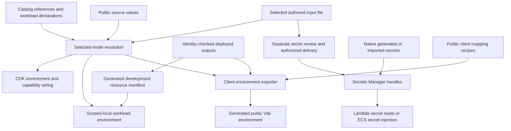

# Workload environment resolution

The catalog defines references; an execution lane supplies their values. [Secrets/input storage](../deployment/secrets.md) owns authored files and deployment synchronization; this page owns delivery to a workload.

## Configuration ownership

Treat these as distinct layers, even when Studio presents them in neighboring inspectors:

| Layer | Authoritative source | Consumers and generated outputs |
| --- | --- | --- |
| Workload intent and source-owned values | `framework-config/workloads/`, `resources/`, `defaults.ts`; standalone `resource.value` | Normalized settings, Studio graph, local runtime and CDK |
| Environment-linked values and secret contents | Selected target's authored `cdk-app/.env.dev` or `.env.prod` (or its explicitly configured input file) | Input resolution and separately authorized secret synchronization |
| Deployment-wide settings | `cdk-app/deployment-inputs.ts`, resolved by `deployment.ts`; targets in `cdk.json` | Account/mode/region, domains, lifecycle and deployment assembly |
| Deployed resource identities | Identity-checked CloudFormation outputs | `.framework/local/resources.json`, generated root Compose controls and production output records |
| Public browser recipes | `framework-config/client-environment.ts` | Generated `client-app/.env.development.local` or `.env.production.local` |
| Per-process runtime environment | The target's declared environment/secrets/bindings plus allowed platform settings | Worker/container environment, generated invocation descriptors and database connection settings |

An environment variable exported in the invoking shell does not override an authored
resource input. [readAuthoredInputs](../../../packages/framework/src/config/source.ts)
parses the selected input file itself; `FRAMEWORK_INPUTS_FILE` selects an explicit
alternate file. CDK context overrides apply when the caller supplies the context reader.
Local workload resolution reads authored inputs without a CDK context reader. Root `.env`
is generated Compose output, not a fallback input store for declarations.

`resolveInput` in [config/resources.ts](../../../packages/framework/src/config/resources.ts)
returns `supplied`, `fallback`, `missing`, `unresolved`, `invalid` or `not-applicable`.
Blank environment lines are unset; enum comparisons accept case-insensitive spelling
and return the declared choice. A required input with no supplied value or default is
missing; an optional one is unresolved. Inputs absent from the selected graph are
not applicable. Standalone values are supplied from source before external reads.
Secrets resolve through secret handles rather than this public-string path.

## Delivery and process scope

The client exporter uses only supported public recipes and input references; secret
handles/contents are excluded from that path. Local authored container secrets can be
injected directly from the private input file, while native stack secrets require an
AWS read. The diagram shows dependencies, not an automatic deploy or export on save.

`resolveLocalWorkloadEnvironment` in [local/environment.ts](../../../packages/framework/src/local/environment.ts) finds the normalized target, starts from an allowlisted platform environment, loads selected authored local inputs and a development resource manifest, then resolves the target's declared environment/secrets/requirements. It runs before application modules read `process.env`.

| Declaration | Local delivery | Cloud delivery |
| --- | --- | --- |
| Literal or `resource.value` | Literal / standalone declared non-secret value | Declared value, without a resource output or link |
| `resource.fromEnv` | Selected authored input with enum/default/required rules | Deployment readers resolve selected target inputs |
| Native string attribute | Manifest keyed by canonical resource attribute; missing nonoptional reference fails | Linked native construct attribute/token |
| Secret `.arn` in Lambda environment | Manifest ARN; runtime secret reader may call AWS | Secrets Manager ARN plus read grant; contents are not embedded in the template |
| Secret `.value` / `.field` in container secrets | Raw authored secret for fromEnv; stack secret fetched once per resolution, optionally JSON field extracted | ECS secret injection from declared native/imported secret |
| `database: true` | Compose database URL and pool settings only for declared consumers | IAM database token/permissions and framework-owned VPC placement |
| Task/workflow/agent binding | Local runner descriptors with declared caller/target | AWS descriptors and narrowly derived invoke permissions |
| User-pool binding | Declared application pool references | Same application pool supplied by CDK; never paste pool IDs |

`readLocalResourceManifest` checks the exported resource document; absent/optional resources are handled deliberately. Conditional `cloud.requirements` are evaluated using the same declared references. `TRUSTED_FRONTEND_ORIGINS` has a deliberate local-browser-origin override. Dual-stack endpoint behavior derives from framework network/placement, not ad hoc application environment branches.

Standalone `resource.value(...)` inputs are resolved from `authoredValue` (and `modes.value`
when graphs differ). `resolveInput` reports them as supplied without consulting environment
or CDK context. Local/cloud delivery, requirements and deploy conditions use that same
answer; development manifests and CloudFormation resource exports omit standalone inputs.
Public client recipes address them by `resource:<catalog.path>`; canonical identities also
work for environment-linked inputs, whose legacy variable-name aliases remain compatible.

A task calling AWS locally declares `local: { resources: ["awsCredentials"] }`; [tasks.ts](../../../local-invocation-runner/src/tasks.ts) mounts the discovered profile directory read-only only for that local resource. [docker.ts](../../../local-invocation-runner/src/docker.ts) passes resolved environment values through the Docker CLI environment rather than value-bearing argv. The runner's Docker socket/profile mounts in [Compose](../../../docker-compose.yml) make it a trusted developer process, not a hostile-workload isolation boundary.

[runtime/database.ts](../../../packages/framework/src/runtime/database.ts) resolves IAM credentials in deployed workloads. Never deliver the database master password to a framework workload. Networking remains [framework-owned](../framework/resources-and-cdk.md); an SDK custom endpoint inside a VPC Lambda needs `useDualstackEndpoint: false` as required by the framework guide.

Common failures: stale/wrong-identity manifest, absent required catalog field, invalid enum/default, missing local secret field, unauthorized stack-secret read, undeclared invocation capability, or missing dev AWS bridge. Debug names, presence and identity first; do not print resolved environment objects or credential values.

## Public client configuration

Browser environment recipes remain public references in
`framework-config/client-environment.ts`. The existing output exporter resolves them
against completed deployed identity and the named target's own input file. Its
`--client-only` mode writes the selected public client env without Docker, root
Compose settings or the local manifest. Studio's static frontend release invokes that
same exporter before its configured package script, binds mapping/input/package hashes
and exact artifact bytes, then separately reviews S3 publication and CloudFront
invalidation. Build settings live in `framework-config/frontend-release.json`;
[frontend release](../../framework-studio/frontend-release.md) owns that workflow and
the distinction between upload, invalidation submission and observed application health.

Client recipes support public `input`, allowlisted stack `output`, deployment `region`,
`endpoint` and `empty` sources, with an optional input equality condition. A shared
recipe serves both modes; `{ dev, prod }` is used only when the recipes differ. There is
no independent `enabled` flag: source availability determines whether the generated
field is blank. Missing required inputs fail export. An unset comparison input also
fails rather than silently selecting false; a comparison outside its graph is blank.
An optional output tolerates an absent stack, not a present stack lacking its requested
output. These distinctions are implemented by
[client-environment-export.ts](../../../scripts/client-environment-export.ts).

The export resolves every mapping before writing, validates deployment identity, refuses
secret references and rejects URL credentials. A public catalog path is
`resource:<catalog.path>`; an environment-linked input also retains its variable-name
alias. `VITE_` values are browser-visible; renaming a secret to evade name checks does
not make it safe. Only public string declarations belong in this recipe system.

## Verification

Validate changes through framework environment/resource/runtime tests, [database runtime tests](../../../packages/framework/test/database-runtime.test.ts), [export tests](../../../cdk-app/test/environment-export.test.ts), [resource deployment tests](../../../cdk-app/test/resource-deployment.test.ts), and local worker/runner tests. Cloud grants, SDK endpoint behavior and real IAM remain separate synth/live checks.
