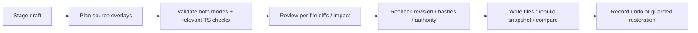

# Inspector drafts and source transactions

Tags use a typed `tags` draft operation for the owning declaration, including all aliases
of shared compute. `server/edits/tags.ts` plans narrow literal changes and
`server/source/tags.ts` supplies conservative editability. Tag changes participate in
normal both-mode review, per-file diffs, stale hashes, refreshed-model validation, guarded
rollback and undo/redo. Stack member overrides are distinct from effective inherited tags;
removal restores inheritance. See [tag authoring](../../framework-studio/declarations-and-tags.md).
The tag Inspector uses labeled key/value inputs, an Add tag action that focuses the new
key, and visible Delete buttons. Validation is associated with its fields; deleting a
row returns keyboard focus to a remaining key or Add tag. Route ownership help stays
inside the Tags disclosure. Its compact heading retains the effective count and any
Modified/Needs attention draft state while collapsed. Registry-backed boolean fields
dispatch through `FieldRow` to the shared switch, including build options and defaults.
An open page with missing tag editability offers
Refresh editor, which reloads its snapshot without writing source; an expired server
session reconnects through a page reload. Refresh is disabled while a draft is dirty.

This is the canonical graph-to-source contract. Creators, trigger editors and resource tools reuse it; they do not gain arbitrary file-writing authority.

Prisma has a separate fixed authority rather than extending the TypeScript configuration
writer. `DatabaseSession` in [database-session.ts](../../../framework-studio/src/database-session.ts)
owns draft text, exact request generations, external-source conflicts and last-valid diagram
identity. CodeMirror retains selection/undo through validation, formatting and explicit
discard; source review remains required before saving. The actual configured Prisma 8
interpreter owns semantic diagnostics. Syntax/local-name suggestions do not promise a
compatible language server or safe rename.

`DatabaseWorkbenchService` in
[database-workbench.ts](../../../framework-studio/server/database-workbench.ts) reviews,
revalidates and hash-guards writes only to `packages/database/prisma/contract.prisma`.
Source success is reported separately from snapshot-refresh failure. It neither generates
artifacts nor applies storage. `DatabaseHistoryService` in
[database-history.ts](../../../framework-studio/server/database-history.ts) runs pinned
Prisma emission/planning in a disposable copy, exposes actual artifact bytes, then installs
only reviewed new files after source/config/history checks, including the bounded imported
configuration helpers used by source validation and copied into offline planning. Existing migration packages
remain immutable; history browsing never executes them. `DatabaseApplicationService` in
[database-application.ts](../../../framework-studio/server/database-application.ts) owns
the separate local target review, typed approval, input/path revalidation and canonical
runner. Empty local initialization has its own metadata-only emptiness check, SQL review and
typed authorization; populated unknown storage remains blocked. Redacted database operation
records survive restart and never replay writes. Database effects and follow-up inspection
failures remain separate. `DatabaseCloudService` and the versioned VPC task add production
inspection/application: read-only metadata preparation pins a named destination and stack-owned
task revision and full launch/log descriptor, showing actual public-IP/subnet/security-group placement (database stays private/IAM), then typed billed inspection returns SQL/source for a separately typed write
approval. Old write-only tasks fail before launch. Full marker/ledger and strict historical
storage checks run under the canonical runner's transaction lock before DDL. Durable task ARN,
request token and CloudWatch evidence survive restart without automatic write retries. Local and production empty initialization share a full-native-operation/SQL-parameter review and under-transaction empty metadata proof; production requires its distinct typed Initialize approval. Populated/partial unknown storage is never adopted or reset. See the
[Database workbench guide](../../framework-studio/database-workbench.md) for precise actions,
evidence and capability limits.

`InspectorDraft` in [draft.ts](../../../framework-studio/src/draft.ts) owns baseline/latest snapshots, staged entries, validation, review and navigation protection. While dirty, the visible graph stays on the baseline. A different snapshot revision marks conflict; it does not auto-merge. Invalid/conflicting drafts cannot apply. An explicit Review against latest source preserves ordinary typed entries and requests a fresh proposal; protected resource/input forms require their own reload. `StudioProvider` in [studio.tsx](../../../framework-studio/src/studio.tsx) connects this lifecycle across routes and browser exit. Draft/history remain in memory; interrupted source writes have a separate durable journal.

During apply, draft setters and discard are inert until the server responds, preserving
the accepted review payload. Network creation/settings and workload placement controls
use the same busy, evaluating, stale and conflict gates as the other Inspectors.

Inspector settings consume `FieldFact` inheritance and source editability. `FIELDS`, `DEFAULT_FIELDS`, `fieldFacts` and `fieldById` in [edits/fields.ts](../../../framework-studio/server/edits/fields.ts) define recognized fields, domains, parsers, source paths and defaults. Add a field through this shared contract rather than a UI-only input. Effective inherited values and authored overrides must remain distinct; removal restores inheritance. Some boolean fields support true/absence rather than explicit false.

Boolean settings reuse `InspectorSwitch` in `InspectorUI.tsx`, including VPC/database
policies and creation forms; toggling stages the owning draft and never applies source.
VPC inspectors contain only network settings and membership, not global workload defaults.
`SharedDefaults.tsx` presents family defaults in their related inspectors; database caller
pool defaults live in Application PostgreSQL's Connection pool defaults and still edit `defaults.database`,
independently of the server policy declaration. See the
[inspector conventions](../../framework-studio/inspector-design.md).

`InterfaceEndpointPicker.tsx` replaces comma entry in VPC editing and creation with
searchable service icons and removable selections. It stages exact endpoint IDs through
the existing network/create drafts. `ModeModel.interfaceEndpointServices` is projected
directly from `INTERFACE_ENDPOINT_SERVICES`, the framework's generated CDK catalog;
`src/endpoint-services.ts` supplies only labels and local artwork. Gateway endpoints keep
their separate controls. An unavailable catalog offers a server restart instruction and
preserves authored selections. The catalog does not verify regional service availability.

The shared [Deployment section](../../../framework-studio/src/views/Deployment.tsx) places the same Dev/Prod cards and scope field on workloads and routes. Route edits target the owning workload. Draft scope previews use each `ModeModel.webSocketApi` flag; saved availability comes from each graph's own target. Catalog/local-service inspectors reuse the cards, with managed ownership explained instead of inventing a deploy field. Catalog availability is not evidence of deployed infrastructure. See the [inspector conventions](../../framework-studio/inspector-design.md).

`EditService` in [transaction.ts](../../../framework-studio/server/edits/transaction.ts) serializes its operations and keeps plans/history. `BatchEditor` in [batch.ts](../../../framework-studio/server/edits/batch.ts) composes field, route, trigger, failure destination, replay wrapper, description, mapping and creation changes into source overrides. Resource and environment details have specialized services with their own validation/private data; see [secrets](../deployment/secrets.md).

`planEdit` in [plan.ts](../../../framework-studio/server/edits/plan.ts) uses [source locations](source-indexing.md), narrow parsing and semantic patches; the shared diff engine preserves interior unchanged runs and emits contextual hunks. [splice.ts](../../../framework-studio/server/edits/splice.ts) replaces/inserts/removes supported literal ranges while preserving surrounding source/quotes. It refuses unsafe computed shapes/comments instead of reprinting entire files.

Comment protection belongs in the shared source operations: inserting the first property
into a commented empty object is refused, and `setProperty` refuses replacing a literal
whose range contains comments. Editors may change a neighboring literal while preserving
comments outside that range. Do not add editor-specific fallbacks that discard this prose.
VPC settings use the registered declaration's source span, including official import
aliases and modules containing multiple declarations; a helper's spelling or file layout
does not identify the declaration to edit.

Plans capture revision and file hashes; both fresh mode evaluations must pass. Canonical source resolution and artifact validation check configured directories, handlers and Dockerfiles against proposed files. Missing implementation is projected independently from declaration validity so repair remains available. Type-aware connection/creation/repair changes use TypeScript checks. Normal Inspector edits preserve target/construct identity. Creation permits expected additions and explicit removal permits only the selected removed identity. Projection-affecting edits, including the legacy route/deployment APIs, run real generation in a private copy and include changed/generated/deleted outputs in review/history. Generator input hashes include existing implementations, contracts and Dockerfiles even when no output changes. Review approval saves authored/generated source; it does not synthesize or deploy infrastructure.

Apply checks source before and after preflight, then checks each write's expected contents. `writeSourceChange` in [io.ts](../../../framework-studio/server/edits/io.ts) distinguishes absent files (`null`) from empty files, creates through an exclusive link, and replaces existing files by temporary-file rename. After refresh, the batch compares relevant actual identities/settings/routes/triggers/creation relationships with the reviewed model.

**Multi-file apply is not a crash-atomic filesystem transaction.** On caught failure it restores written files in reverse only while they still equal its own written contents. Concurrent edits are preserved and can produce `unconfirmed`; inspect those files. Undo/redo uses expected contents and inverse validation, including creator-owned file deletion. Server restart loses in-memory review/history. [journal.ts](../../../framework-studio/server/edits/journal.ts) writes a private fsynced write-ahead source record before batch/resource multi-file writes. An exclusive checkout lock spans writes and post-write verification; competing Studio processes cannot begin another journaled transaction. Begin never reclaims a stale lock. Restart exposes dead-owner records (including a lock acquired before journaling) through Source recovery. Typed Restore source restores matching bytes and preserves later edits; typed Keep current source completes recovery only after current-source revalidation and a fingerprint check. A separate exclusive recovery lock serializes explicit recovery. A shared active registry excludes in-flight transactions across service instances and rejects recovery against them. Record/root/path/symlink validation applies on reads as well as writes. Corrupt metadata or an interrupted recovery lock requires explicit inspection while snapshots remain inspectable and source writes remain blocked. Environment values and database operations have separate service boundaries. Revision/hash checks do not eliminate every external-editor race between a check and rename; editors outside Studio do not honor its lock.

The single-edit API and resource editor follow the same expected-contents write guard during recovery.
Journal records retain per-file authority: recognized native CDK edits first pass the
linked-stack ownership check and record a bounded native source entry; generated/new
files retain creator authority. A mixed native/source/generated transaction can recover
without broadening the normal configuration writer or accepting HTTP-selected paths.
Post-write snapshot exceptions and stale/error models trigger restoration, never a
successful history entry. An external edit or deletion remains untouched and yields
`unconfirmed`. If refresh still fails after recovery, the response distinguishes restored
source from an unavailable snapshot and asks the user to refresh after resolving it.
Resource rollback attempts every written file even when one was externally deleted or
cannot be restored, reports `unconfirmed`, and leaves successful undo history untouched.

Use [extensions](../guides/extensions.md) for new fields. Tests: [plan](../../../framework-studio/test/plan.test.ts), [splice](../../../framework-studio/test/splice.test.ts), [transaction](../../../framework-studio/test/transaction.test.ts), [draft](../../../framework-studio/test/draft.test.ts), [draft UI](../../../framework-studio/test/draft-ui.test.ts), and feature-specific creation/trigger/resource suites. Assert refusal causes zero writes and undo preserves unrelated changes.

Typed VPC removal and managed database settings reuse this batch journal, including
post-apply semantic checks, guarded rollback and undo/redo. VPC removal rescans source
consumers immediately before writing. `ManagedDatabaseInspector.tsx` joins local PostgreSQL
and production RDS, showing independent data, connection paths, the VPC home and consumers.
Policy edits target literal settings. A separate typed `databasePlacement` operation
coordinates the database declaration and the union of normalized database consumers in
both modes, preserving each workload's subnet tier and bindings. `DatabasePlacement.tsx`
offers only registered VPCs and private/isolated subnets; the owning VPC is required.
Computed declarations and competing consumer placement edits are refused. Actual placement
is checked after apply; mismatch uses guarded rollback, and undo/redo restores source.
This edits source only: deployed RDS moves need migration/cutover planning and separately
authorized deployment. Identity and native CDK source remain source-owned. See
[placement and parity](../../framework-studio/network-database-declarations.md).
The [database placement suite](../../../framework-studio/test/database-placement.test.ts)
covers coordinated consumers, policy composition, unsafe-source refusal, post-write rollback
and exact undo/redo without touching a live database.
The
[HTTP response helper](../../../framework-studio/server/http.ts) catches synchronous
validation as well as rejected planning promises. A shared browser/server protocol blocks
incompatible edits with an explicit restart instruction; a Vite refresh does not reload
the running server API.
