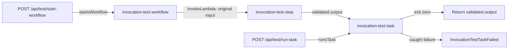

# Framework Studio resource baseline — 2026-10-20

> Historical evidence record. Results and capability assessments apply to the
> dated checkout/campaign below, not automatically to the current tree. For current
> scope use [implementation status](../aws-studio-knowledge/reference/status.md);
> for current procedures use the [documentation index](../README.md).

This records the application's distribution baseline before experiments with Studio
resource creation, Lambda directories, connections, workflows and deployment controls.
Use it to recover the original application resources while keeping later improvements
to the framework and Studio.

## Snapshot and scope

| Item | Recorded baseline |
| --- | --- |
| Exact source revision | `6ea931fc0ae86985615a38214d8f13cd2d30ff7c` (`6ea931f`, commit subject `10/20`) |
| Working tree before analysis | Clean; no uncommitted application changes to capture |
| Checkout actually inspected | `/Users/matt/Desktop/code/framework-fix/matts-aws-framework` |
| User's Windows working location | `D:\code\Agentic + ML\lawstruct.ai base framework port\matts-aws-framework-NEW`; not accessible in this session and not verified to match this revision |
| Evidence | Authored configuration, handler/container/agent source, CDK constructors, Compose, generated declarations, framework normalization |
| Workload inventory | **26 targets: 21 Lambdas, 1 service, 2 tasks, 1 workflow, 1 agent** |
| Lambda breakdown | 10 HTTP, 4 WebSocket routes + 1 authorizer, 4 event handlers, 2 tools; 20 TypeScript ZIP functions and 1 Python container function |
| AWS inspection | No deployed inventory, data backup, deployment, teardown or migration application performed |

The tables describe source at the pinned revision. They do not assert that any resource
currently exists in AWS. Ignored input files, credentials, resolved secret values, CDK
outputs and database contents are intentionally absent. Template settings and code
fallbacks below are distinguishable from private deployment overrides.

Exact implementation bytes remain available from the pinned Git revision, including
files subsequently deleted. The recovery section explains how to retrieve them without
rolling Studio back. Keep this document and that revision available when experimenting;
the document alone is an inventory, not a copy of every implementation file.

## Ownership and source map

| Layer | Baseline source | Responsibility |
| --- | --- | --- |
| Application composition | [framework.config.ts](../../framework.config.ts) | Imports literal section modules as arrays; supplies resources, defaults, network, database and user pool |
| Application declarations | [framework-config/](../../framework-config/) | Routes, functions, containers, graph, tools, agent, resources and presentation metadata |
| Application CDK | [cdk-app/lib/app/](../../cdk-app/lib/app/) | Cognito, RDS, website, frontend destination publishing, reference resources |
| CDK entry and assembly | [cdk-app/bin/](../../cdk-app/bin/), [deployment.ts](../../cdk-app/deployment.ts), [cdk.json](../../cdk-app/cdk.json) | Deployment selection, stack order and names, conditional construction |
| Framework CDK | [cdk-app/lib/framework/](../../cdk-app/lib/framework/) | Builds workloads, triggers, network, IAM, integrations and exports from declarations |
| Lambda implementations | [cdk-app/lambda_functions/](../../cdk-app/lambda_functions/) | HTTP, WebSocket, event and tool source |
| Container implementations | [cdk-app/ecs_containers/](../../cdk-app/ecs_containers/) | One service and two run-to-completion tasks |
| Agent implementation | [agents/example-agent/](../../agents/example-agent/) | Agent adapter, LangGraph graph and streaming contract |
| Local runtime | [docker-compose.yml](../../docker-compose.yml), [Dockerfile.dev](../../Dockerfile.dev), `local-api-dev-server/`, `local-ws-dev-server/`, `local-invocation-runner/` | Development execution and dispatch |
| Data | [packages/database/](../../packages/database/) | Prisma contract, migrations, repositories and local setup jobs |
| Studio | [framework-studio/](../../framework-studio/) | Reads declarations and CDK source, projects the map, applies reviewed source edits; is not a workload owner |

“Application stack” and “framework managed” overlap in places: RDS lives in
`lib/app/rds-stack.ts` and is a catalog stack, but the framework owns workload database
access and Studio marks it managed. Conversely, seeing a catalog stack on the map does
not mean the CDK entry point constructs it.

## Everything under framework-config

The complete module composition is:

| Root property / consumer | Modules and exports in composition order |
| --- | --- |
| `resources` | `resources.ts` → `resources`; also re-exported by `framework.config.ts` |
| `defaults` | `defaults.ts` → `defaults` |
| `network` | `network.ts` → `network` |
| `database` | `resources.rds.database`; the catalog stack is absent in development |
| `userPool` | `resources.cognito.userPool.userPoolId`, `resources.cognito.userPoolClient.userPoolClientId` |
| `http` | `http/auth.ts` → `authRoutes`, `http/graphql.ts` → `graphqlRoutes`, `http/examples.ts` → `exampleRoutes`, `http/workflows.ts` → `workflowRoutes`, `http/tasks.ts` → `taskRoutes` |
| `webSocket` | `websocket/routes.ts` → `webSocketRoutes` |
| `events` | `events/cognito.ts` → `cognitoEvents`, `events/invocation-tests.ts` → `invocationTestEvents` |
| `services` | `services/example.ts` → `exampleService` |
| `tasks` | `tasks/invocation-tests.ts` → `invocationTestTasks`, `tasks/database.ts` → `databaseTasks` |
| `workflows` | `workflows/invocation-tests.ts` → `invocationTestWorkflows` |
| `tools` | `tools/example.ts` → `exampleTools` |
| `agents` | `agents/example.ts` → `exampleAgent` |
| Shared model declarations | `models.ts` → `models`; imported by the example agent section |
| Section typing | `contracts.ts`; type-only aliases derived from the complete resource catalog |
| Studio descriptions | `descriptions.ts` → `descriptions`; canonical entity IDs, documentation only |
| Client environment export recipes | `client-environment.ts` → `clientEnvironment`; consumed by export and Studio, not another workload section |

Section arrays preserve duplicate detection. CDK values are imported **type-only** into
the catalog. Section modules import that catalog directly instead of importing the root
configuration. There are no application-specific dispatch tables to restore in the
generic local servers.

### Compute and connection defaults

| Setting | Baseline |
| --- | --- |
| Lambda | `runtime: "nodejs24"`, `packaging: "zip"`, `architecture: "arm64"` |
| Lambda sizing | 128 MB, 10 seconds |
| ZIP bundling | `minify: true`, `sourceMap: true`; default entry `index.ts`, export `lambdaHandler` |
| Lambda logs | 30 days; framework-created log group and JSON logging |
| Lambda network | `subnet: "none"`; a database declaration lifts inherited `none` to `private` |
| WebSocket section | 3-second timeout, including its authorizer; disconnect explicitly overrides to 10 |
| Containers | `architecture: "x86_64"`, `subnet: "public"`; inherited by service and both tasks |
| Container sizing fallback | 256 CPU units, 512 MiB; explicitly repeated by service and invocation task |
| Database pool | `maxConnections: 10`, `connectionTimeoutMs: 20000`, `idleTimeoutMs: 30000` |

Entry overrides beat section defaults, which beat shared defaults. The Python container
owns its runtime through its Dockerfile; `nodejs24` does not change its Python image.
AgentCore's Node 22 code runtime is also independent of the Lambda default.

### Resource catalog and inputs

Source: [resources.ts](../../framework-config/resources.ts).

| Catalog path | Declaration and public surface | Baseline use |
| --- | --- | --- |
| `referenceExamples` | `resource.stack<ReferenceExampleStack>()`; `documentsBucket`, `recordsTable`, `notificationsTopic`, `processingQueue`, `deadLetterQueue` | Source-visible example resources; no workload consumes them, and the CDK app does not instantiate the stack |
| `cognito` | `resource.stack<CognitoStack>()`; `userPool`, `userPoolClient`, `userPoolDomainUrl`, `oauthProviderRedirectUri`, `trustedOriginsCsv`, `frontendUrl`, `skipEmailVerification` | Application auth, browser settings, triggers and workload user-pool injection |
| `rds` | `PROD_DEPLOYMENT ? resource.stack<RdsStack>() : undefined`; public `database` | Root database binding; development uses Compose PostgreSQL |
| `openaiApiKey` | `resource.secret("OPENAI_API_KEY")` | Example agent receives its ARN through `models.environment` |
| `googleClientSecret` | `resource.secret("GOOGLE_CLIENT_SECRET")` | Cognito Google provider when Google client ID is configured |
| `langgraph.modelProvider` | `fromEnv("LANGGRAPH_MODEL_PROVIDER").enum("bedrock-mantle", "bedrock", "openai").default("bedrock-mantle")` | Agent `MODEL_PROVIDER` |
| `langgraph.bedrockModelId` | `fromEnv("LANGGRAPH_BEDROCK_MODEL_ID").default("global.amazon.nova-2-lite-v1:0")` | Agent `BEDROCK_MODEL_ID` |
| `langgraph.bedrockMantleModelId` | `fromEnv("LANGGRAPH_BEDROCK_MANTLE_MODEL_ID").default("openai.gpt-oss-20b")` | Agent `BEDROCK_MANTLE_MODEL_ID` |
| `langgraph.openaiModelId` | `fromEnv("LANGGRAPH_OPENAI_MODEL_ID").default("gpt-4.1-mini")` | Agent `OPENAI_MODEL_ID` |

These are the catalog's only stack entries, secret entries and input group. There are no
standalone `resource.cdk` entries in this baseline. Stack public constructs and strings
become resources automatically through a constructor's `linkResources` call.

Raw secret inputs belong only in the selected ignored `cdk-app/.env.dev` or `.env.prod`.
`deploy:resources` uploads authored values and supplies secret ARNs. The OpenAI key is
required when the selected provider is `openai`; the Google secret is required when the
Google provider is configured. No secret is embedded in this baseline document.

## Lambda inventory

Every identifier in these tables is a canonical `lambda:<id>` target. Directory values
in configuration have a leading slash but are relative to `cdk-app`, not the OS root.
All TypeScript handler directories currently have their own `package.json` and
`tsconfig.json`; a new handler does not require a manifest unless it needs dependencies
outside the existing workspace installation.

### HTTP Lambdas

Declarations live in `framework-config/workloads/http/`. Every row runs locally in development
and is cloud-enabled for production; development CDK builds none of these functions.
Browser paths prepend `/api` to the declaration path. Unspecified `deploy` resolves to
`both`. “Pool” below means `userPool: true`.

Every implementation directory is `cdk-app/lambda_functions/http_functions/<id>/`.

| Public declaration → target ID | Module | Methods | Gateway auth / Pool | Memory / timeout | Production placement | Construct ID |
| --- | --- | --- | --- | --- | --- | --- |
| `/sign-in` → `sign-in` | `auth.ts` | `*` | No / Yes | 128 / 10s | Outside VPC | `SignIn` |
| `/sign-out` → `sign-out` | `auth.ts` | `*` | No / Yes | 128 / 10s | Outside VPC | `SignOut` |
| `/oauth/callback` → `oauth-callback` | `auth.ts` | `*` | No / Yes | 512 / 30s | Private; database | `OAuthCallback` (explicit) |
| `/verify-session` → `verify-session` | `auth.ts` | GET, POST | Yes / Yes | 128 / 10s | Outside VPC | `VerifySession` |
| `/refresh` → `refresh` | `auth.ts` | `*` | No / Yes | 128 / 10s | Outside VPC | `Refresh` |
| `/mfa` → `mfa` | `auth.ts` | POST | Yes / Yes | 128 / 10s | Outside VPC | `Mfa` |
| `/graphql` → `graphql-api` | `graphql.ts` | GET, POST | Yes / Yes | 512 / 30s | Private; database | `GraphQLApi` (explicit) |
| `/examples/python` → `python-example` | `examples.ts` | POST | Yes / No | 128 / 10s | Outside VPC | `PythonExample` |
| `/test/start-workflow` → `test-start-workflow` | `workflows.ts` | POST | Yes / Yes | 256 / 15s | Outside VPC | `TestStartWorkflow` |
| `/test/run-task` → `test-run-task` | `tasks.ts` | POST | Yes / Yes | 256 / 15s | Outside VPC | `TestRunTask` |

HTTP resource dependencies and behavior:

| Target | Environment, grants and implementation details |
| --- | --- |
| `sign-in` | `TRUSTED_FRONTEND_ORIGINS ← cognito.trustedOriginsCsv`; Cognito sign-in/challenges and session cookies; adjacent `contract.ts` |
| `sign-out` | Same trusted-origins reference; clears cookies and revokes refresh token |
| `oauth-callback` | Same trusted-origins reference plus `COGNITO_DOMAIN_URL ← cognito.userPoolDomainUrl`; `database: true`; exchanges hosted-UI code, verifies token and ensures the application user |
| `verify-session` | Trusted origins, authenticated session verification |
| `refresh` | Trusted origins, refresh-cookie session renewal |
| `mfa` | Trusted origins; literal `MFA_ISSUER: "matts-aws-framework"`; `cognito.userPool.grant("cognito-idp:AdminGetUser")`; adjacent `contract.ts` |
| `graphql-api` | `database: true`; `GRAPHQL_GRAPHIQL_ENABLED` is `true` in dev, `false` in prod; `GRAPHQL_PERSISTED_DOCUMENTS_ONLY: "false"`; ZIP source maps disabled; Pothos schema in `schema/`, features `user.ts` and `project.ts`, registered by `schema/index.ts` |
| `python-example` | `packaging: "container"`; `Dockerfile` uses `public.ecr.aws/lambda/python:3.13`; entry `lambda_function.py`, export `lambda_handler`; adjacent `contract.schema.json` and Python tests; local execution uses the container lane |
| `test-start-workflow` | Explicit `deploy: "both"`; trusted origins; `startsWorkflow("invocation-test-workflow")`; authenticated handler returns 202 and execution identity |
| `test-run-task` | Explicit `deploy: "both"`; trusted origins; `runsTask("invocation-test-task")`; authenticated handler returns 202 and run identity |

Requested HTTP ARN output IDs are `SignInLambdaArn`, `SignOutLambdaArn`,
`OAuthCallbackLambdaArn`, `VerifySessionLambdaArn` and `RefreshLambdaArn` on their
corresponding auth routes. These workload output specs have no explicit export name;
other HTTP entries request no custom outputs. Preserve these IDs and the separate
stack-prefixed exports explicitly declared by other stacks.

The pool flag injects `USER_POOL_ID` and `USER_POOL_CLIENT_ID` from the root binding;
it does not grant arbitrary Cognito administration. HTTP authentication requirements
and handler verification are separate declarations. Preserve both for authenticated
handlers when restoring.

### WebSocket functions

Source: [websocket/routes.ts](../../framework-config/workloads/websocket.ts).
All five functions use ZIP/Node 24/ARM64/128 MB/30-day logs, outside the VPC. No route
declares database access, invocation bindings or `manageConnections`.

Every implementation directory is `cdk-app/lambda_functions/websocket_functions/<id>/`.

| Route / role | Target ID | Timeout | Construct ID | ARN output ID |
| --- | --- | --- | --- | --- |
| `$connect` | `ws-connect-route` | 3s | `ConnectRouteFunction` | `ConnectRouteFunctionArn` |
| `$connect.authorizer` | `ws-authorizer` | 3s | `AuthorizerFunction` | `AuthorizerFunctionArn` |
| `$default` | `ws-default-route` | 3s | `DefaultRouteFunction` | `DefaultRouteFunctionArn` |
| `$disconnect` | `ws-disconnect-route` | 10s | `DisconnectRouteFunction` | `DisconnectRouteFunctionArn` |
| `customAction` | `ws-custom-action-route` | 3s | `CustomActionRouteFunction` | `CustomActionRouteFunctionArn` |

The authorizer declares `userPool: true`. It verifies connection identity before
`$connect`; the principal/context reach later route events. These are demonstration
handlers, with no persistent connection registry or declared broadcast capability.
The API routes messages by `$request.body.action`, uses stage construct `ProdStage`
with literal stage name `prod` in either graph, and publishes `WebSocketAPIEndpoint`.

Local WebSocket execution is available independently of AWS deployment. Both AWS
WebSocket stacks are constructed only when `DEPLOY_PROD_WEBSOCKET_API` is enabled for
the selected deployment, including in development. Both committed input templates set
that flag to `false`; private input-file overrides were not inspected.

### Event Lambdas

Declarations: [events/cognito.ts](../../framework-config/workloads/events.ts) and
[events/invocation-tests.ts](../../framework-config/workloads/events.ts).
Directories are inferred as `cdk-app/lambda_functions/event_functions/<id>/`.
All four are built in both AWS graphs and have no per-event `deploy` toggle.

| Target ID | Construct ID | Memory / timeout | Native caller and dependencies |
| --- | --- | --- | --- |
| `cognito-pre-signup-trigger` | `CognitoPreSignUpTrigger` (explicit) | 128 / 10s | Cognito pre-sign-up; `SKIP_EMAIL_VERIFICATION ← cognito.skipEmailVerification`; account-linking/verification logic |
| `cognito-custom-message` | `CognitoCustomMessage` | 128 / 10s | Cognito custom-message; `FRONTEND_URL ← cognito.frontendUrl` |
| `cognito-post-confirmation-trigger` | `CognitoPostConfirmationTrigger` | 512 / 30s | Cognito post-confirmation; `database: true`, `localReplay: true`, source maps disabled; `withLocalReplay` wrapper ensures the application user |
| `invocation-test-step` | `InvocationTestStep` | 128 / 10s | Workflow validation step; no replay, database, custom environment or extra permission |

Pre-sign-up grants `cognito-idp:AdminLinkProviderForUser`, `ListUsers` and
`ListIdentityProviders` on `arn:{partition}:cognito-idp:{region}:{account}:userpool/*`.
It does not need a configured pool ID injected into its environment: Cognito's event
identifies the invoking pool.

Post-confirmation is the **only** replay-enabled application event. In development its
AWS function captures the event to replay infrastructure, and the local handler writes
to PostgreSQL; it does not require a development AWS VPC or database. Production runs
the real database handler in private subnets. The other event functions are outside
the VPC. Event local executability does not make Cognito invoke the local process.

`invocation-test-step` requires a truthy `message` and returns exactly
`{ validatedBy: "invocation-test-step" }`. It exists in development AWS even though
the example state machine runs locally in development.

### AgentCore Lambda tools

Source: [tools/example.ts](../../framework-config/workloads/tools.ts).
Directories: `cdk-app/lambda_functions/tool_functions/<id>/`, with `index.ts`,
`contract.ts`, `package.json` and `tsconfig.json` in each.

| Target ID | Construct ID | Request | Response |
| --- | --- | --- | --- |
| `add-numbers` | `AddNumbers` | `{ a: number, b: number }` | `{ sum: number }` |
| `multiply-numbers` | `MultiplyNumbers` | `{ a: number, b: number }` | `{ product: number }` |

Both use `tool(contract, handler)` without `auth: true`: arithmetic is a service tool,
and the agent/Gateway boundary controls invocation. They inherit the Lambda defaults,
use no database or extra resource bindings, and follow their consuming agent's
deployment lanes. There is no independently authored tool `deploy` setting.

## Containers, workflow and agent

### Long-running ECS service

Source: [services/example.ts](../../framework-config/workloads/services.ts).

| Property | Baseline |
| --- | --- |
| Route / canonical target | `/example-service/*` / `service:example-service` |
| Implementation | `cdk-app/ecs_containers/services/example-service/src/index.ts` |
| Build files | **Lowercase** `dockerfile`, `scripts/build.mjs`, `package.json`, `tsconfig.json` |
| Deployment | `local-only`; no production service, service cluster, load balancer or service VPC link is constructed at baseline |
| HTTP | All methods, port 5000, health path `/health`, `auth: true`, `userPool: true` |
| Cloud settings retained for future enablement | `constructId: "ExampleService"`, CPU 256, memory 512 MiB, desired count 1; inherited public subnet and x86_64 |
| Load balancer if enabled | Internal ALB by default (`publicLoadBalancer: false`), reached by HTTP API VPC link |
| Output if enabled | URL output ID `ExampleServiceUrl` |
| Database / custom bindings | None |

The Express service exposes `GET /health` without handler auth, `GET /hello` with token
verification, and `POST /greet` with token verification and a validated 1–100 character
name. `/api/example-service` is stripped by the proxy before the request reaches it.
The public mount still enforces route auth, including requests targeting `/health`;
internal health probes reach the service directly.

The production Dockerfile builds from repository root using Node 24 and npm workspaces,
then runs the built service. Local Compose instead uses `Dockerfile.dev` and the
workspace dev command through `packages/framework/scripts/run-service.ts`.
`docker-compose.services.yml` and the service `.env.example` are generated artifacts.
Customize the declaration, `x-framework-service` in authored Compose, or a Compose
override rather than editing the generated file.

### Run-to-completion ECS tasks

| Property | `task:invocation-test-task` | `task:db-migrate` |
| --- | --- | --- |
| Declaration | `tasks/invocation-tests.ts` | `tasks/database.ts` |
| Directory | `cdk-app/ecs_containers/tasks/invocation-test-task/` | `cdk-app/ecs_containers/tasks/db-migrate/` |
| Entrypoint | `src/index.ts` | `migrate.ts` |
| Build | `Dockerfile`; own workspace manifest and tsconfig | `Dockerfile`; no own package manifest |
| Deployment | `both`: local runner in dev; AWS in prod | `cloud-only`: absent from local target lane and development AWS graph |
| Construct ID | `InvocationTestTask` | `DbMigrate` |
| CPU / memory | 256 / 512 MiB, explicitly declared | 256 / 512 MiB, framework fallback |
| Architecture / subnet | x86_64 / public | x86_64 / public |
| Database | None | `{ connection: "direct" }`, bypassing any optional proxy |
| Behavior | Reads `FRAMEWORK_TASK_INPUT`, waits 10 seconds, logs supplied/defaulted fields, exits; answers callback if a callback-enabled caller supplies one | Resolves IAM database URL, runs `npm --workspace @repo/database run db:migrate -- --no-interactive`, forwards exit status |

Neither task is a continuously running service or exposes a port. Both Dockerfiles use
repository-root build context and Node 24. `EcsTasksStack` owns cluster construct
`EcsTasksCluster`, per-target task definitions, execution roles, application task roles,
logs, security groups and launch descriptors. Public placement gives a launched task
public egress; it does not expose the isolated database or create inbound task rules.
The service cluster is separate and absent at baseline.

Only the migration task and database-using Lambdas receive database connectivity/IAM
login grants. Workloads never receive the database master password. Running the
migration task is an environment-specific action, not part of restoring these files.

### Example workflow and invocation connections

Source: [workflows/invocation-tests.ts](../../framework-config/workloads/workflows.ts).
Target `workflow:invocation-test-workflow`, construct ID `InvocationTestWorkflow`,
`deploy: "both"`, total timeout **900 seconds**. A workflow has no implementation directory.



The graph sequences `invokeLambda`, an `attempt(runTask(...))` with **600-second** task
timeout, and `succeed(validated.output)`. Failure uses error `InvocationTestTaskFailed`
and cause `invocation-test-task did not exit zero.` Workflow permissions derive from
its steps; the starter has only its own `startsWorkflow` binding. The direct task
starter has only its own `runsTask` binding.

The task receives the **validation result**, not the original message: the validation
Lambda returns only `validatedBy`, so the workflow task logs its fallback message and
generates a task ID. Direct task invocation can supply message/task/caller fields.
Preserve this distinction when checking a restoration; it is the current behavior.
The workflow waits for process completion, not the optional callback path in task code.

Development uses the local interpreter, Lambda executor and Docker task runner;
production compiles Step Functions and ECS integration. No managed-service workflow
integration, callback binding or development bridge is declared in this application.

### Example agent and shared model access

Source: [agents/example.ts](../../framework-config/workloads/agents.ts),
[models.ts](../../framework-config/shared/models.ts), [agent implementation](../../agents/example-agent/).

| Property | Baseline |
| --- | --- |
| Canonical target / construct ID | `agent:example-agent` / `ExampleAgent` |
| Directory declaration | `/agents/example-agent`, relative to **repository root**, unlike Lambda/container directories |
| Entrypoint and graph | `index.ts` exports `handler`; `graph.ts` implements the assistant/tool loop; `contract.ts` declares request/events |
| Browser route | `/chat/example` exactly; no `/api` prefix |
| Auth / deployment | `auth: true`, `deploy: "both"`; root pool is supplied automatically |
| Gateway tools | `add-numbers`, `multiply-numbers`; no other workload invocation bindings |
| Local execution | Session process per conversation; runner emulates the Gateway and executes real tool handlers |
| Production execution | AgentCore Runtime code asset, Node 22 bundle; one AWS-IAM-authorized MCP Gateway with its declared Lambda targets |
| Session defaults | 900-second idle timeout, 28,800-second maximum lifetime |
| Conversation persistence | LangGraph `MemorySaver` in the session process; not a durable database resource |

The streaming contract accepts `message`, `resume` and `history`; emits `delta`,
`message`, `interrupt`, `history` and `refused` (`NO_PENDING_INTERRUPT`). The graph
also has an in-process human-confirmation tool; it is not a third catalog Lambda tool.

`models.environment` maps `MODEL_PROVIDER`, `BEDROCK_MODEL_ID`,
`BEDROCK_MANTLE_MODEL_ID`, `OPENAI_MODEL_ID` and `OPENAI_API_KEY_SECRET_ARN` to the catalog
references listed earlier. Model access is shared by declaration:

- `bedrock:InvokeModel`, `bedrock:InvokeModelWithResponseStream` on foundation models
  and account inference profiles across regions.
- `bedrock-mantle:CreateInference` on the region/account `project/default`.
- `bedrock-mantle:CallWithBearerToken` on `*`, since this action has no resource scope.
- Secret ARN reference derives Secrets Manager read access. The conditional OpenAI
  requirement is declared alongside the model environment/access.

The Runtime role can reach its own Gateway; Gateway/tool invocation permissions derive
from the declared tool list. Production also constructs the framework's Runtime
metadata provider/custom resources. Those supporting functions are not extra
application Lambda targets.

## Application stacks and native AWS resources

### ReferenceExampleStack — declared but not instantiated

Source: [reference-example-stack.ts](../../cdk-app/lib/app/reference-example-stack.ts).
Catalog entry `resources.referenceExamples` links its five public fields, but
`cdk-app/bin/cdk-app.ts` does **not** import or construct this stack. Restoring the
baseline must leave that distinction intact. The class's old comment saying nothing
is registered with framework config is stale: the catalog entry and link do exist.

| Construct ID / public field | Configuration |
| --- | --- |
| `DocumentsBucket` / `documentsBucket` | S3, block public access, S3-managed encryption, enforce SSL, versioning; expire noncurrent versions after 30 days, abort incomplete multipart uploads after 7 days; EventBridge notifications set directly on the CFN bucket; no object auto-delete helper |
| `RecordsTable` / `recordsTable` | DynamoDB `TableV2`, on-demand billing; string partition `pk`, sort `sk`; TTL `expiresAt`; stream `NEW_AND_OLD_IMAGES`; GSI `byStatus` with string `status` / `updatedAt`, projection `ALL`; PITR follows retention flag |
| `ProcessingDeadLetterQueue` / `deadLetterQueue` | SQS, 14-day retention, enforce SSL |
| `ProcessingQueue` / `processingQueue` | SQS, 60-second visibility, 4-day retention, enforce SSL; DLQ after 3 failed receives |
| `NotificationsTopic` / `notificationsTopic` | SNS display name `Reference example notifications`; subscription to processing queue with raw delivery |
| `UploadCreatedRule` | EventBridge `aws.s3` / `Object Created`, matching this bucket and `uploads/` object-key prefix; targets SNS topic |
| `HourlySweepRule` | Rate 1 hour; targets topic with `{ kind: "hourly-sweep", firedAt: EventField.time }` |
| `ProcessingQueueUrlParameter` | SSM string parameter `/<stackName>/processing-queue-url`, value from queue URL |
| `DeadLetterQueueAlarm` | CloudWatch visible DLQ messages, 5-minute Maximum, threshold ≥1, one evaluation period, missing data not breaching; no alarm action configured |

The native flow is `S3 uploads/ → EventBridge rule → SNS → SQS → DLQ after 3 receives`;
the hourly rule also publishes to SNS. There is **no** queue consumer, S3 Lambda
notification, DynamoDB stream consumer or framework event-source mapping attached.
The DynamoDB table is otherwise independent of the messaging flow.

`retainStatefulResources` defaults to `false` here: bucket/table use `DESTROY`, or
`RETAIN` when enabled. Queue/topic constructors do not apply that flag. Bucket objects
must be emptied manually before deletion when this example is actually deployed.
Outputs `DocumentsBucketName`, `RecordsTableName`, `NotificationsTopicArn`,
`ProcessingQueueUrl`, `DeadLetterQueueUrl` all export as `<stackName>:<outputId>`.

### CognitoStack — constructed in both graphs

Source: [cognito-stack.ts](../../cdk-app/lib/app/cognito-stack.ts).
Public fields are the seven catalog members listed above. Native resources are:

- `UserPool`: stack-prefixed pool name, email sign-in, case insensitive, self-sign-up,
  auto-verified email, required mutable email/given/family names; changed email remains
  original until verification. Password minimum 12 without character-class rules;
  optional authenticator TOTP, no SMS, email-only recovery.
- Trigger attachments to the three declared Cognito event targets. Keep event
  construction before pool construction.
- `UserPoolDomain`: hosted prefix or custom domain with imported ACM certificate.
- Optional `Google` identity provider when credentials are configured, with
  `openid/email/profile`, including mapped provider-verified email.
- `UserPoolClient`: no generated client secret; SRP/password flows, authorization-code
  OAuth, five-minute auth challenge validity, one-hour ID/access tokens, 30-day refresh
  tokens, ten-second rotation grace, token revocation and existence-error prevention.

Despite a stale entry-point comment mentioning an identity pool, this stack creates
**no Cognito Identity Pool**. Its public string fields carry resolved frontend/domain
settings, not secret contents. Google credentials resolve through the catalog secret.
SES sender and frontend/domain settings come from deployment inputs; imported
certificates, SES identities and external Google configuration are not created here.

Pool deletion protection/removal follow `retainStatefulResources` (constructor
fallback false). Outputs: `UserPoolId`, `UserPoolClientId`, `UserPoolDomainUrl`,
`OAuthProviderRedirectUri`; custom domain adds `UserPoolDomainCloudFrontEndpoint`.
The first two have no explicit export name; the others use stack-prefixed exports.

### RdsStack — production only, framework-managed access

Source: [rds-stack.ts](../../cdk-app/lib/app/rds-stack.ts),
[database-settings.ts](../../cdk-app/database-settings.ts),
[framework-database.ts](../../cdk-app/lib/framework/framework-database.ts).

| Resource / setting | Baseline source behavior |
| --- | --- |
| Public `database` / `PostgresDatabase` | PostgreSQL writer in framework VPC isolated subnets; database `app_db`; private, encrypted, IAM authentication |
| Writer fallback / prod template | `db.t3.micro`, PostgreSQL `16`, gp2 20 GiB, autoscale maximum 100 GiB, single AZ |
| Backup fallback / prod template | 7 days; automated backups retained on instance deletion; optional backup/maintenance windows |
| Upgrades | Major upgrade opt-in false; automatic minor upgrades true; apply-immediately unset by fallback |
| Read replicas | Count 0 by fallback/template; optional `ReadReplica1`… in isolated subnets, private and IAM-authenticated |
| Proxy | Disabled by fallback/template; optional `DatabaseProxyRole` and `DatabaseProxy`, isolated, TLS, IAM auth; max connections 90%, borrow timeout 15s, idle-client timeout 1800s |
| Master secret | RDS-generated `postgres` credentials, not an authored workload secret or public catalog secret field |
| IAM application login | `app_user`; `FrameworkDatabaseLogin` custom resource and provider initialize it using the generated master secret |
| Log settings | No exports by fallback; accepted `postgresql,upgrade`, 30-day retention when exported |
| Stateful removal | Retention flag enables protection/RETAIN; otherwise writer final SNAPSHOT, generated secret DESTROY; replicas RETAIN or DESTROY |
| Public output | `RdsDatabaseEndpoint`, export `<stackName>:RdsDatabaseEndpoint` |

`bindPostgresDatabase` registers writer/proxy/readers for workload access. Only
`database: true` or its options supply connection settings, network admission and
`rds-db:connect`; the database master secret is used by setup infrastructure, not
handed to application workloads. The migration task explicitly chooses the direct
writer. Exact private database overrides are outside this source snapshot.

Baseline application schema is `User` (`users`) and `Project` (`projects`) in
[contract.prisma](../../packages/database/prisma/contract.prisma): unique Cognito sub
and email for users; projects have owner, name, archived flag and timestamps, an owner
index and cascade-delete relation to users. Committed migration packages are
`20260831T0358_init`, `20260831T2122_drop_user_profile_picture`,
`20260916T1757_add_projects`, with adjacent migration snapshots. Preserve these if
restoring the GraphQL/user/project examples. Restoring source does not reverse an
already applied migration or recover records.

### FrontendWebsiteS3Stack and FrontendRouting — production only

Sources: [website stack](../../cdk-app/lib/app/frontend-website-s3-stack.ts),
[routing construct](../../cdk-app/lib/app/frontend-routing.ts),
[routing handler](../../cdk-app/lib/app/frontend-routing-handler.ts).

The website owns `FrontendWebsiteBucket` (private, S3-managed encryption, SSL,
`DESTROY`, auto-delete objects), CloudFront distribution, S3 origin access control,
bucket read policy, SPA request-rewrite function and security response-headers policy.
CloudFront is explicitly enabled by the application. A custom domain imports its
certificate; the default generated-domain path owns `FrontendRoutingStore`.

`addApiOrigin` serves same-origin `/api` and `/api/*`, strips `/api` before HTTP API,
and uses an uncached API origin. `addAgentOrigins` creates streaming route behaviors
for `/chat/example` with the appropriate origin request policy. Generated-domain
request functions read backend destinations from the KeyValueStore, avoiding a
website → Cognito → backend → website dependency cycle; missing destinations return 503.

`FrontendRouting` is a **construct in HttpApiGatewayStack**, not a standalone stack.
It creates `RoutingHandlerLogs` (one week), Node 24 `RoutingHandler` (two-minute timeout),
`RoutingProvider`, and `RoutingEntries` (`Custom::FrontendRouting`). Its handler is
outside the application Lambda directory. It writes `http-api` and
`agent:/chat/example` destinations with scoped Describe/List/Update KeyValueStore
permissions once API resources exist. Custom-domain routing references backends directly.

Website outputs: `CloudFrontUrl`, `CloudFrontDomainName`, `CloudFrontId`,
`FrontendWebsiteBucketName`, `FrontendWebsiteBucketArn`, all stack-prefixed exports.
This stack is not a `resources.ts` catalog entry at baseline; Studio can still project
it from its output/source evidence.

## Framework-built stacks and supporting infrastructure

All stack IDs are `<deploymentName>-<suffix>`. Preserve the suffixes, stack scopes,
construct IDs and output naming when moving source. A directory move is not permission
to rename a deployed construct.

| Stack suffix | Development AWS graph | Production AWS graph | Source and contents |
| --- | --- | --- | --- |
| `CognitoStack` | Yes | Yes | Application identity stack described above |
| `AsynchronousLambdaFunctionsStack` | Yes | Yes | `event-lambda-functions-stack.ts`; four declared events. The class is `EventLambdaFunctionsStack`, but the historical deployed suffix stays **AsynchronousLambdaFunctionsStack** |
| `DevLambdaReplayStack` | Yes | No | Replay S3 bucket, SQS queue and DLQ; S3 object-created notification to queue; captured object expiry 7 days, queue visibility 5 minutes, DLQ after 5 receives, DLQ retention 14 days; notification/auto-delete helpers, policies and outputs |
| `FrontendWebsiteS3Stack` | No | Yes | Website and optional routing store |
| `NetworkStack` | No | Yes | Lazily created by production VPC consumers; subnet/gateway/endpoint constructs and security groups |
| `RdsStack` | No | Yes | Writer and database setup described above |
| `EcsTasksStack` | No | Yes | Two task definitions, own cluster, roles, images, logs and launch descriptors; tasks are not started by construction |
| `WorkflowsStack` | No | Yes | `orchestration-stack.ts`; example workflow and AgentCore Runtime/Gateway/two tools. Historical stack name is retained despite the `OrchestrationStack` class name |
| `SynchronousLambdaFunctionsStack` | No | Yes | Ten HTTP functions, bundled/container assets, execution roles, policies, logs and requested outputs |
| `HttpApiGatewayStack` | No | Yes | HTTP API, `$default` stage, access logs, Cognito authorizer, routes and Lambda integrations; frontend routing publisher when needed |
| `WebSocketLambdaFunctionsStack` | Only with WS flag | Only with WS flag | Five WebSocket/authorizer functions and requested outputs |
| `WebSocketApiStack` | Only with WS flag | Only with WS flag | API, authorizer, route integrations/responses, `prod` stage and endpoint output |
| `EcsServicesStack` | No | No at baseline | Defined framework capability; skipped because example service is local-only |
| `WorkflowBridgesStack` | No at baseline | No | Development-only HTTPS/explicit-AWS-operation bridge capability; no such integrations declared |
| `ReferenceExampleStack` | No | No | Catalog/source example only; no constructor in app |

The default-template graphs therefore construct three stacks in development and nine
in production, plus the two optional WebSocket stacks when enabled. This is a
source-derived count, not a live CloudFormation inventory.

Replay output IDs are `ReplayBucketName`, `ReplayQueueUrl`, `ReplayQueueArn` and
`ReplayDeadLetterQueueUrl`, each with a stack-prefixed export. The HTTP API publishes
stack-prefixed `HttpApiUrl`; WebSocket publishes `WebSocketAPIEndpoint` without an
explicit export. Tasks publish `InvocationTestTaskLaunchDescriptor` and
`DbMigrateLaunchDescriptor`, marked by descriptions
`framework:task-launch:v1:<task-id>`. Deployment ownership is recorded through the
`framework:deployment:v1` output marker. Keep these discovery contracts intact.

There are more AWS Lambda functions than the **21 declared application targets** when
CDK helpers are included. Preserve their owners instead of adding them as application
declarations: S3 notification/auto-delete providers, the database login handler/provider,
frontend routing handler/provider, and AgentCore metadata handler/completion/provider
(including the provider's waiter machinery). IAM roles/policies, log groups,
security-group rules, Lambda invoke permissions and asset references are also generated
beside their owners. Exact CloudFormation logical IDs and helper counts require synthesis;
this document does not fabricate them from class names.

### Construction order and connections across stacks

`cdk.json` launches `bin/main.ts`, which resolves deployment mode/inputs through
`bin/app.ts` **before** loading the conditional catalog, then loads `bin/cdk-app.ts`.
The baseline application assembly is:

1. Initialize framework resources; validate configuration and cloud edges.
2. Production website first; resolve the common frontend/auth settings from its URL.
3. Development replay foundation; production RDS/network; production tasks (dependent
   on RDS when present).
4. Event functions using historical stack identity; development replay dependency.
5. Cognito with native trigger attachments to the already-built event functions.
6. Application-stack insertion point, currently empty: **no ReferenceExampleStack**.
7. Production orchestration after events/tasks/Cognito; workflows and agents share one
   stack so invocation relationships can be supported without cross-stack cycles.
8. HTTP/WebSocket/service factories and APIs; caller descriptors reference task/workflow
   registries. HTTP API depends on RDS where present.
9. Website API/agent routing, dynamic routing publisher when needed, then
   `finalizeFrameworkResources` resolves deferred references, permissions and bindings.

The reference resource flow is native CDK source wiring; workflow/task starter edges
are declared framework bindings; database/user-pool edges are derived from their opt-in
flags. Studio distinguishes these evidence types. It does not infer a Lambda consumer
just because a stack contains a queue or DynamoDB stream.

### Production network

Source (migrated to an explicit VPC): [application/index.ts](../../framework-config/networks/application/index.ts), implemented by
[framework-network.ts](../../cdk-app/lib/framework/framework-network.ts).

- CIDR `10.0.0.0/16`, two availability zones, public/private/isolated subnet terraces,
  dual-stack networking and internet gateway.
- Shared subnet layout names/masks are `public` `/24`, `private` `/20`, `isolated`
  `/24`; preserve these and the `S3`/`DynamoDB` endpoint construct keys for identity.
- IPv6 egress-only internet gateway **on**; IPv4 NAT gateway **off**.
- Gateway endpoints for S3 and DynamoDB **on**; interface endpoints list **empty**.
- Database writer and any replicas/proxy are isolated; OAuth, GraphQL and real
  post-confirmation Lambdas resolve to private; tasks resolve to public.
- The IAM-login setup handler uses framework database-client placement. Egress,
  security groups and database admission derive from the framework; no workload
  manually sets CDK VPC/subnets/security groups.

There is no development AWS VPC. Local execution uses Compose networking and
PostgreSQL. Changing production subnet placement or endpoint/NAT policy changes the
connectivity assumptions; keeping the original directories alone would not restore them.

## Environment, client mappings and local containers

### Deployment selection and input ownership

[cdk-app/cdk.json](../../cdk-app/cdk.json) commits production target `my-aws-app-prod`,
mode `prod`, region `us-east-1`, pinned account and inputs `cdk-app/.env.prod`.
Development identity comes from `CDK_APP_NAME` in `.env.dev` (template: `my-aws-app`),
unless an explicitly selected target supplies it. Do not infer the active private
deployment name or AWS state from these template examples.

| File / source | Ownership and restoration rule |
| --- | --- |
| `cdk-app/.env.dev.template`, `.env.prod.template` | Tracked input references; template WS flag false; production database defaults recorded above |
| `cdk-app/.env.dev`, `.env.prod` | Ignored private authored inputs, including secrets; preserve separately; never recover from generated outputs or commit into documentation |
| Root `.env` | Generated development Compose/auth/replay/port controls; not a resource input source |
| `.framework/local/resources.json` | Generated development resource/invocation identifiers, no raw secret values |
| `.framework/prod/outputs.json` | Generated public production exports/publishing identifiers |
| `client-app/.env` | Browser-public authored file; generated `.env.*.local` settings take precedence |
| `client-app/.env.development.local`, `.env.production.local` | Generated by output export from the matching deployment |
| `framework-config/client-environment.ts` | Tracked symbolic export recipes, shown below |

Custom domains/certificates, SES sender, Google client ID, stateful retention and
deployment-wide flags are interpreted in `cdk-app/deployment.ts`. Raw credential
values and imported certificate ARNs are not copied here. Both templates default to
no custom Cognito domain; production defaults to no custom frontend domain. Development
template enables skipped email verification; production validation restricts that setting.

### Every client export mapping

| Variable | Development recipe | Production recipe |
| --- | --- | --- |
| `VITE_API_GATEWAY_URL` | HTTP localhost endpoint using `LOCAL_API_DEV_SERVER_HOST_PORT`, with `VITE_API_GATEWAY_URL` input override | `FrontendWebsiteS3Stack` output `CloudFrontUrl`, fallback `FrontendWebsiteUrl` |
| `VITE_LOCAL_WS_URL` | WS localhost endpoint using `LOCAL_WS_DEV_SERVER_HOST_PORT` | Empty |
| `VITE_API_GATEWAY_WS_URL` | Optional `WebSocketApiStack.WebSocketAPIEndpoint` | Same optional output |
| `VITE_WS_TESTER_URL` | HTTP localhost endpoint using `WS_TESTER_HOST_PORT` | Empty |
| `VITE_AWS_REGION` | Cognito stack deployment region | Same selected deployment source |
| `VITE_USER_POOL_ID` | `CognitoStack.UserPoolId` | Same output in production deployment |
| `VITE_USER_POOL_CLIENT_ID` | `CognitoStack.UserPoolClientId` | Same output in production deployment |
| `VITE_COGNITO_DOMAIN` | `CognitoStack.UserPoolDomainUrl` | Same output in production deployment |

Recipes resolve only during export. Studio edits/review do not themselves export,
synthesize or deploy. Keep browser requests same-origin `/api` and Vite `base=/`.

### Local execution resources outside the workload catalog

Authored [docker-compose.yml](../../docker-compose.yml) includes generated
`docker-compose.services.yml`. These Compose services are not additional ECS targets:

| Service | Purpose and source |
| --- | --- |
| `postgres` | `postgres:16`, database `app_db`, port 5432 internally, persistent named volume **postgres_data** |
| `prisma-migrate` | Local schema synchronization from committed database migrations; `PRISMA_LOCAL_SCHEMA_SYNC` defaults to migrate, optional explicit push mode |
| `prune-cognito-orphans` | After migrations, removes local users absent from the selected dev pool only after a successful full pool listing |
| `seed-test-user` | After prune, uses authored dev test-user inputs to establish the dev Cognito account/local row |
| `local-invocation-runner` | `local-invocation-runner/src/index.ts`; internal 8090, loopback host binding, Docker socket for task/container-Lambda execution |
| `local-api-dev-server` | TypeScript HTTP dispatcher/proxy, internal 8080 |
| `local-ws-dev-server` | WebSocket route executor, internal 8081; internal management endpoint for framework WebSocket transport |
| `ws-tester` | Browser WebSocket test UI, internal 3001 |
| `pgadmin` | `dpage/pgadmin4`, internal 80, loopback host binding, `pgadmin/servers.json` read-only |
| `example-service` (generated) | Framework-declared service, internal 5000, generated run-service command and `/health` probe |

Development template host ports are API 8080, WebSocket 8081, runner 8090, tester 3001,
PostgreSQL 5432 and pgAdmin 5050. React client runs separately with `npm run dev:client`;
Studio runs separately with `npm run studio` (default 4590), neither as a baseline ECS
resource. Starting Compose is not purely an inspection action: its setup jobs may
migrate local data, prune local users and create/reset the configured dev test account.

Images own installed dependencies and generated database artifacts. Compose Watch
syncs authored source and restarts on declaration/framework changes, excluding host
dependencies, env files and generated database artifacts; the invocation runner has a
separate sync policy for workload image inputs. Keep read-only AWS/input/resource
mounts and do not mount the whole checkout over image dependencies. Preserve
`postgres_data` when rebuilding local containers. Image cleanup remains scoped to
framework/Compose labels and unforced.

## Restoring the application baseline after experiments

The objective is to restore these application declarations and example implementations
while retaining newer Studio and framework capabilities. A whole-repository reset
would also discard the work this baseline is intended to support.

### Recover exact source without touching the experimental checkout

The following read-only export uses only tracked source from the pinned revision and
excludes ignored secrets/data/outputs. Run from the repository root; both PowerShell
and POSIX shells accept this single-line command:

```sh
git archive --format=zip --output=../framework-resource-baseline-2026-10-20.zip 6ea931fc0ae86985615a38214d8f13cd2d30ff7c framework.config.ts framework-config cdk-app/lib/app cdk-app/bin cdk-app/deployment.ts cdk-app/database-settings.ts cdk-app/cdk.json cdk-app/.env.dev.template cdk-app/.env.prod.template cdk-app/lambda_functions cdk-app/ecs_containers agents packages/database docker-compose.yml docker-compose.services.yml Dockerfile.dev package.json package-lock.json
```

This is a recovery recipe; the archive was not created during this documentation task.
Alternatively inspect an individual original file using
`git show 6ea931fc0ae86985615a38214d8f13cd2d30ff7c:framework-config/resources.ts`.
Before rewriting Git history, retain the pinned commit in a branch/tag or export a
source archive. An archive contains exact source, not the history or a data backup.

### Restore scope and procedure

1. Save experimental work in a commit/branch or an external copy. Confirm the current
   checkout is the intended repository and the pinned commit is available. On Windows,
   compare `git rev-parse HEAD`/history with the recorded revision rather than assuming
   the two named checkouts are identical.
2. Compare the current resource files against the baseline. Inspect deleted and newly
   created directories as well as modified files. Keep desired Studio/framework changes.
3. Restore/reconcile the **application payload**: root composition, all
   `framework-config/` modules, original Lambda/service/task/agent directories and
   `cdk-app/lib/app/`. If the newer framework changed its declaration API, translate
   the recorded settings onto that API instead of replacing the newer implementation.
4. Review `cdk-app/bin/cdk-app.ts` separately: recover application construction order
   and the empty custom-stack insertion point without reverting newer framework
   assembly support. Likewise reconcile deployment/database settings, templates,
   Compose and Docker configuration when experiments changed them.
5. Preserve the baseline User/Project contract, repositories, migrations and GraphQL
   registration when recovering the data examples. Keep newer unrelated data work
   unless deliberately restoring it too. Applied database changes require a separate
   migration/data recovery plan.
6. Remove only identified experimental declarations/directories that are no longer
   wanted. Restoring old files alone does not remove every newly added path. Do not
   run repository-wide cleanup, reset or Docker volume deletion as a shortcut.
7. Reconcile workspace/dependency manifests using npm **11**; keep the root esbuild pin
   and native lockfile bindings. Do not blindly replace the modern root lockfile with
   the archived one when newer Studio/framework dependencies must survive.
8. Regenerate from restored source and run the checks below. Do not hand-edit generated
   projections. Review the diff for resource identities, imports and remaining extras.
9. Review actual infrastructure changes separately. Deploying, destroying or applying
   migrations requires explicit authorization for the intended environment. Source
   restoration alone makes no change to an existing deployment.

For an exact replacement of the original application directories **after saving work
and reviewing that scope**, this command restores baseline tracked content:

```sh
git restore --source=6ea931fc0ae86985615a38214d8f13cd2d30ff7c --worktree -- framework.config.ts framework-config cdk-app/lib/app cdk-app/lambda_functions cdk-app/ecs_containers agents
```

That command overwrites changes within its listed paths; it is supplied as a future
recovery operation and was **not run**. It excludes `framework-studio/`,
`packages/framework/`, generic `cdk-app/lib/framework/` and local server implementations.
It does not replace the separate entry-point/dependency/data review above. Use
individual file recovery or selective merging when only part of an experiment should
be reverted. New/untracked paths still require an explicit review.

### Regeneration and acceptance checks

From the root, after restoring source:

```sh
npm run framework:generate
npm run verify
```

If a data contract or its consumers changed, use the full `npm run contract` sequence
required by the [data automation procedure](../playbooks/typed-contract-propagation.md)
before verification. Build `client-app` before typechecking if its routes changed.
Do not hand-edit `client-app/src/api/generated/`, database/framework/API generated
directories, `docker-compose.services.yml` or `client-app/src/routeTree.gen.ts`.

After infrastructure/configuration changes, synthesize both explicit graphs using the
appropriate configured target inputs/account, as required by [Framework](../FRAMEWORK.md):

```sh
npm --workspace cdk-app exec -- cdk synth -c prodDeployment=false --quiet
npm --workspace cdk-app exec -- cdk synth -c prodDeployment=true -c deployProdWebSocketApi=true --quiet
```

Compare CloudFormation logical IDs, stack scopes, construct IDs, exports, target IDs
and routes with the pinned source/baseline templates before any deployment. Preserve
`AsynchronousLambdaFunctionsStack` and `WorkflowsStack` despite newer class names.
Check the enabled/disabled WebSocket cases as well; production-with-WebSocket synthesis
intentionally exercises more than the default false template flag.

For a restored runtime, browser acceptance should cover sign-in/refresh/sign-out,
GraphQL user/project operations, service `/hello` and `/greet`, authorized WebSocket
connection/custom action/disconnect, task/workflow terminal success, and agent
arithmetic/history/interrupt-resume. In Studio check Development/Production placement,
inspectors and bindings, the reference stack's uninstantiated status, database schema
view and synthesis inventory. These are recovery acceptance checks, not claims of
browser or AWS validation performed for this documentation change.

## Verification recorded for this document

- The starting Git tree was clean at the recorded revision. Source was cross-checked
  against `getFrameworkTargets`, `resolveLambdaTarget`, deployment predicates and
  normalized container settings: 26 targets and the identities/settings above.
- All 44 local documentation links resolve; all 21 `framework-config` modules and
  26 normalized targets are covered. Target directories and Lambda construct IDs were
  checked against source; Markdown code fences and `git diff --check` passed.
- `npm run verify` was run with Node `v26.0.0`, npm `11.19.0`. An initial sandbox IPC
  restriction was bypassed by an approved rerun outside the sandbox.
- The rerun passed lockfile platform checks, framework generation/local-wiring checks,
  database generation, GraphQL generated-output checks and preceding workspace
  typechecks, then **failed on an existing Studio test type error** at
  `framework-studio/test/landscape.test.ts:420`: a fixture's `lanes` is missing
  `deploy`, `origin` and `cloud` required by `Lanes` (`TS2345`). The source tree was
  still clean at that point; no application or test source was changed to hide it.
- Because verify stops at typechecking, its later schema/workspace test stages did
  not run. No browser, Docker runtime, standalone CDK synth or live AWS/database checks
  were run for this source inventory/documentation task.

Guides consulted: [README](../../README.md), [Framework](../FRAMEWORK.md),
[Studio README](../../framework-studio/README.md),
[Studio documentation index](README.md), [Studio architecture](architecture.md).
