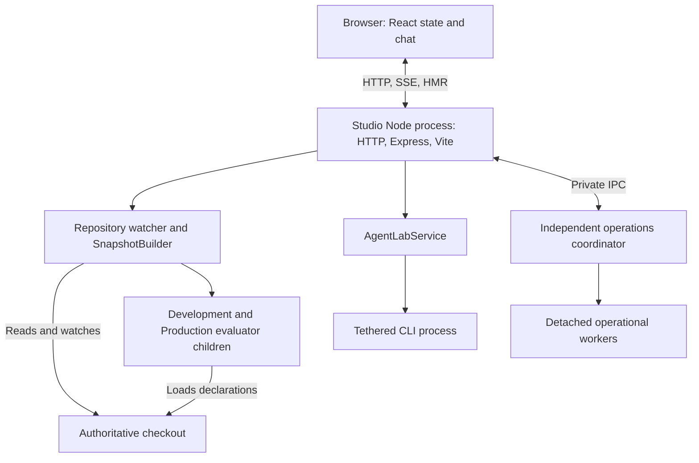
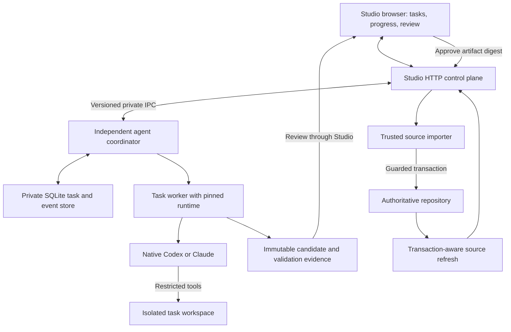
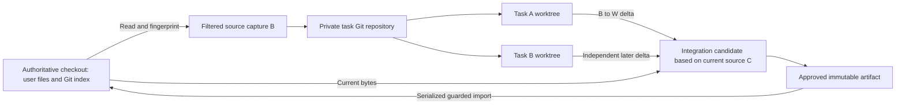
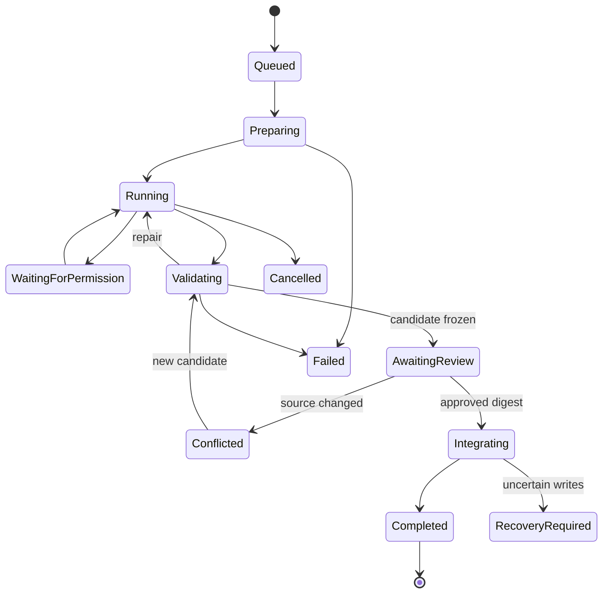
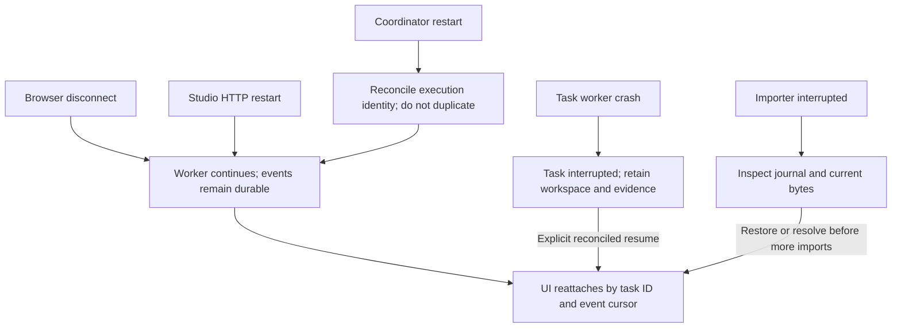

# AWS Studio — Live Coding Agent Architecture Investigation

Date: November 5, 2026

**I recommend an independent agent execution service, one isolated workspace per coding task, native Codex/Claude execution, and a separate reviewed import transaction into the live repository.** Studio should remain the interface and source observer. Coding tasks should outlive its HTTP process, and agent processes should never write directly into the authoritative checkout.

The repository already contains useful foundations: durable operations workers, SQLite-backed execution records, guarded source writes, recovery journals, diff presentation, and fresh-process architecture evaluation. The principal missing pieces are workspace management, durable coding sessions, a general patch-review authority, transaction-aware graph publication, and controlled activation of changes to Studio itself.

This investigation was read-only. I inspected the current source, documentation, Git state, installed CLI help, and official documentation. A Node process was listening on `127.0.0.1:4590`. I did not run inference, tests, builds, deployments, migrations, or lifecycle experiments, and created no files or worktrees. Runtime consequences below are distinguished from experimentally verified behavior.

## A. Verified current-state audit

### Startup and process boundaries

`npm run studio` runs:

```text
node --import tsx framework-studio/server/index.ts
```

There is **no outer watch/restart supervisor** in this command. `index.ts` discovers the repository from the working directory and starts the server. The server binds loopback before initializing its other services. [Startup script](/Users/matt/Desktop/code/framework-fix/matts-aws-framework/package.json:25), [entry point](/Users/matt/Desktop/code/framework-fix/matts-aws-framework/framework-studio/server/index.ts:11), [server startup](/Users/matt/Desktop/code/framework-fix/matts-aws-framework/framework-studio/server/server.ts:146)

The principal boundaries are:

| Component | Current owner and behavior |
|---|---|
| HTTP API and browser delivery | One Node process owns Express and the HTTP listener. |
| Studio frontend development | Vite runs as middleware inside that process; HMR uses the same HTTP server. |
| Architecture observation | The Node process owns repository watchers and `SnapshotBuilder`. |
| Declaration evaluation | Fresh Node/tsx subprocesses evaluate Development and Production separately. |
| Conversational agent | `AgentLabService` owns request-bound CLI subprocesses. |
| Durable operational work | A separate coordinator and detached workers already exist for supported operations. |

Vite’s root is the Studio implementation directory, while architecture observation uses the application repository root. These are separate concepts already present in the implementation. [Vite setup](/Users/matt/Desktop/code/framework-fix/matts-aws-framework/framework-studio/server/server.ts:538)

### Source watching and graph refresh

The architecture watcher observes explicit paths: declarations, framework configuration implementation, CDK sources, workload implementations, database configuration/contracts, selected manifests, and environment inputs. It does **not** broadly watch all of `framework-studio/` or `client-app/`.

It uses native directory watches, a **200 ms debounce**, and a **five-second content-hash polling fallback**. Configured source roots outside the checkout or reached through symlinks are rejected. [Watcher implementation](/Users/matt/Desktop/code/framework-fix/matts-aws-framework/framework-studio/server/watch.ts:24)

A changed source generation launches fresh Development and Production evaluator processes, avoiding stale Node module caches. Failed evaluation can retain the last usable graph with explicit error/stale status. Dirty Inspector drafts retain their accepted baseline and become conflicted when newer source arrives. [Evaluator pool](/Users/matt/Desktop/code/framework-fix/matts-aws-framework/framework-studio/server/evaluator/pool.ts:158), [snapshot fallback](/Users/matt/Desktop/code/framework-fix/matts-aws-framework/framework-studio/server/snapshot.ts:165), [draft handling](/Users/matt/Desktop/code/framework-fix/matts-aws-framework/framework-studio/src/draft.ts:73)

**Inference requiring an experiment:** a task workspace outside both watched roots should produce no live graph or HMR changes. This depends on avoiding imports, symlinks, or shared dependencies that reconnect it to the authoritative checkout.

Studio currently distinguishes its own known writes from external writes by comparing file hashes against `ownWrites`. This suppresses duplicate refresh notifications; it is not a transaction-wide observation barrier. [Write recognition](/Users/matt/Desktop/code/framework-fix/matts-aws-framework/framework-studio/server/server.ts:574)

### The current agent

The earlier report is substantially correct:

- Provider discovery finds standalone CLIs and checks their saved authentication.
- Chat receives a fixed Studio overview and bounded recent conversation.
- Each answer runs in a disposable directory with restricted CLI settings.
- Codex execution is ephemeral; Claude session persistence is disabled.
- The server collects output and returns one validated structured answer.
- A single service-level `working` flag serializes generation.
- Generation has a 45-second timeout and 128 KiB output limit.

[Provider and prompt handling](/Users/matt/Desktop/code/framework-fix/matts-aws-framework/framework-studio/server/agent-lab.ts:122), [execution restrictions](/Users/matt/Desktop/code/framework-fix/matts-aws-framework/framework-studio/server/agent-lab.ts:276)

Browser conversation state lives in React memory. Reloading loses it. Closing the chat request aborts execution; stopping Studio disposes the service and terminates its child trees. A tether also detects loss of the parent pipe. These are appropriate semantics for short questions, but unsuitable for durable coding tasks. [Chat state](/Users/matt/Desktop/code/framework-fix/matts-aws-framework/framework-studio/src/agent-chat.ts:16), [disconnect cancellation](/Users/matt/Desktop/code/framework-fix/matts-aws-framework/framework-studio/server/agent-lab.ts:356), [process tether](/Users/matt/Desktop/code/framework-fix/matts-aws-framework/framework-studio/server/deploy/tether.mjs:23)

The demo editing path is more constrained: the server constructs one string declaration, stores a ten-minute single-use plan, checks unchanged source, and applies by plan ID. Plans disappear on restart. Unlike chat, its `/plan` route does not use the disconnect-cancellation wrapper. [Demo planning/application](/Users/matt/Desktop/code/framework-fix/matts-aws-framework/framework-studio/server/agent-lab.ts:234)

### Reusable editing and supervision infrastructure

The existing batch editor already provides:

- Typed intentions and server-owned reviews.
- Baseline revisions and source fingerprints.
- Candidate overlays evaluated in both declaration modes.
- Expected-content checks.
- A durable write-ahead journal and checkout source lock.
- Per-file replacement and exclusive creation.
- Post-write verification and guarded rollback.

However, these authorities cover specific domains. `/edits/batch/apply` is not an arbitrary patch endpoint, and the journal validates authority-specific paths. General agent changes need a distinct importer. [Batch application](/Users/matt/Desktop/code/framework-fix/matts-aws-framework/framework-studio/server/edits/batch.ts:585), [journal](/Users/matt/Desktop/code/framework-fix/matts-aws-framework/framework-studio/server/edits/journal.ts:16), [file writes](/Users/matt/Desktop/code/framework-fix/matts-aws-framework/framework-studio/server/edits/io.ts:21)

The independent operations system is especially relevant. It already has detached workers, private IPC, durable acceptance, execution identity, cancellation, resource claims, numbered logs, and replay after reconnection. Its store uses built-in `node:sqlite`, WAL, and synchronous durability. **Reuse these mechanisms, without exposing the deployment adapter to the coding agent.** [Operations client](/Users/matt/Desktop/code/framework-fix/matts-aws-framework/framework-studio/server/operations/client.ts:14), [store](/Users/matt/Desktop/code/framework-fix/matts-aws-framework/framework-studio/server/operations/store.ts:26)

Two limits matter:

1. The existing independent runner supports macOS/Linux private Unix sockets; Windows support is explicitly absent.
2. Its executable sources and toolchain still come from the mutable checkout. Surviving an HTTP-server restart does not make it safe from self-modification.

[IPC boundary](/Users/matt/Desktop/code/framework-fix/matts-aws-framework/framework-studio/server/operations/ipc.ts:11)

### What changes to Studio do today

| Change | Source-grounded consequence |
|---|---|
| Lambda/declaration/resource source | Relevant watcher events rebuild architecture views. |
| Application client source | Generally outside the architecture watcher; its separate development server owns reload behavior. |
| Studio React source | Vite may hot-reload it immediately; arbitrary changes can also cause errors or full reloads. |
| Studio backend source | The loaded backend remains old until restart. |
| Vite configuration | Installed Vite can restart its internal middleware/environments; this does not restart the outer Node server. |
| Evaluator/shared framework source | Newly spawned evaluators may load new code while the parent retains old modules. |
| Dependencies | Installing into live `node_modules` can change modules subsequently loaded by Vite or workers. |

The **old-parent/new-child mismatch** is a major self-modification risk. The existing protocol-version check helps when a version is deliberately bumped, but cannot detect every incompatible semantic change. [Protocol guard](/Users/matt/Desktop/code/framework-fix/matts-aws-framework/framework-studio/server/server.ts:324)

### Native CLI capabilities

Installed versions are **Codex 0.166.0** and **Claude Code 2.1.318**. The guide’s November 2 version record is historical.

| Capability | Codex | Claude |
|---|---|---|
| Repository reading, editing, shell/tests | Native coding runtime | Native coding runtime |
| External workspace | `-C` / protocol working directory | Process/SDK working directory |
| Streaming | `exec --json`; richer app-server events | `--output-format stream-json`; SDK events |
| Persistent sessions | Thread/session IDs and resume | Session IDs and resume |
| Structured completion | Output schema | JSON schema |
| Integrated approvals | App-server requests/responses | SDK permission handling |
| Cancellation | Turn interruption plus owned-process termination | SDK interruption plus owned-process termination |
| Sandbox controls | Filesystem/network policy, subject to supported configuration | Tool restrictions plus separately configured shell sandbox |

These capabilities were verified from help/documentation, **not exercised here**.

For Codex, use an owned **app-server over stdio**, initially one process per task. It is designed for rich clients and exposes thread/turn lifecycle, progress, file/command activity, and approvals. Avoid its explicitly unsandboxed auxiliary execution APIs. Do not assume the current `exec --ignore-user-config` flags transfer to app-server; configuration containment needs a compatibility test. [Codex app-server documentation](https://learn.chatgpt.com/docs/app-server)

For Claude, a first adapter can consume print-mode streaming with bounded permissions. A fuller adapter should use its official SDK control interface, including the installed executable option, rather than maintaining a handwritten protocol. Resume restores conversation state, not an interrupted command’s execution state. [Claude TypeScript SDK](https://code.claude.com/docs/en/agent-sdk/typescript), [session persistence](https://code.claude.com/docs/en/agent-sdk/sessions)

## B. Architecture comparison

The performance assessments below are engineering expectations; this session did not benchmark them.

| Approach | Isolation and live-Studio fit | Performance / complexity | Platform considerations | Recommendation |
|---|---|---|---|---|
| Branch in the authoritative checkout | No filesystem isolation; edits immediately affect observers | Simple and unsafe for this workflow | Broad Git support | Reject |
| Linked worktree from authoritative Git repository | Separate working files; shares Git metadata and configuration | Fast, low disk overhead; moderate lifecycle work | Broad Git support | Useful, but shared metadata needs protection |
| Temporary independent clone | Separate working files and Git metadata; dirty source needs explicit capture | More copying/storage; straightforward ownership | Broad support | Good fallback and early prototype |
| Filtered copied workspace | Strong separation of working files; history absent unless initialized | Simple conceptually; snapshot correctness must be implemented | Broad support | Good snapshot input, not sufficient task management alone |
| Container with private snapshot | Filesystem/process separation can be enforced; no live source mount required | Image/auth/dependency setup; stronger resource controls | Docker Desktop VM on macOS/Windows | Strong executor for arbitrary commands |
| Container bind-mounting a task worktree | Suitable if only task paths are writable; Git metadata mapping needs care | Convenient host review; bind I/O may be costly | Path, UID, executable-bit and native-module differences | Supported execution backend |
| Native CLI sandbox alone | Depends on policy; using the live checkout still exposes partial edits | Fastest local experience | Providers and OSs differ | Pair with isolated workspace; never substitute for it |
| Independent supervisor + private task repository/worktrees + selectable executor | Separates task lifetime, source authority and execution permissions | Moderate initial work; best fit for concurrency/recovery | Implement platform-specific executor/IPC support | Recommended |

Git worktrees have separate working files and indexes, but share substantial repository state, including ordinary refs and configuration. Consequently, a worktree is useful isolation of edits, not an access-control boundary. [Git worktree documentation](https://git-scm.com/docs/git-worktree)

The friend’s Docker proposal works only when the mounted code belongs exclusively to the task. A writable bind mount of the authoritative repository gives the container direct ability to change that repository; a branch does not change this. [Docker bind mounts](https://docs.docker.com/engine/storage/bind-mounts/)

## C. Recommended architecture

### Separate source authority, execution, and presentation

Introduce three logical authorities:

1. **Studio HTTP/UI:** submits tasks, displays progress, provides context and collects approvals.
2. **Agent execution service:** owns task persistence, workspaces, native provider processes, command supervision and evidence.
3. **Source integration service:** imports only an immutable, approved artifact into the authoritative checkout.

The execution service must be a **separate process from Studio from the first actionable version**. Individual task workers should own provider pipes and descendants. Browser or Studio shutdown should detach observation, while explicit cancellation targets the task worker.

The importer can initially be a narrow trusted component associated with Studio, using durable recovery. Its permission to write authoritative source must never be available to the provider process. Integration cannot depend on a browser request remaining connected.

For self-modification, coordinator, worker and importer execution must eventually use **versioned runtime artifacts outside the editable checkout**. Starting a detached process from mutable TypeScript source is insufficient.

### Default workspace arrangement

Use one workspace per **task attempt**, with follow-up turns reusing it until review, cancellation or completion.

My preferred mature arrangement is:

- A private task Git repository outside the authoritative checkout.
- One worktree and task branch per attempt.
- Baseline snapshots and checkpoints stored there.
- No push remote by default.
- Trusted workspace management owns refs and Git metadata.
- Agent tools receive working-file permissions and the Git reads they need, with metadata mutation brokered or restricted.

This avoids connecting agent Git commands to the user’s real branch/index/configuration. An independent clone per task is a reasonable first implementation if it simplifies that boundary.

A task branch such as `studio/task/<id>/<attempt>` is bookkeeping. The actual isolation comes from the separate directory and execution policy.

**Capture current working-tree bytes, not merely `HEAD`.** This checkout already contains many modified and untracked source files. Include eligible dirty tracked files and relevant untracked source; exclude private inputs, credentials, runtime state, dependencies and disposable artifacts. Record exclusions explicitly.

Unsaved Inspector/editor drafts are separate: they are not repository contents. Show that a task starts from saved source, and preserve the existing draft conflict behavior.

### Executor choice and Docker

I would keep Docker **optional as an architectural backend**, but would not enable unrestricted host shell execution based only on native sandbox labels.

Use this release policy:

- The first bounded edit/review slice can use the installed CLI without Docker.
- General command/test execution requires a demonstrated filesystem, process and network boundary.
- Until a native profile passes those tests, use a restricted container/VM executor for that capability or leave it unavailable.
- Never silently downgrade to unsandboxed execution.

A container executor should expose only task files, use private process/network namespaces, omit the Docker socket and host credentials, avoid privileged mode and host networking, and enforce resource limits. Containers do not provide protection when configured to expose the host’s powerful interfaces. [Docker security model](https://docs.docker.com/engine/security/)

Running the whole provider inside a container introduces authentication and installation questions, especially saved macOS Keychain login. Those must be proven. A host CLI with its tools merely instructed to use Docker is not equivalent containment.

### Durable task lifecycle

Use the existing SQLite approach, with an agent-specific schema and private state directory. No external database or message broker is needed.

Persist:

- Canonical checkout identity and task/attempt ID.
- User instruction and approved execution policy.
- Captured context and source-baseline digest.
- Workspace location and ownership.
- Provider executable version, session/thread ID and capabilities.
- Execution identity and current lifecycle state.
- Sequenced events, bounded logs and command exit evidence.
- Validation tree digest.
- Immutable review artifact and approval digest.
- Integration journal reference and activation status.

Recommended lifecycle:

```text
queued → preparing → running → validating → awaiting_review
       → integrating → completed
```

Add `waiting_for_permission`, `conflicted`, `interrupted`, `failed`, `cancelled`, and `recovery_required`. Treat `awaiting_activation` separately from whether source was integrated.

Persist task acceptance before launching. Use idempotency keys so a browser retry cannot create duplicate tasks. Resume by exact task/provider session IDs, never “latest session.”

Begin with one active coding task and one heavy validation process. Later allow concurrent task workspaces, while keeping authoritative integration serialized. Native processes offer weaker portable resource controls; containers provide clearer CPU/memory limits. Disk and log quotas must preserve review/recovery evidence.

### Progress and cancellation

Replace the long-running chat POST with task submission returning a task ID. Stream/replay events through Studio’s existing SSE conventions and cursor-based logs.

Display observable progress: files inspected/changed, command start/end, concise output, failed checks, requested permissions, and review readiness. Provider final prose is not proof of successful validation.

Browser disconnection should have no execution consequence. Explicit Cancel should interrupt the provider, terminate its owned descendants after a grace period, and retain the workspace. During integration, cancellation becomes a request to reach a consistent transaction boundary; it must not kill the importer halfway through writes.

### Sightline context

Reuse `buildSightline` as an initial bounded context projection. It already separates source state, selected focus, workspace state, observed deployments, activity and omissions, with a 12,000-character budget. [Sightline builder](/Users/matt/Desktop/code/framework-fix/matts-aws-framework/framework-studio/src/sightline/build.ts:352)

Attach:

- Capture time and accepted source revision.
- Declaration mode and selected entity.
- Relevant source references.
- Dirty/conflicted draft indicators.
- Explicitly labelled cached observations.

Then let the native agent inspect the isolated repository. The task snapshot is authoritative for code; Sightline supplies user intent and navigation context; observed infrastructure remains timestamped evidence.

Later add narrowly scoped read capabilities for refreshed context. Do not expose generic Studio APIs or serialize private caches. The current hook is mounted only in the visible debug view, so prompt-time capture needs a deliberate API rather than making the whole debug subscription permanent. [Current input hook](/Users/matt/Desktop/code/framework-fix/matts-aws-framework/framework-studio/src/sightline/useSightlineInputs.ts:38)

### Concrete application workflow

For “find Cognito configuration, add a protected endpoint, and verify it”:

1. Studio persists the prompt and captures bounded context.
2. The workspace manager snapshots saved source, including eligible dirty files.
3. A worker starts the selected native CLI in that workspace.
4. The agent reads `AGENTS.md`, the auth checklist, workload declarations and nearby handlers.
5. It adds the handler and declaration using existing conventions: `authenticated(...)`, `userPool: true`, appropriate route auth, and explicit database/VPC declarations if needed.
6. It runs generators and focused checks within task storage, repairs failures, then requests the required broader checks.
7. Studio streams events throughout; the live graph continues showing authoritative source.
8. The worker stops background writers and freezes its candidate.
9. Studio prepares the actual proposed change against the current authoritative tree and presents its diff and validation evidence.
10. The user approves or rejects that immutable candidate.
11. Approval triggers fresh conflict, dependency and ownership checks.
12. The importer journals and applies the complete feature.
13. Studio evaluates the resulting source and publishes one accepted revision.
14. Dirty UI drafts retain their existing conflict protection.
15. Completion distinguishes source validation from synth, local runtime, database and deployed checks.

The repository already documents the specific auth and declaration contracts this workflow must follow. [Auth checklist](/Users/matt/Desktop/code/framework-fix/matts-aws-framework/docs/playbooks/auth.md), [HTTP declarations](/Users/matt/Desktop/code/framework-fix/matts-aws-framework/framework-config/workloads/http.ts), [feature build procedure](/Users/matt/Desktop/code/framework-fix/matts-aws-framework/docs/playbooks/feature-build.md)

Preparation failure leaves authoritative source untouched. Validation failure returns the task to iteration or an explicitly failed review. Rejection preserves or discards only task-owned artifacts. Stale review stops before writing. Integration failure enters guarded restoration or recovery.

## D. Technical diagrams

**1. Current process architecture**



**2. Proposed execution architecture**



**3. Repository and workspace relationships**



**4. Code-change lifecycle**



**5. Failure and recovery boundaries**



## E. Git integration and live refresh

### Use a reviewed artifact, not a live branch tip

Define:

- **B:** saved source captured when the task began.
- **W:** finished task workspace.
- **C:** current authoritative source.
- **R:** proposed integration result.

The agent’s change is **B → W**. The review must show **C → R**.

For each changed path:

| Condition | Action |
|---|---|
| `C == B` | Candidate uses the agent’s result. |
| `C == W` | Change is already present; no write needed. |
| Agent did not change the path | Preserve current source. |
| Both user and agent changed it | Construct a three-way candidate outside the live checkout. |
| Add/add, delete/modify or unresolved merge | Stop for conflict resolution. |

A clean three-way merge still creates a new candidate requiring fresh review and relevant validation. Nonoverlapping edits can conflict semantically through shared types, dependencies or declarations.

**Do not stash, checkout, merge or cherry-pick in the user’s checkout as the default integration mechanism.** Preserve its branch and index. Approved changes become ordinary working-tree changes.

Git remains useful for task checkpoints, diffs and merge preparation. `git apply --3way` is not a transaction engine: it can involve the index and produce conflicts, and index-based application has requirements incompatible with arbitrary dirty state. Use Git merge machinery in preparation storage, then import exact reviewed bytes. [Git apply documentation](https://git-scm.com/docs/git-apply)

### Artifact contents

The trusted worker should compute the diff, including new untracked files, independently of the model’s summary.

Bind approval to:

- Repository/task identity.
- Baseline and candidate digests.
- Every path’s before/after bytes or blob hashes, absence, type and mode.
- Validation commands, exit statuses and validated tree digest.
- Relevant dependency/source membership fingerprint.
- Required activation classification.

Initially support ordinary text source files. Reject unsupported symlinks, hard links, submodules, path escapes, binary changes and special files explicitly. Generated tracked files need generator provenance and review; they cannot be blanket-excluded because real endpoint changes may require them.

### Integration transaction

The importer should:

1. Freeze the candidate and terminate task-owned writers.
2. Acquire a checkout integration claim shared with source writers and relevant operational tooling.
3. Recheck artifact integrity, repository identity, affected files and validation dependencies.
4. Hold graph publication and invalidate evaluations started against an older source epoch.
5. Persist the write-ahead journal.
6. Apply complete reviewed changes using expected-content guards and durable per-file operations.
7. Verify final bytes and evaluate the complete source generation.
8. Complete the journal and publish one new accepted revision.
9. Invalidate stale reviews without claiming deployed infrastructure changed.

Current `SnapshotBuilder` coalescing and debounce do not provide step 4. This needs an explicit **source epoch/publication barrier**, including handling evaluations already in flight. [Current refresh scheduling](/Users/matt/Desktop/code/framework-fix/matts-aws-framework/framework-studio/server/snapshot.ts:111)

On failure, restore only paths still matching the importer’s own writes. If newer edits prevent restoration, preserve them, retain the journal, keep the prior graph labelled stale, and require recovery. Reuse the existing recovery model with expanded, explicit artifact authority.

### Limits that must remain explicit

There is no portable filesystem-wide atomic replacement of an arbitrary multi-file checkout. Studio’s barrier protects its own publication; external editors, application watchers and other readers can still observe per-file changes.

Likewise, checking bytes and then renaming is not an atomic compare-and-swap against an unrelated editor. **An absolute guarantee against an editor writing at precisely the same instant requires cooperating writers or a different storage model.** Current Studio has this limitation too. The implementation should detect ordinary races, minimize the critical section, preserve recovery evidence and test adversarial timing—not claim the race is eliminated.

A complete feature is the default apply unit. Partial application must create and validate a new dependency-complete candidate. Arbitrary hunk selection can break handler/declaration/generated-contract consistency.

Finally, application Compose watchers are separate observers and can restart local workloads after integration. Changes affecting running executions should coordinate with existing local lifecycle controls. A graph publication barrier cannot suppress Docker Compose’s independent behavior.

## F. Permissions, command execution and self-modification

### Permission model

Use distinct capabilities:

| Capability | Default treatment |
|---|---|
| Read task source; edit task files | Allowed within task scope. |
| Run compilation/unit checks | Allowed only inside the established executor boundary. |
| Install dependencies / registry access | Separate controlled capability; task-local installation and npm 11. |
| Start local servers or disposable test infrastructure | Explicit task-scoped capability with ports, processes and resources owned by the task. |
| Read live AWS evidence | Separate target-bound read capability or sanitized Studio projection. |
| Deploy, destroy, migrate, publish or change access | Existing separately approved operational workflow; unavailable as generic agent shell authority. |
| Write authoritative source | Only the trusted importer after artifact approval. |
| Activate new Studio/runtime dependencies | Separate managed activation step. |

Declaration mode and selected AWS profile are context, never permission.

A command allowlist is not sufficient: an allowed `npm test` can execute a newly modified script. Likewise, removing `AWS_*` variables does not remove credential files, credential processes, localhost services or Docker sockets.

Native sandbox defaults require care. Codex workspace-write does not automatically restrict all reads. Claude safe mode is customization control, not an OS sandbox; shell sandboxing and file-tool restrictions are distinct. Neither reviewed provider documentation establishes universal protection against signalling another same-user process. These are capability-test requirements. [Codex permissions](https://learn.chatgpt.com/docs/permissions), [Claude sandboxing](https://code.claude.com/docs/en/sandboxing)

Prevent access to the authoritative checkout, task coordinator/importer IPC, Studio’s HTTP API, credential directories and Docker socket from coding tools. Existing loopback/token guards protect browser access; they do not constitute a boundary against an unrestricted same-user process. [Studio guards](/Users/matt/Desktop/code/framework-fix/matts-aws-framework/framework-studio/server/guards.ts:4)

### Dependencies, ports and long-running processes

Every task needs its own writable dependency/build/generated-output locations. Sharing live `node_modules` is particularly dangerous in this npm-workspace repository: links or module resolution can lead back to authoritative packages.

Dependency reuse should use independently materialized caches keyed by lockfile/platform/runtime, not writable links into Studio’s installation. Installation lifecycle scripts must execute inside the task boundary.

Reserve ports centrally for approved previews. Deny recursive authoritative `npm run studio`, broad process termination and unowned Docker lifecycle commands. All long-running children need ownership, limits and cleanup. Resource restrictions should leave capacity for Studio.

`npm run verify` itself regenerates ignored database artifacts; `contract` generates additional output. These commands belong in task/candidate storage. Required synth and live checks remain separate evidence categories, with missing inputs or authorization reported honestly. [Verification scripts](/Users/matt/Desktop/code/framework-fix/matts-aws-framework/package.json:16)

### An additional trust transition: importing declarations

Studio executes TypeScript declarations during evaluation, and its evaluator currently inherits the server environment. A disposable evaluator process is not a security sandbox. [Evaluator environment](/Users/matt/Desktop/code/framework-fix/matts-aws-framework/framework-studio/server/evaluator/pool.ts:63)

Therefore, accepted agent source becomes trusted executable repository code. Before claiming strong isolation, candidate validation must run without operational credentials, and live declaration evaluation should gain constrained permissions where compatible. Source review remains necessary; the architecture cannot assume declarations are inert data.

### Studio’s own implementation

Classify changes by runtime impact, not only directory:

- **Application source:** generally integrate and refresh.
- **Studio UI/backend/worker source:** requires activation handling.
- **Shared framework packages, root dependencies and build configuration:** potentially control-plane-affecting even outside `framework-studio/`.

For the first implementation, keep self-modification candidates isolated until the user chooses a managed apply/restart window. Preserve tasks through the independent worker; preserve unsaved UI drafts before restarting.

For mature operation:

1. Run Studio frontend, backend, evaluator code and compatible dependencies from an immutable release directory.
2. Continue observing the authoritative application checkout separately.
3. Build and validate a proposed Studio release in isolation.
4. Integrate approved source while the old release remains active.
5. Offer explicit activation.
6. Restart under a small stable launcher, reconnect to tasks, and retain the prior release for rollback.

This avoids immediate HMR of agent-authored Studio changes and old-parent/new-child mixtures. It does **not** promise zero downtime: a short controlled restart is the realistic initial contract. A proxy and version handoff could reduce interruption later, but are not necessary for the first reliable design.

Claude’s documented authentication rules also need a distribution decision before productizing the integration. Technical reuse of a personal saved login does not establish permission to offer that login model in a third-party product. [Claude SDK overview](https://code.claude.com/docs/en/agent-sdk/overview)

## G. Incremental implementation roadmap

| Milestone | Deliverable | Reuse / extension |
|---|---|---|
| **1. Boundary and provider spike** | Confirm installed protocol, authentication, task-root restrictions and containment using disposable fixtures. | Existing CLI discovery; new provider capability adapter. |
| **2. End-to-end one-file slice** | Prompt → durable task → isolated native edit → focused validation → immutable diff → approved import → graph refresh. One provider, one task, application source only. | Operations lifecycle patterns, `SourceDiff`, guarded writes/journal. |
| **3. Multi-file feature support** | Dirty/untracked baseline capture, generated artifacts, candidate rebasing, full-feature review, conflict handling and graph publication barrier. | Batch validation patterns; new agent artifact importer. |
| **4. Full coding loop** | Sandboxed commands, streamed activity, native approvals, dependency provisioning, cancellation and failed-check iteration. | Codex app-server first; Claude adapter after compatibility proof. |
| **5. Recovery and concurrency** | Reattach after browser/Studio restart, interrupted-worker reconciliation, task queues, parallel workspaces, serialized imports, retention and quotas. | SQLite store, execution identity, cursor replay and claims. |
| **6. Studio self-modification** | Immutable runtime packaging, impact classification, activation/restart workflow and previous-version recovery. | Existing protocol checks; new stable launcher and runtime-version ownership. |
| **7. Optional operational capabilities** | Narrow read/context tools and explicit handoff to existing target-bound operations. | Existing operational authorities; no generic credentialed shell. |

Minimal task persistence and separation from the HTTP process belong in milestone 2. Full recovery and concurrency can expand later; they should not require replacing the initial ownership model.

Do not broaden the Inspector edit API into a universal writer. Keep typed UI edits and agent artifacts as separate inputs to shared transaction primitives. Replace request-bound chat execution for coding tasks while retaining lightweight conversational Q&A if useful.

## H. Targeted proof-of-concept plan

These experiments are proposed for a later authorized implementation session.

| Experiment | Measurable acceptance condition |
|---|---|
| **Watcher isolation** | Editing declarations/handlers in a task workspace causes no authoritative graph revision or Studio HMR event. |
| **Native coding turn** | Installed CLI reads patterns, changes two task files, runs a check, reports failure and repairs it; actual diff matches evidence. |
| **Containment** | Disposable tests cannot write a fake authoritative root, read fake credentials, reach a sentinel loopback/socket service, or signal a sentinel process outside task scope. |
| **Dirty baseline** | Captured task includes eligible modified and untracked source; original index, branch and bytes remain unchanged. |
| **Concurrent edits** | Same-file edits, add/add and delete/modify cases refuse stale import with zero authoritative writes. |
| **Merge preparation** | Nonconflicting user edits survive; the merged candidate receives a new digest, validation and approval. |
| **Publication barrier** | An evaluator finishing during deliberately slow multi-file integration never publishes an intermediate generation. |
| **Crash recovery** | Fail after journaling and after each write; recovery preserves subsequent external edits and blocks further import when uncertain. |
| **Browser/server loss** | Closing the tab or terminating a disposable Studio host leaves the task worker running; reconnect replays events without duplicate execution. |
| **Worker cancellation** | Interruption stops all owned descendants; retained workspace and session can be reconciled before resume. |
| **Self-change classification** | Frontend, backend, Vite config, evaluator and shared-package edits produce recorded PID/HMR/version behavior in a disposable Studio instance. |
| **Dependency isolation** | Candidate installs/generation do not alter authoritative dependencies, generated outputs, private inputs or runtime state. |
| **Operational contention** | Isolated coding continues during a tooling operation; authoritative import waits for the required claim. |
| **Activation recovery** | Failed candidate startup restores the previous runtime while tasks and review artifacts remain available. |

The highest-risk unknowns are native process/network containment, saved-auth compatibility with that containment, transaction publication under concurrent evaluation, external-editor race behavior, and immutable runtime dependency resolution.

## I. Decision and trade-offs

I would choose **an independent, versioned agent supervisor with private task worktrees, native provider adapters, SQLite task persistence, and an immutable artifact importer**.

Git worktrees should be the default workspace abstraction, preferably attached to a private task repository. They make parallel work and checkpoints practical without exposing unfinished edits to Studio. Independent clones are an acceptable simpler first implementation.

Docker should be a supported executor, not the source-integration mechanism. I would omit it from the first bounded editing slice, but require proven containment before enabling general command execution; where native containment remains unproven, use a restricted container/VM backend.

The essential continuity rule is: **the agent works elsewhere, approval selects exact bytes, and only a trusted transaction changes the live checkout.** Studio self-edits additionally require staged activation through a managed restart, with tasks owned by processes that survive that restart.

The minimum useful implementation is one provider, one durable task, one isolated application-source change, one meaningful validation, one reviewed artifact and one guarded import followed by a verified graph refresh. That demonstrates the real workflow while establishing the ownership boundaries needed for larger features.
